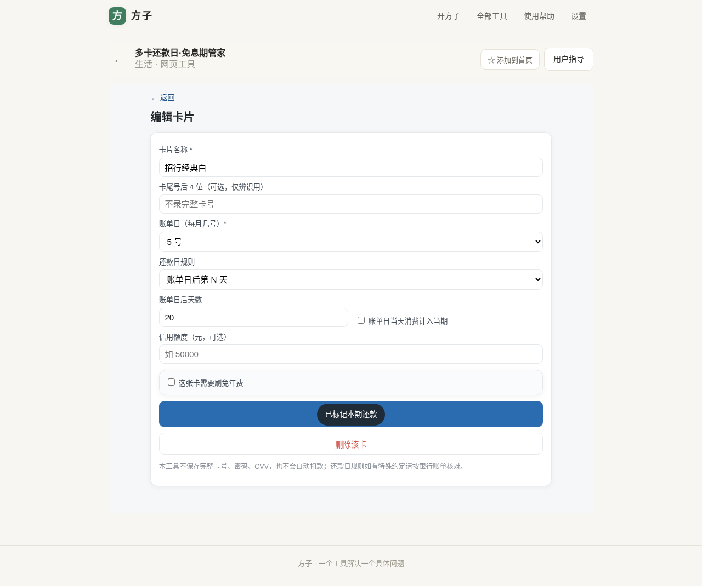
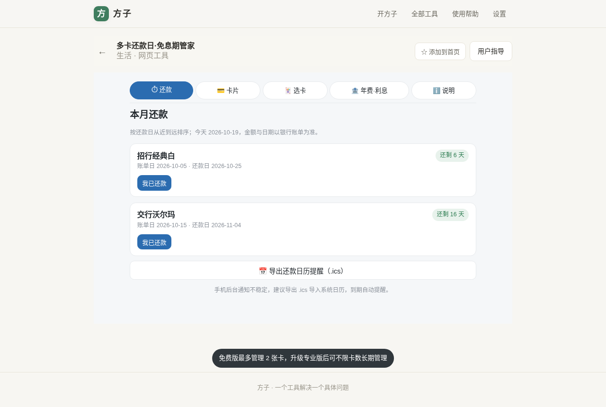
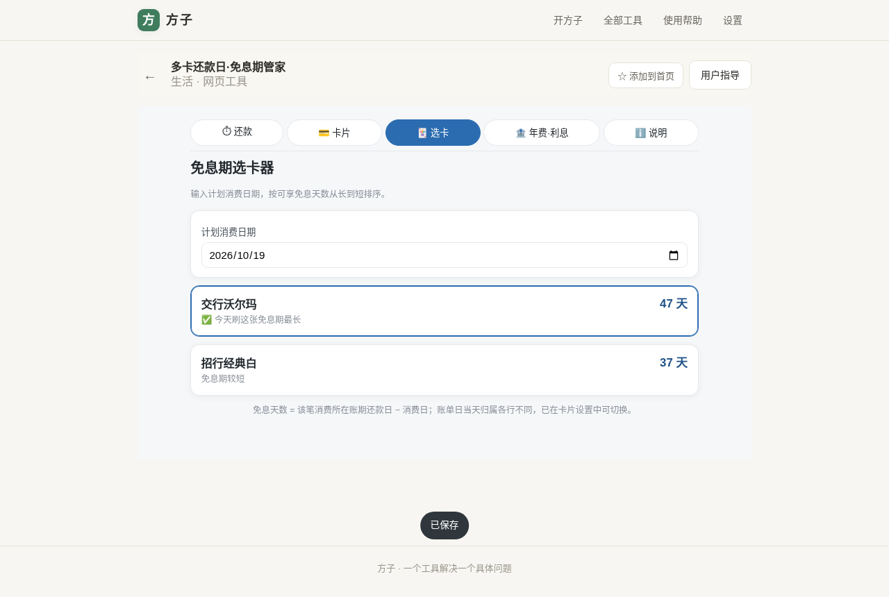
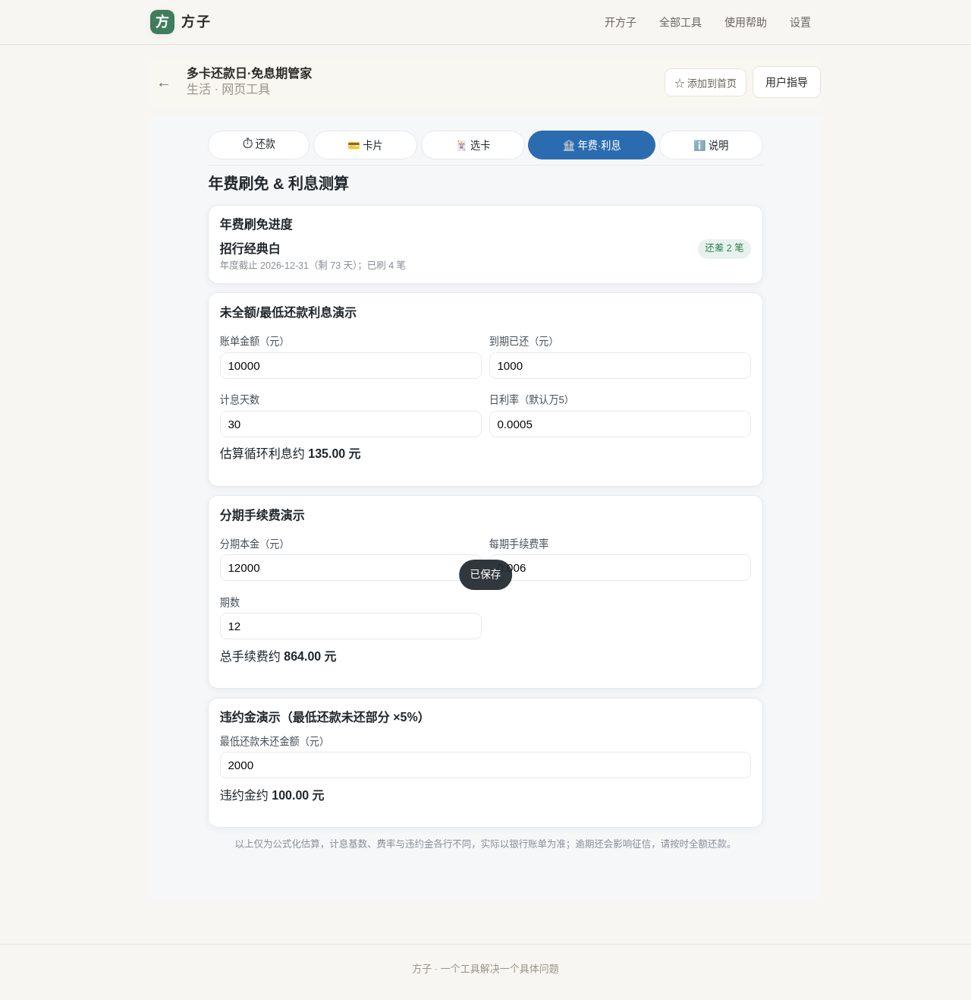
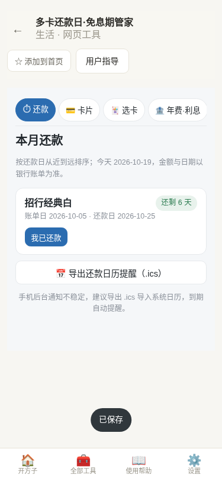
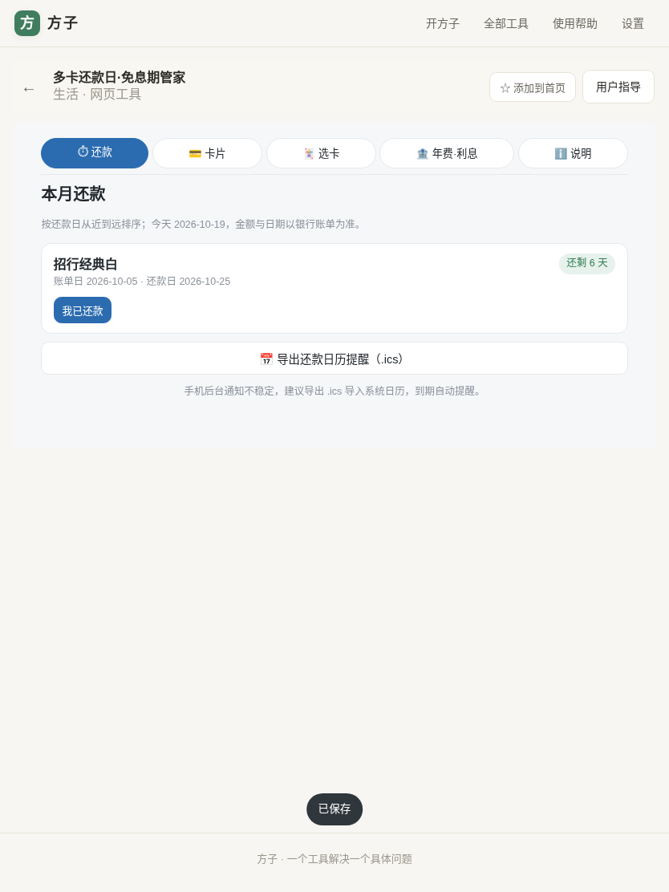

# 用户使用指导书：多卡还款日·免息期管家

- 对应 dev：dev_004_多卡账单还款日免息期管家.md
- 日期：2026-10-19
- 版本：v1.0.0
- 工具位置：fangzi `src/tools/card-billing/`，入口「全部工具 → 生活 → 多卡还款日·免息期管家」，路由 `#/t/card-billing`

## 功能简介

集中管理多张信用卡的账单日与还款日，一屏看清最近该还哪张、还剩几天，防逾期罚息与征信风险；大额消费前按"可享免息天数"推荐该刷哪张卡；追踪年费刷免进度；演示最低还款/分期/违约金的大致费用。**不录完整卡号、密码、CVV，不代查账单、不自动还款，所有数据只存在本机 IndexedDB。**

## 运行环境要求

- 现代浏览器：Chrome / Edge / Safari / Firefox 近两个大版本（移动端、桌面端均可）。
- 已随 fangzi PWA 离线可用；数据使用浏览器 IndexedDB（库名 `fangzi-card-billing` v1）。
- 无需联网、无后端、无第三方账号、无新增依赖。

## 安装与启动

1. 打开 fangzi（线上 https://www.fangzi.asia ，或本地 `npm run dev` / `npm run preview`）。
2. 进入「全部工具 → 多卡还款日·免息期管家」。
3. 首次使用为免费版，最多管理 2 张卡；专业版买断 ¥8.90（订阅 ¥2.6/月或 ¥26/年）解锁不限卡数、选卡器、年费与利息测算。

## 使用说明

### 1. 添加卡片（「💳 卡片」页）

点「＋ 添加卡片」，填写：卡名（如招行经典白）、可选尾号后 4 位、每月账单日；选择还款日规则——「账单日后第 N 天」或「固定每月某日」；可选填信用额度；需要刷免年费的卡勾选并填写年度截止日与刷免目标。

### 2. 还款看板（「⏱ 还款」页，默认页）

各卡按还款日从近到远排列，右侧彩色标签显示「还剩 N 天 / 今天还款 / 已逾期 N 天」（逾期红、当天橙、3 天内黄、其余绿）。还款后点「我已还款」，按钮变为「✓ 已还（撤销）」，可随时撤销；可导出 `.ics` 导入手机系统日历，到期自动提醒。

### 3. 免息期选卡器（「🃏 选卡」，专业版）

选择计划消费日期，各卡按可享免息天数从长到短排序，带蓝色高亮边框的第一张即免息期最长的卡。免息天数 = 该笔消费所在账期还款日 − 消费日；账单日当天消费计入当期还是下期，可在卡片编辑里切换（默认计入下期，通常免息更长）。

### 4. 年费刷免与利息测算（「🏦 年费·利息」，专业版）

- 年费刷免：显示每张卡年度截止前还差几笔 / 多少钱达标。
- 利息演示：按默认日利率万分之五估算未全额还款的循环利息；分期按每期手续费率×期数估算总手续费；违约金按最低还款未还部分的 5% 演示。

### 5. 移动端

手机端采用顶部吸顶功能分段（可横向滑动）+ 系统级底部主导航，内容满宽、无横向溢出，单手可操作。

## 常见问题（FAQ）

- **还款日和银行 App 对不上？** 工具按你填的规则机械计算，固定/延后、大小月、节假日顺延等特殊约定请以银行账单为准，可在卡片里调整规则。
- **收不到浏览器通知？** 手机 PWA 后台通知不稳定，建议用「导出 .ics」导入系统日历。
- **数据会同步吗？换设备怎么办？** 数据只存本机，不上云；清理浏览器数据会删除，重要提醒请提前导出 .ics。
- **账单日是 31 号，小月怎么办？** 自动落到当月最后一天（如 2 月 28/29 日）。

## 注意事项

- 本工具是日期/费用的规则化估算助手，**不是银行服务，不碰资金、不代还**；实际账单金额、计息基数、费率、违约金与征信后果一律以发卡行账单为准。
- 请勿在卡片名称或备注中填写完整卡号、密码、CVV、身份证号等敏感信息。
