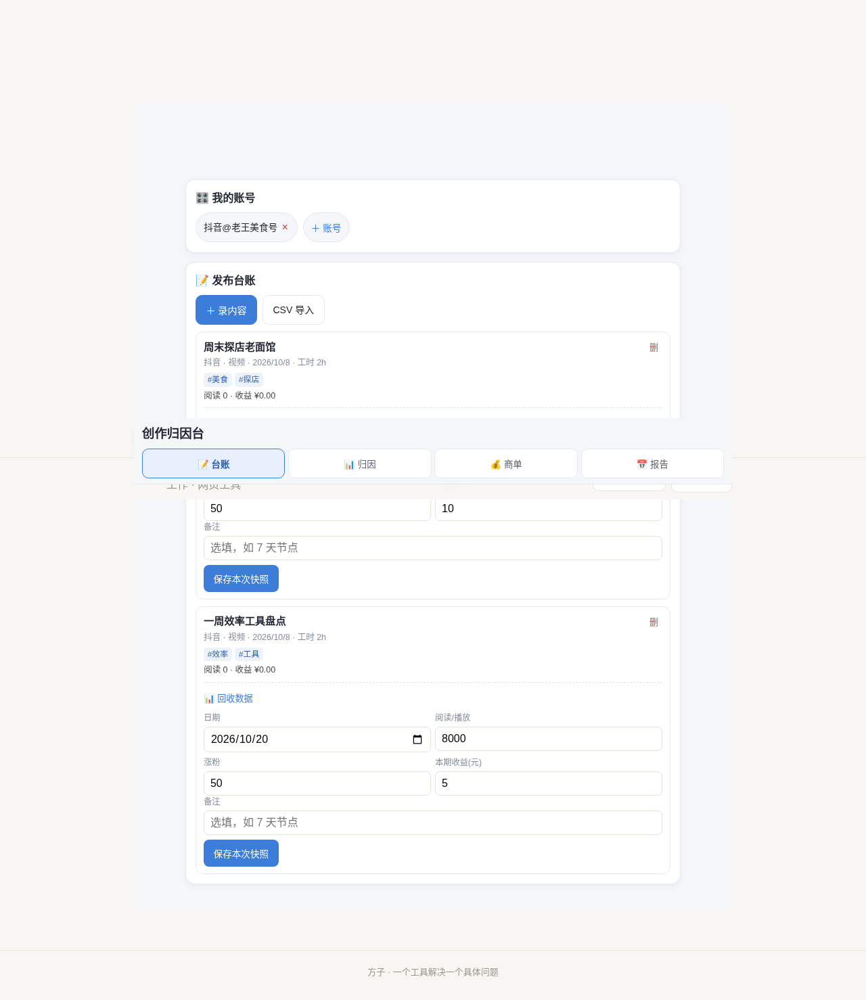
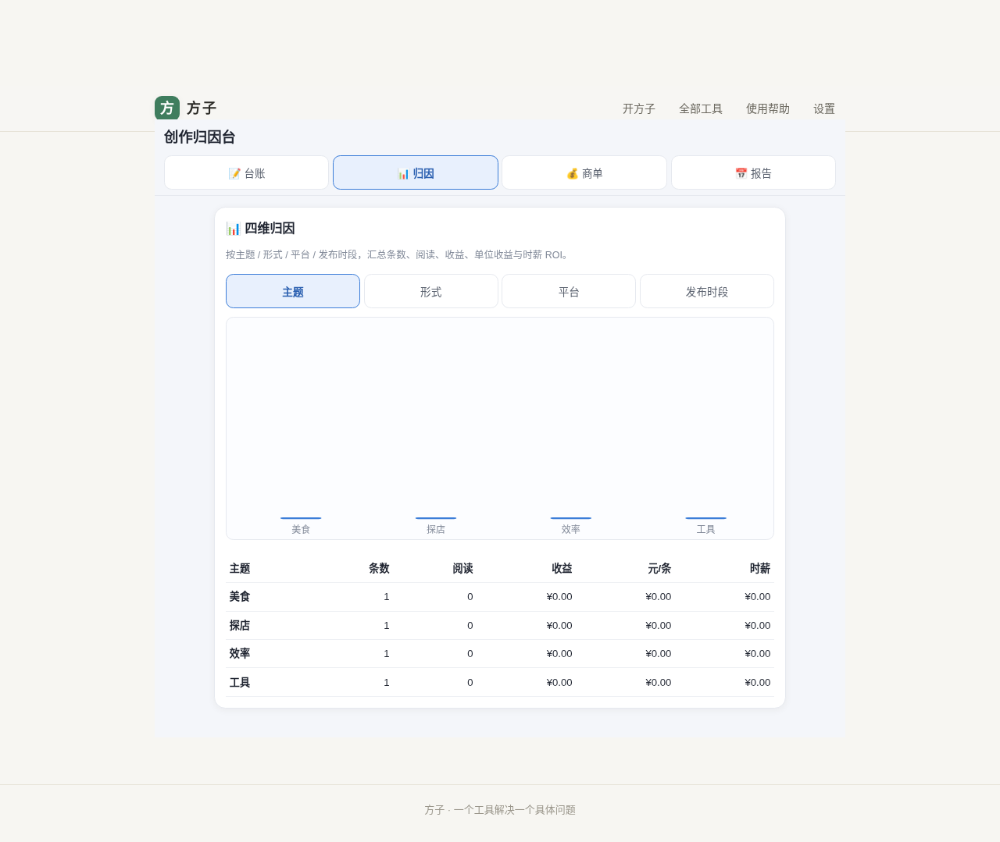
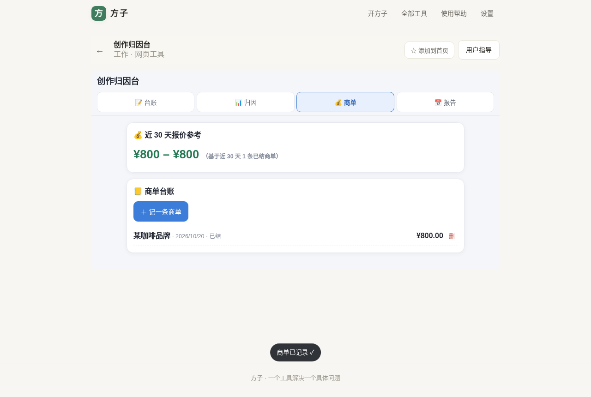
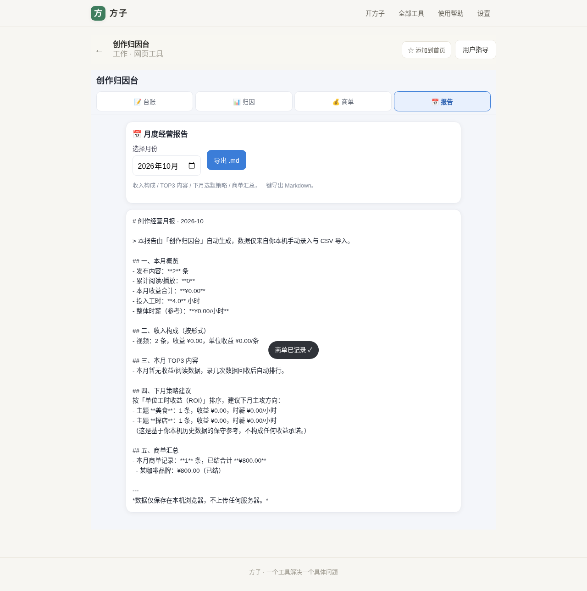
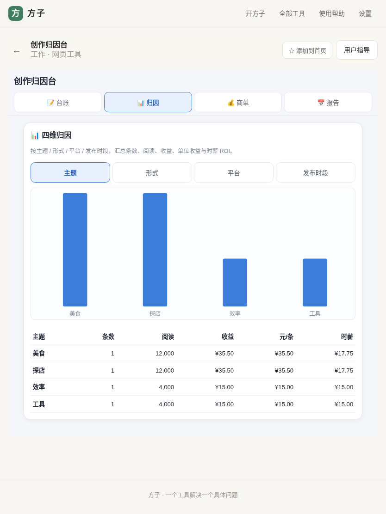
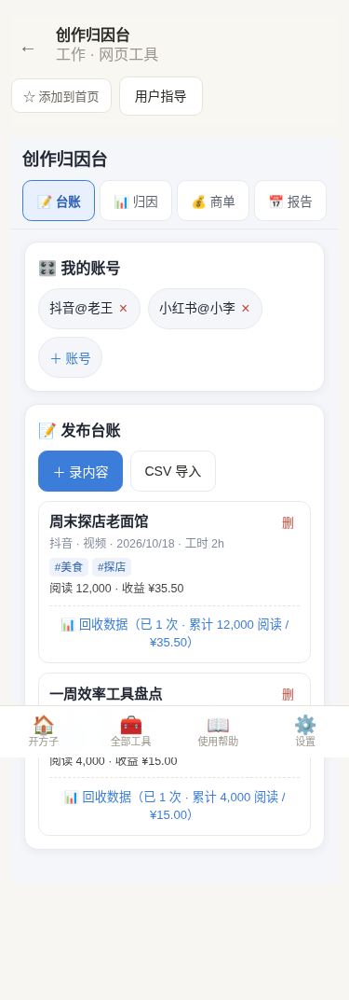
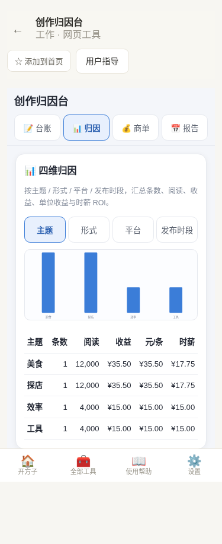

# 用户使用指导书：创作归因台

- 对应 dev：dev_002_创作归因台.md
- 日期：2026-10-20
- 版本：v1.0.0

## 功能简介

同时运营抖音、小红书、B站、公众号好几个号的独立创作者，把每周逐平台手抄的阅读、收益、投入工时录成本地台账，工具按**主题 / 形式 / 平台 / 发布时段**四个维度自动归因单位收益与时薪 ROI，并附商单报价参考区间与一键导出的月度经营报告。**全程本地 IndexedDB 存储，不接任何平台 API、不上云。**

## 运行环境要求

- 现代浏览器（Chrome / Edge / Firefox / Safari）最新版
- 无需联网即可使用（数据全部在本机）；首次安装 PWA 时联网一次即可

## 安装与启动

本工具是「方子」PWA 内的一个工具，无需单独安装：

1. 打开方子（已安装为 PWA 后可从桌面图标进入）。
2. 在「全部工具」里搜索「创作归因台 / 内容复盘 / 收益归因」并进入。
3. 数据默认存于本机浏览器；免费版可用 3 个账号、30 条内容台账。

## 使用说明

### 1. 建账号

进入工具默认在「台账」页，点「＋ 账号」，选择平台（抖音 / 小红书 / B站 / 公众号 / 知乎 / 播客等）并填昵称，例如「抖音@老王美食号」。



### 2. 录内容台账

点「＋ 录内容」，选择所属账号，填写标题、主题标签（逗号分隔，如 `美食,探店`）、形式（图文/视频/播客）、发布时间、投入工时（小时，可填 0.5）。一条内容一次约 30 秒。

### 3. 回收数据（一内容多次）

每条内容下方点「📊 回收数据」展开，记录发布后 7 天、30 天等节点的阅读/播放量、涨粉、本期收益（元）、备注，保存即可。同一条内容可录多次快照，累计阅读与收益自动汇总。

### 4. CSV 批量导入历史台账

点「CSV 导入」选择本地 CSV（UTF-8 或 GBK 编码均可）。工具会模糊识别中文列名（标题 / 平台 / 发布时间 / 标签 / 阅读量 / 收益元 / 工时），先弹出预览「解析到 N 条、跳过 M 条（缺标题/日期）」，确认后**追加**写入，不覆盖已有数据。

CSV 表头示例：

```
标题,平台,发布时间,标签,阅读量,收益元,工时
周末探店老面馆,抖音,2026-10-08,美食 探店,12000,35.5,2
```

### 5. 四维归因看板

切到「归因」页，在 主题 / 形式 / 平台 / 发布时段 之间切换，手写 SVG 柱状图按收益展示，下方表格列出每一类的条数、阅读、收益、元/条、时薪（元/小时）。工时记 0 的类别只显示单位收益、时薪显示「—」。



### 6. 商单台账与报价参考

切到「商单」页，点「记一条商单」填品牌、金额（元）、结果（已结/在谈/黄了）。顶部自动给出**近 30 天已结商单的 min–max 报价区间**，下次品牌来问价心里有数。



### 7. 月度经营报告

切到「报告」页，用月份选择器选月份，预览「本月概览 / 收入构成 / TOP3 内容 / 下月策略（按 ROI Top2 主题）/ 商单汇总」，点「导出 .md」保存 Markdown 文件。



平板与手机端自适应布局如下：





## 常见问题（FAQ）

- **Q：我的阅读/收益数据是怎么来的？会自动抓取抖音/小红书后台吗？**
  A：不会。本工具不接任何平台 API、不抓包、不内嵌平台网页。所有数据由你手动录入或通过你自己导出的 CSV 导入，完全本机。
- **Q：免费版能用到什么程度？**
  A：3 个账号、30 条内容台账与手动数据回收免费；CSV 导入、四维归因看板、商单台账、月度报告为专业版（一次买断 ¥19.90，账号/内容条数同时不限）。
- **Q：换手机/重装浏览器数据还在吗？**
  A：数据存在当前浏览器 IndexedDB 里，换机不自动跟随；可定期手动导出 CSV/Markdown 留存。
- **Q：时薪 ROI 怎么算的？为什么有的类别显示「—」？**
  A：ROI = 该维度收益合计 ÷ 工时合计（元/小时）。某类别工时记为 0 时无法除，回退显示「—（工时0）」，补录工时后自动算出。

## 注意事项

- 金额录入一律为「元」，程序内部按整数分存储，避免浮点误差。
- CSV 缺「标题」或「发布时间」必需列时整批不写入并提示；个别行缺标题/日期会被跳过并计数。
- 删除账号会级联删除其内容、数据快照与商单，不可恢复，请谨慎。
- 本工具输出的「下月策略」仅基于你本机历史数据的保守参考，不构成任何收益承诺。
