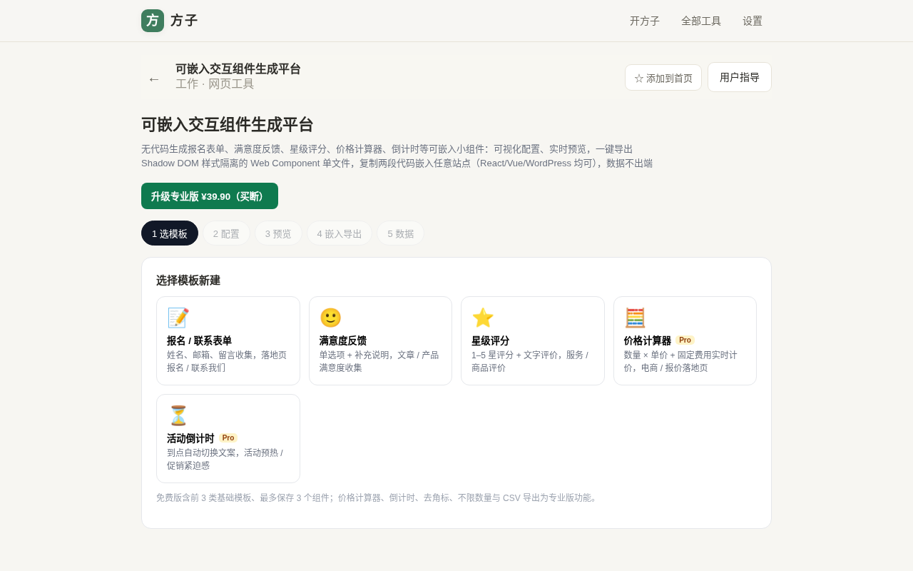
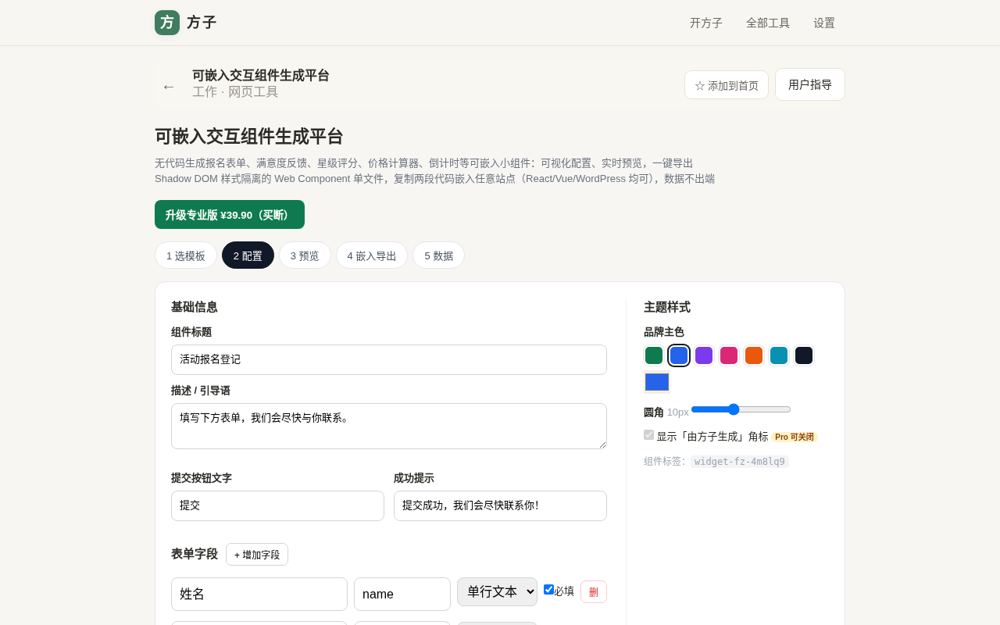
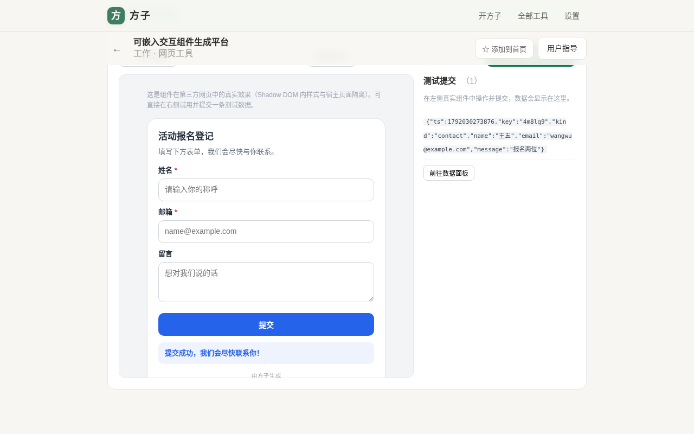
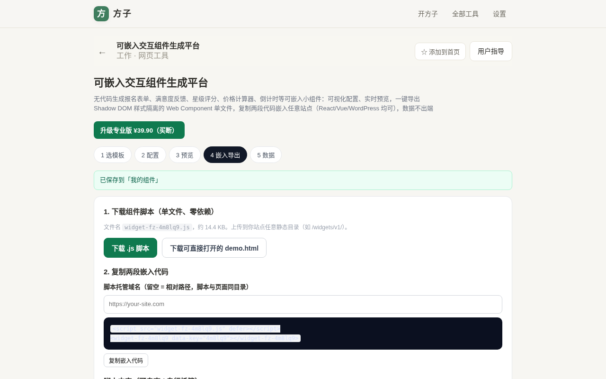
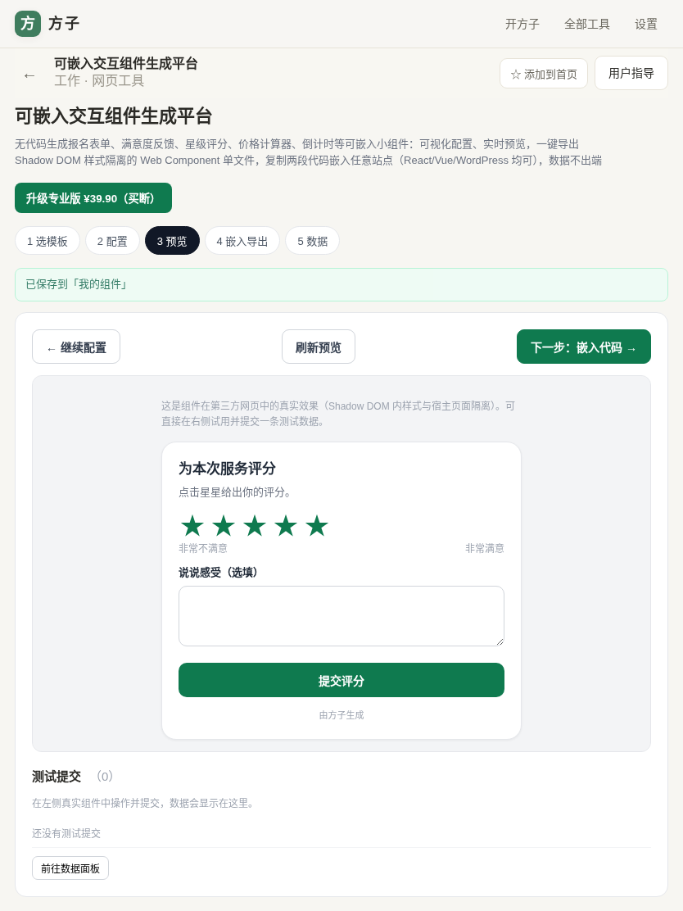
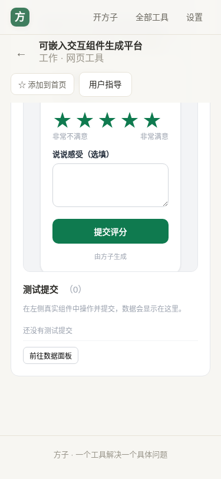

# 用户使用指导书：可嵌入交互组件生成平台

- 对应 dev：dev_006_可嵌入交互组件生成平台.md
- 日期：2026-10-15
- 版本：v1.0.0
- 档位：M（标准档）

## 功能简介

无代码生成「可嵌入任意网站的交互小组件」：选择模板 → 可视化配置文案、字段、计价规则、品牌色 → 实时预览并试提交 → 一键导出**自包含、零依赖、Shadow DOM 样式隔离**的 Web Component 单文件脚本，复制两段代码即可嵌入 React / Vue / 原生 HTML / WordPress 等任意技术栈站点。内置 5 类模板：报名/联系表单、满意度反馈、星级评分、价格计算器、活动倒计时。

## 运行环境要求

- 生成器：现代浏览器（Chrome / Edge / Firefox / Safari 近两年版本），作为方子 PWA 工具页运行，路由 `/#/t/embed-widget-builder`。
- 生成的组件：任何能加载普通 `<script>` 的网页；无需框架、无需构建工具。
- 数据：默认保存在访问者浏览器（localStorage），不上传；可选给组件标签加 `data-endpoint="https://你的接口"` 把提交 POST 到自有服务。

## 安装与启动

- 在线：打开方子 → 工作类工具 →「可嵌入交互组件生成平台」。
- 本地：`npm install && npm run dev`（或构建后 `npm run build && npm run preview`），访问 `/#/t/embed-widget-builder`。
- 组件分发无需安装：把导出的 `widget-fz-xxxxxx.js` 上传到你站点任意静态目录即可。

## 使用说明

### 1. 选择模板 / 管理我的组件

进入工具先看到「我的组件」和 5 类模板卡片。点击卡片即基于该模板新建一个组件（免费版最多保存 3 个）。



### 2. 可视化配置

- 修改标题、描述、按钮文字、成功提示。
- 联系表单可增删字段、改字段标题/数据键名/类型（文本/邮箱/多行/数字）与是否必填。
- 满意度反馈每行一个选项；星级可设上限与两端文案；价格计算器设数量名、单价、固定费用、货币；倒计时设目标时间与到期文案。
- 右侧设置品牌主色（预设色板或自定义取色）、圆角；专业版可关闭「由方子生成」角标。配置会实时保存。



### 3. 实时预览并试提交

点击「保存并预览」，左侧 iframe 用与第三方站点一致的方式真实渲染组件（Shadow DOM 内样式与宿主页面隔离）。可直接填写并点提交，成功提示出现的同时，这条测试数据会跨 frame 回流到右侧「测试提交」列表。



### 4. 导出脚本与复制嵌入代码

- 「下载 .js 脚本」得到单文件（约 14KB、零依赖）；也可下载一个可直接双击打开的 `demo.html` 验证效果。
- 在「脚本托管域名」填入你的站点地址（留空则用相对路径），复制下方两段代码：一段 `<script src=... defer>`，一段 `<widget-fz-xxxxxx data-key="...">` 标签，粘贴到目标网页即可。



嵌入示例：

```html
<script src="https://your-site.com/widgets/v1/abc123.js" defer></script>
<widget-fz-abc123 data-key="abc123"></widget-fz-abc123>
```

如需把提交数据回传到自有服务（而非仅存访问者本地）：

```html
<widget-fz-abc123 data-key="abc123" data-endpoint="https://your-site.com/api/collect"></widget-fz-abc123>
```

### 5. 数据面板

在「5 数据」查看预览阶段产生的测试提交（时间、类型、JSON），专业版可一键导出带 UTF-8 BOM 的 CSV（Excel 直接识别中文）。

### 多端自适应

配置与预览在平板、手机下自动改为单列布局，组件本身最大宽度 440px 自适应，移动端可正常点选星级、填写与提交。





## 常见问题（FAQ）

- **嵌入后页面样式会串吗？** 不会。组件用 Shadow DOM 封装，内部样式与宿主站点完全隔离（已实测宿主 `div{border-radius:0}` 等规则不影响组件）。
- **React / Vue 项目能用吗？** 能。把 `<script>` 放到页面（如 index.html），JSX/模板里直接写 `<widget-fz-xxxxxx data-key="...">` 即可，它是浏览器原生自定义元素。
- **WordPress / Notion 怎么加？** 在支持自定义 HTML 的区块/代码嵌入块里粘贴那两段代码即可。
- **提交的数据去哪了？** 默认写入访问者浏览器 localStorage（键 `fz-widget:<id>:submissions`，最多保留 200 条）；配置 `data-endpoint` 后会以 `keepalive` POST JSON 到你的接口。受浏览器同源策略限制，嵌入第三方站点的数据不会跨域回流到本生成器。
- **更新组件要改宿主代码吗？** 不用。宿主引用的是固定 URL 的脚本，重新生成并覆盖同名脚本（建议放 `widgets/v1/` 版本化目录）即可，旧标签无需改动。

## 注意事项

- 免费版：报名/联系、满意度、星级 3 类模板，最多 3 个本地组件，保留角标；价格计算器、倒计时、去角标/品牌定制、不限组件数、CSV 导出为专业版（买断 ¥39.90）。
- 宿主站点需允许该脚本加载（CSP 放行脚本 URL）；跨站收集数据时你的接口需正确配置 CORS。
- 组件收集的用户数据由你自己的站点负责合规（请在站点提供隐私说明，录音/问卷等场景取得必要同意）。
