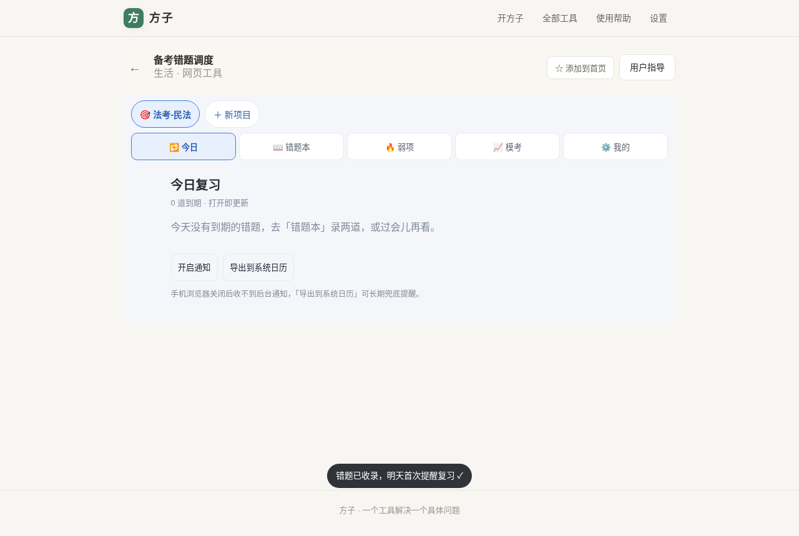
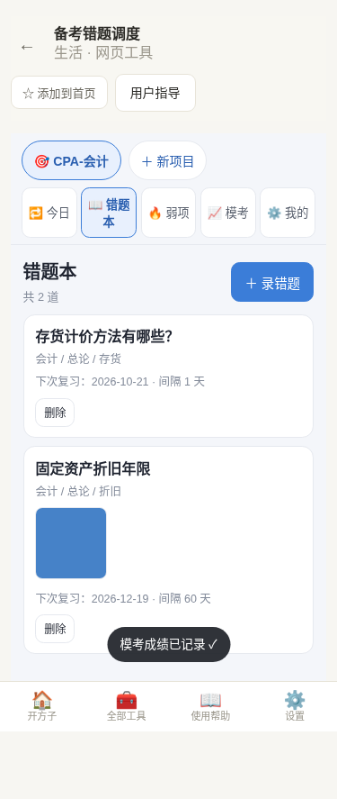
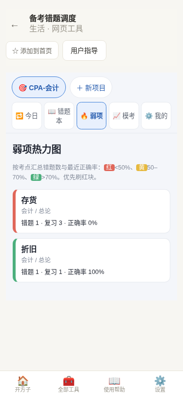
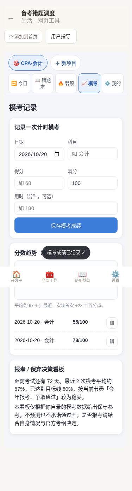
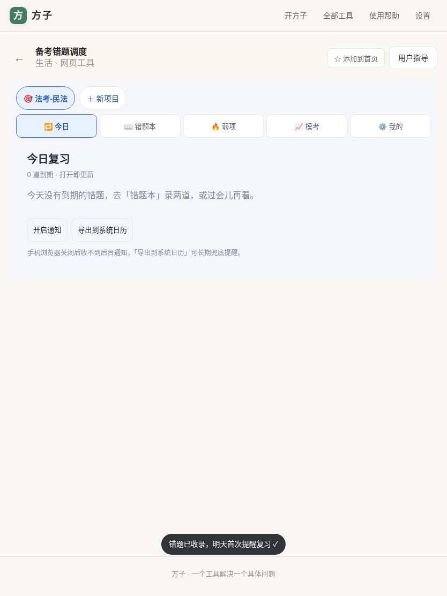

# 用户使用指导书：备考错题调度（exam-review-scheduler）

- 对应 dev：`dev_003_备考错题调度.md`
- 日期：2026-10-20
- 版本：v1.0.0

## 功能简介

「备考错题调度」是一个**纯本地、无后端**的错题本 + 艾宾浩斯间隔复习调度工具。你把考证/考研/考公中做错的题记进来（可拍照），它会根据你每天的「记得 / 模糊 / 已忘」自评，自动算出每道题下次该哪天复习，并按逾期紧急程度排成「今日复习队列」。同时用弱项热力图告诉你哪个考点正确率最低、用模考曲线追踪分数进步。**所有数据只存在你自己浏览器里，不上传、不联网搜答案。**

## 运行环境要求

- 任意现代浏览器（Chrome / Edge / Firefox / Safari 最近两个大版本），支持 IndexedDB 与 PWA。
- 作为 PWA 安装后可离线使用；首次打开后 Service Worker 会缓存资源，断网也能看已录错题。
- 无需登录、无需账号、无需联网权限（除首次加载与可选系统通知授权外）。

## 安装与启动

1. 在方子首页搜索「错题」「复习」「备考」「艾宾浩斯」等关键词，或直接访问路由 `#/t/exam-review-scheduler`。
2. 首次进入为空态，点击「建立第一个考试项目」。
3. 填写项目名（如「CPA-会计」）、考试日期、目标分数，点「建立项目」。
4. 建议用浏览器「安装应用 / 添加到主屏幕」把它装成 PWA，获得独立窗口与离线能力。

## 使用说明

### 1. 建立考试项目

空态点击「建立第一个考试项目」，填写项目名、考试日期、目标分。免费版可建 **1 个项目**；第二个项目会触发专业版升级门。

### 2. 录入错题（错题本）

进入「错题本」标签，点「＋ 录错题」：

- **三级标签（必选末级考点）**：科目 → 章节 → 考点，三级都要填才能保存（如 会计 / 总论 / 存货）。标签会自动记忆，下次输入可下拉选择。
- **题干**：必填。
- **错因 / 正解 / 来源**：选填，帮助复盘。
- **拍照附件**：点「拍照/相册」选图，自动压缩为长边 1600px 的 JPEG 并去除 EXIF/GPS 信息，免费版也可用。

免费版最多录 **50 道题**；第 51 道会触发专业版升级门。

### 3. 今日复习队列与自评

新题默认明天到期。到了「今日」标签，到期的题会按**逾期越久越靠前**排列。每道题下方三个按钮：

- **记得**（绿）：连续答对次数 +1，间隔按艾宾浩斯序列递进（1→2→4→7→15 天，之后按难度系数滚动增长）。
- **模糊**（黄）：间隔小幅推进。
- **已忘**（红）：连续答对归零，间隔回到 1 天，明天重背。

### 4. 弱项热力图

进入「弱项」标签，按考点聚合正确率：

- 🔴 红：正确率 < 50%，重点补；
- 🟡 黄：50%–70%；
- 🟢 绿：> 70%，已掌握。

### 5. 模考记录与分数曲线

进入「模考」标签，录入每次模考的日期、科目、得分、满分。手写 SVG 曲线会画出分数走势，并用**目标分虚线**标出你和目标的差距。下方「报考/保弃决策看板」给出固定模板文案与免责声明（专业版）。

### 6. 提醒与导出

- **角标**：今日待复习题数显示在标签上。
- **系统通知**：授权后可在到期时收到浏览器通知。
- **.ics 导出**：把今日复习计划导入系统日历。
- **全库导出/导入**：在「我的」标签导出 JSON 备份（换机/重装时导入，按 id 去重合并，不覆盖本机更新数据）。

### 7. 平板 / 手机自适应

三端自适应布局，手机端安全区沉浸、触控目标 ≥ 44px，平板与 PC 端自动多列排布、无横向溢出。

## 常见问题（FAQ）

**Q：录的题会丢吗？**
A：数据存在浏览器 IndexedDB 里，断网刷新仍在。但清理浏览器站点数据会删除，请定期在「我的」导出 JSON 备份。

**Q：为什么我录的题今天没出现在「今日」？**
A：新题默认明天到期。想立刻复习可在「我的」或后续版本调整；当前版本按调度引擎自动排期。

**Q：拍照会泄露我的位置吗？**
A：照片经 Canvas 重绘为 JPEG，EXIF（含 GPS）元数据被丢弃，不会保留拍摄位置。

**Q：专业版多少钱？解锁什么？**
A：买断 ¥8.90，解锁多项目、不限题数、报考/保弃决策看板与全库导出导入。今日队列、弱项热力图、模考曲线在免费版即可用。

**Q：能帮我搜这道题的答案吗？**
A：不能。本工具只管理你自录的错题，不联网搜答案、不内置任何机构题库，避免版权与合规风险。

## 注意事项

- 本工具**不提供搜答案、不内置/抓取任何机构题库、教材或出版社版权内容**，只管理用户自录错题。
- 报考/保弃决策看板为**固定模板文案**，不构成报考或弃考建议，一切以官方招生简章与你自己的判断为准。
- 数据全程只存本机；换浏览器/设备需用导出导入迁移。
- OCR 拍照识字为**实验/即将支持**能力，当前版本拍照后请手动录入题干。
