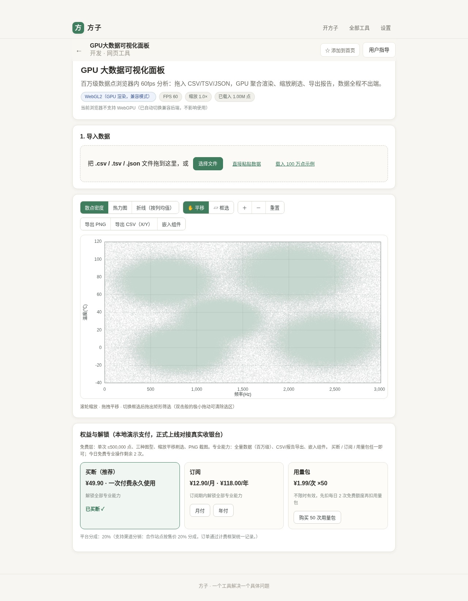
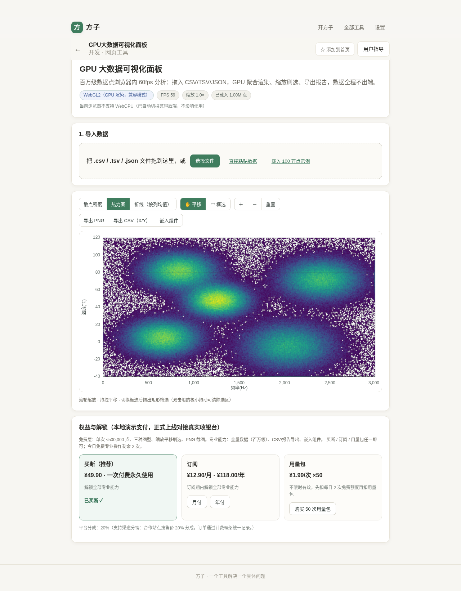
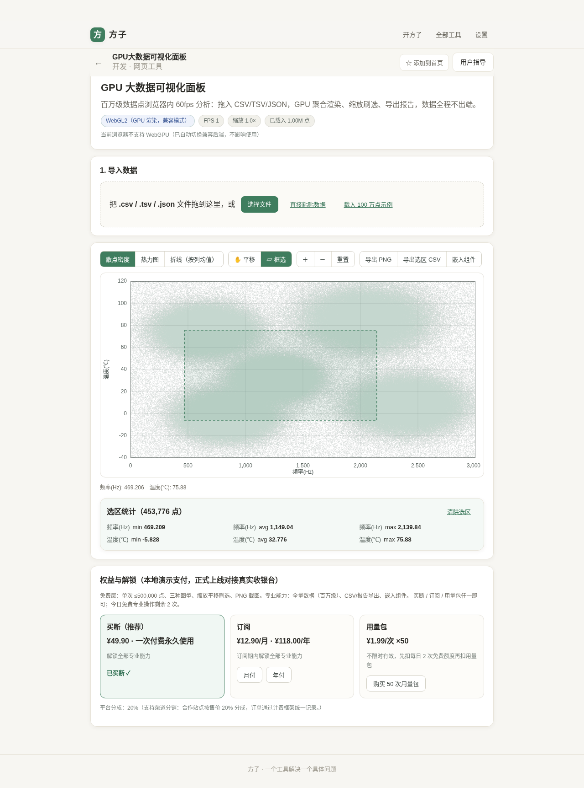
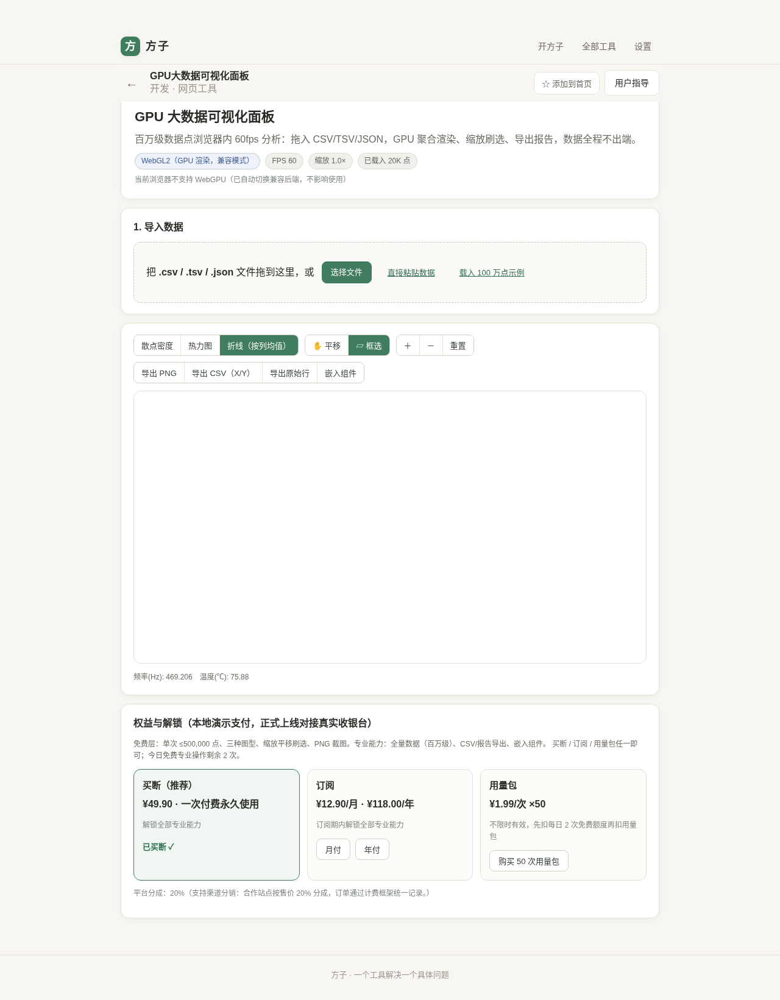
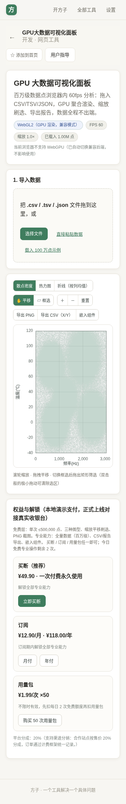

# 用户使用指导书：GPU 大数据可视化面板

- 对应 dev：dev_002_GPU大数据可视化面板.md
- 日期：2026-10-15
- 版本：v1.0.0
- 工具入口：方子 PWA → 路由 `/#/t/gpu-data-viz`

## 功能简介

在浏览器里直接分析**百万级数据点**的纯本地可视化面板：拖入 CSV/TSV/JSON 即可在 60fps 下流畅缩放、平移、框选，提供散点密度图、热力图、折线图三种视图，支持导出 PNG 截图与框选结果 CSV。**数据全程留在本机，不上传任何服务器**，无需注册、无需后端。

## 运行环境要求

- **终端**：PC、平板、手机均可（响应式，已在 1280×800 / 834×1112 / 375×812 三视口验证，无横向溢出）。
- **浏览器**：
  - 推荐 Chrome / Edge 113+、Safari 26+（支持 WebGPU，百万点走 GPU compute，最流畅）；
  - Firefox 及较旧浏览器自动降级到 **WebGL2**（真实 GPU 渲染，兼容模式）；
  - 极旧环境再降级到 **Canvas2D**（上限 10 万点）。
- **离线**：作为方子 PWA 的一部分，首次访问后可离线使用（Service Worker 缓存）。
- **数据规模**：免费层单次 ≤ 50 万点；解锁后支持百万级全量。

## 安装与启动

无需安装。部署上线后，在方子 PWA 内打开「GPU 大数据可视化面板」即可，或直接访问 `https://<你的域名>/#/t/gpu-data-viz`。

- 点击「添加到首页」可把面板作为 PWA 图标安装到桌面/手机主屏幕。
- 本地开发预览：在仓库根目录 `npm install && npm run dev`；生产预览 `npm run build && npm run preview`（默认 `http://localhost:4173`）。
- 无任何需要用户配置的密钥、环境变量或后端地址。

## 使用说明

### 1. 导入数据（三种方式）

打开面板后，在「1. 导入数据」区域任选其一：

- **拖入 / 选择文件**：把 `.csv` / `.tsv` / `.json` 文件拖到虚线框，或点「选择文件」。文件由浏览器内 Worker 流式解析，不产生网络请求。
- **直接粘贴数据**：点「直接粘贴数据」，把表格文本粘进文本框。
- **载入 100 万点示例**：点「载入 100 万点示例」，立即生成一份传感器簇模拟数据用于体验。

导入文件后会提示「检测到 N 行、M 列」，在下拉框中选择 **X 轴**与 **Y 轴**（二者不能为同一列），点「载入 N 点」。

### 2. 切换视图

工具栏提供三种图型：

- **散点密度**：以半透明点叠加呈现点云密度，观察数据簇与离群点；
- **热力图**：基于 512×300 网格聚合，viridis 色带高亮密集核心；
- **折线（按列均值）**：按 X 分桶后对 Y 取均值，用于看趋势/波形。

### 3. 缩放、平移与框选

- **滚轮缩放**：在图表上滚动鼠标滚轮（移动端双指捏合）以光标为中心缩放；
- **拖拽平移**：默认处于「✋ 平移」模式，按住拖动平移视图；点「重置」回到全局；
- **框选筛选**：点「▱ 框选」切换模式，在图上拖出矩形，下方立即显示选区统计（点数、X/Y 的最小/均值/最大值）。双击或拖一个极小框可清除选区。

### 4. 导出

- **导出 PNG**：把数据层与坐标网格、轴标合成为一张高清 PNG 下载（免费）；
- **导出 CSV（X/Y）/ 导出选区 CSV**：导出全部或框选结果的原始 X/Y 数值（专业能力）；
- **嵌入组件**：点「嵌入组件」生成一段 `<iframe>` 代码，可把当前面板嵌入自己的网页/文档。

### 5. 移动端

手机访问时工具栏与图表自动纵向排布，图表宽度自适应屏幕，可双指缩放、拖拽平移，无横向滚动条。

## 常见问题（FAQ）

- **顶部显示「WebGL2（兼容模式）」或提示「当前浏览器不支持 WebGPU」？**
  属正常降级，不影响使用，只是百万点极限帧率略低于 WebGPU。升级到最新版 Chrome/Edge 即可走 WebGPU。
- **载入大数据时帧率较低？**
  在无独立显卡或虚拟机/软件渲染环境下，百万点的帧率会明显下降（实测软件渲染约 1fps，真实显卡 60fps）。可先用 50 万点以内数据，或在真实 GPU 设备上使用。
- **提示「X 轴与 Y 轴不能是同一列」？**
  在导入预览里把 X、Y 选为两个不同的数值列即可。
- **专业按钮提示「该操作属于专业能力」？**
  全量数据、CSV 导出、嵌入组件为专业能力。未购买时每日有 2 次免费体验额度；买断、订阅或购买用量包后解锁。
- **数据会被上传吗？**
  不会。解析与渲染全部在浏览器本地（含 Web Worker、GPU），页面不发起任何数据上传请求。

## 注意事项

- 免费层单次最多载入 50 万点；专业版百万级。超大文件解析期间浏览器可能短暂占用较高内存，属正常现象。
- Canvas2D 兜底后端对单次点数设 10 万点上限；WebGL2 后端上限 500 万点，超出会提示。
- 支付当前为**本地演示收银台**，正式上线需在方子计费框架接入真实支付网关（见 ops 文档）。
- WebGPU 为较新能力，个别浏览器版本/企业策略可能禁用；面板会自动降级，不会白屏。
