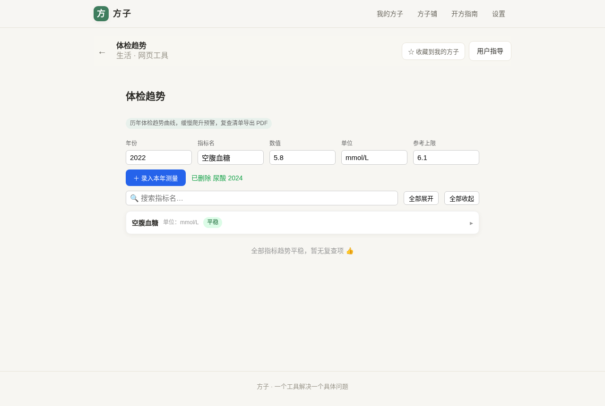
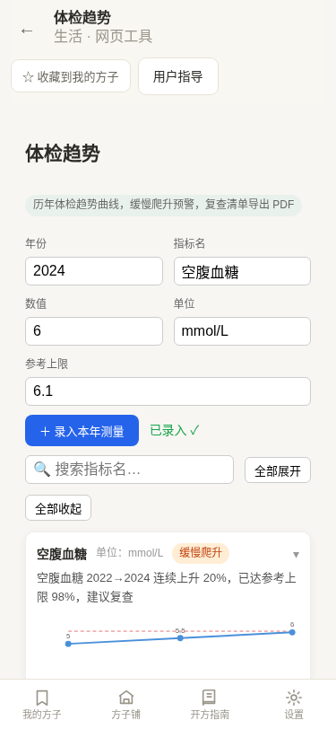
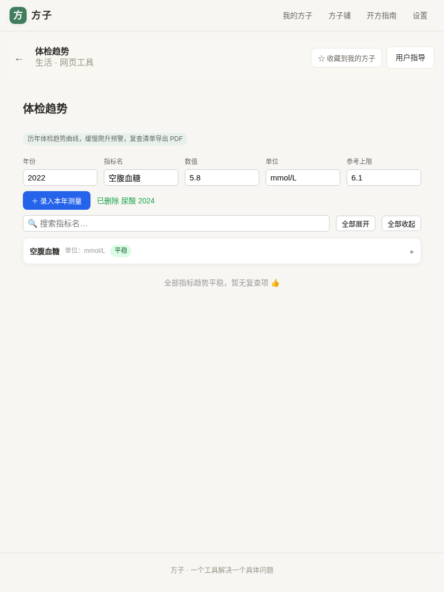

# 用户使用指导书：体检趋势

- 对应 dev：`docs/stage/dev_004_体检趋势.md`
- 日期：2026-11-03
- 版本：v1.0.0

## 功能简介
把历年体检报告里的关键指标录进来，跨年画趋势曲线；只在「连续缓慢爬升接近上限」或「已超限」时预警，自动生成复查行动清单并导出 PDF，数据全程本机不上传。

## 使用说明
1. 每年体检后，在顶部表单填年份、指标名（如 空腹血糖）、数值、单位、参考上限，点「＋ 录入本年测量」。
2. 同一指标名的历年数据会自动汇成一条趋势曲线：虚线是参考上限，红点=已超限，橙色徽标=连续爬升预警；手机窄屏自适应不裁切坐标与数值。
3. 录错了：每条记录下方有「编辑/删」，可单独改某年数值（顶部表单回填后点「保存修改」）或删该年记录（二次确认）。
4. 指标多了：顶部「🔍 搜索指标名」即时过滤；卡片点头部折叠/展开——有预警默认展开、平稳默认收起，另有「全部展开/收起」。
5. 下方「复查行动清单」自动列出所有需要复查的指标（已超限优先），点「导出复查清单 PDF」可直接带去医院。

## 注意事项
- 预警规则：连续 ≥2 年上升、累计涨幅 ≥20%、且已达参考上限 80% 才提示「缓慢爬升」，避免对单次波动过度焦虑。
- 数据存在本机浏览器，清缓存会丢，建议每年导出 PDF 备份。
- 本工具不替代医生诊断，异常请就医。
