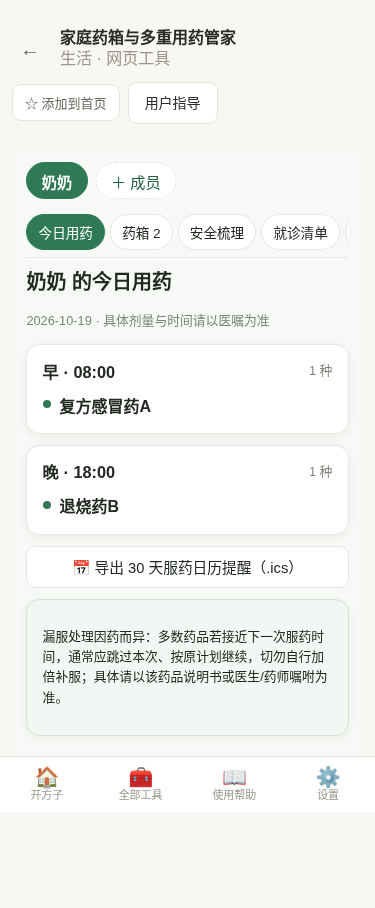
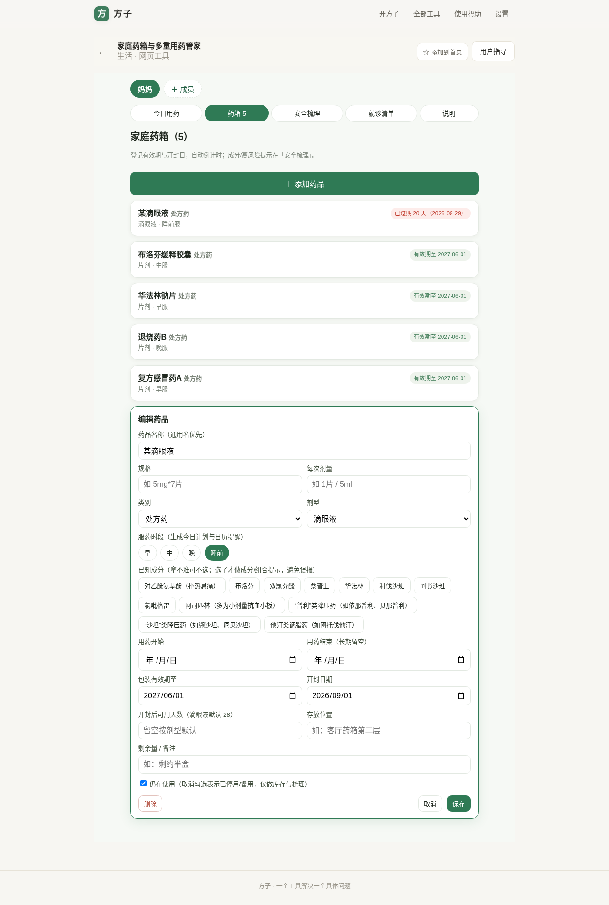
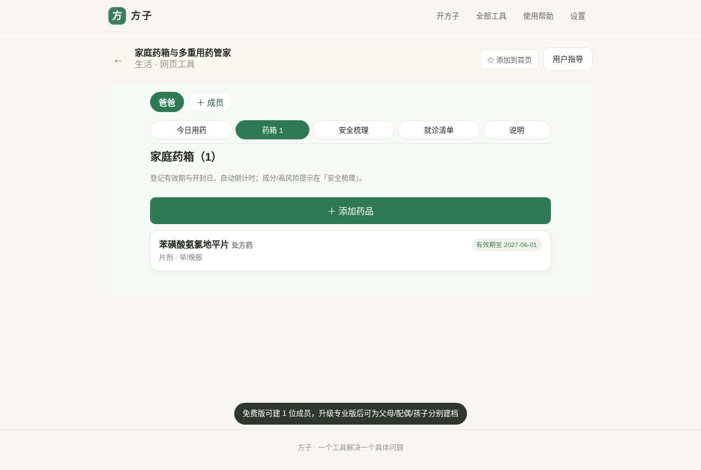
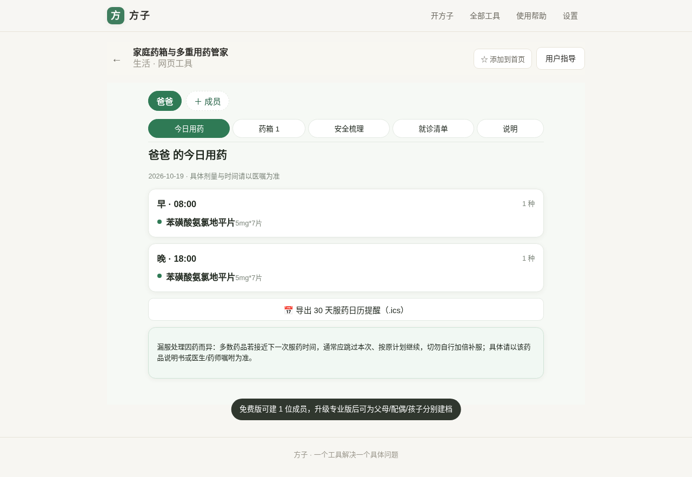
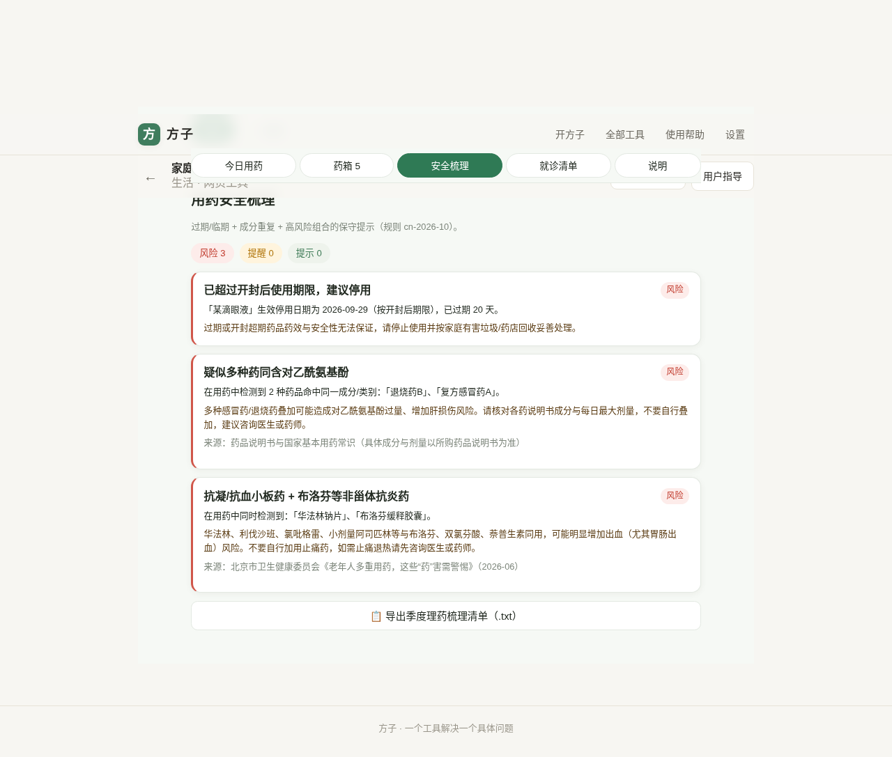
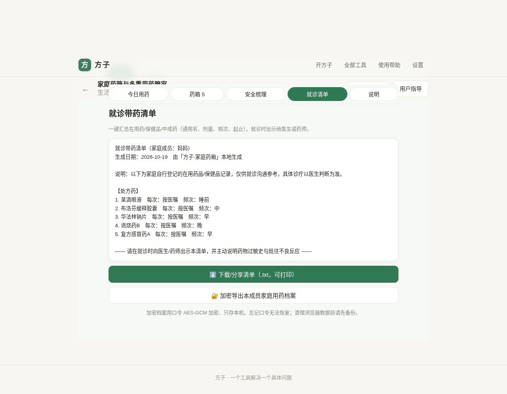
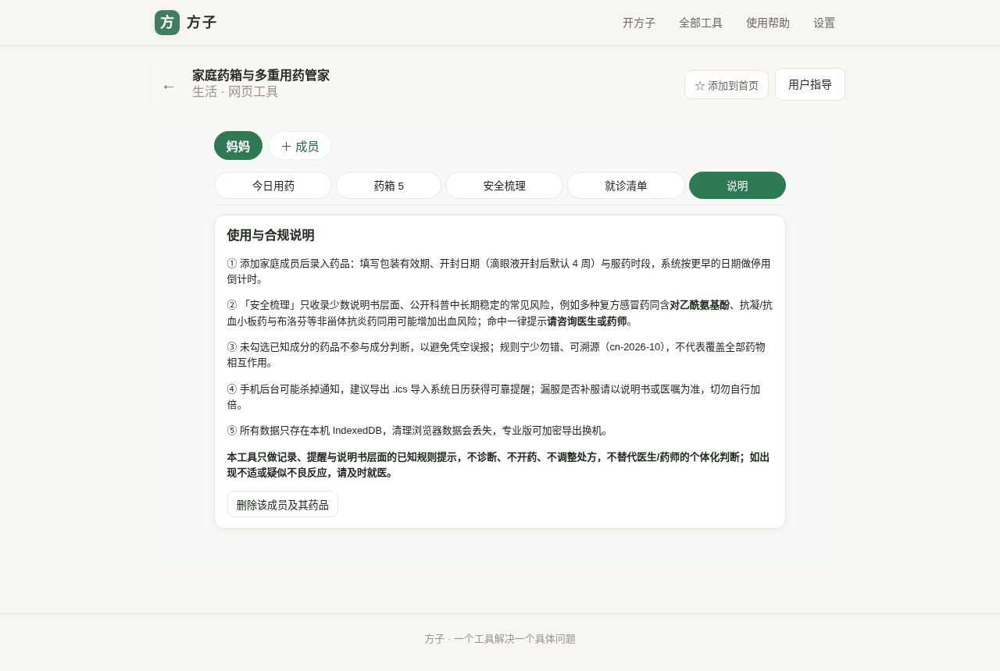

# 用户使用指导书：家庭药箱与多重用药管家

- 对应 dev：dev_002_家庭药箱与多重用药管家.md
- 日期：2026-10-19
- 版本：v1.0.0
- 工具 id：`home-medicine`（生活 · 网页工具，路由 `#/t/home-medicine`）

## 功能简介

为每位家庭成员建立本地家庭药箱台账，自动做**包装有效期与开封后双重倒计时**，生成早/中/晚/睡前服药计划与系统日历（.ics）提醒，并对少数说明书层面、公开科普中长期稳定的**成分重复与高风险组合**做保守提示，就诊前一键导出“在用药全清单”。

本工具**只做记录、提醒与已知规则提示，不诊断、不开药、不评价或调整处方，不承诺疗效**；命中任何风险一律建议咨询医生或药师。数据全程只存在本机浏览器 IndexedDB，不上传、不同步。

## 运行环境要求

- 现代浏览器：Chrome / Edge / Firefox / Safari 较新版本（手机/平板/PC 均可）。
- 纯前端 PWA，无后端；支持安装到桌面/主屏后离线使用（数据存本机）。
- 系统日历提醒通过导出 `.ics` 后由系统日历 App 完成；浏览器通知为可选补充。

## 安装与启动

- 在线访问：在方子内打开「全部工具 → 生活 → 家庭药箱与多重用药管家」，或直接访问 `https://www.fangzi.asia/#/t/home-medicine`。
- 无需注册登录；首次进入按引导添加家庭成员即可。
- 数据保存于本机 IndexedDB（库名 `fangzi-home-medicine`，v1）；清理浏览器数据会删除记录，请先用专业版“加密导出”备份。

## 使用说明

### 1）添加家庭成员

进入工具点顶部「＋ 成员」，输入称呼（如爸爸/妈妈/本人）即可。免费版可建 1 位成员；专业版可分别为父母、配偶、孩子建档。删除成员：点该成员标签右侧的「×」，确认后会连同 TA 的全部药品记录一并删除（操作前请留意，已删除记录本机不可恢复）。

### 2）登记药品与有效期/开封倒计时

进入「药箱 → ＋ 添加药品」，填写通用名、规格、类别、剂型、服药时段、包装有效期、开封日期。

- 同时填包装有效期与开封日期时，按**更早**的日期提示停用。
- 滴眼液（eyeDrop）开封后默认 **28 天**到期，也可在“开封后可用天数”手动覆盖。
- 标签颜色：绿=正常，黄=90 天内临期，红=已过期/已超开封期限。
- 勾选“仍在使用”才会进入今日计划与成分/组合判断；停用/备用药只做库存与有效期梳理。

### 3）今日用药计划与日历提醒

「今日用药」按早（08:00）/中（12:00）/晚（18:00）/睡前（21:30）列出当天在用药。点「导出 30 天服药日历提醒（.ics）」导入系统日历，获得后台可靠提醒（浏览器后台通知可能被系统杀掉）。

漏服处理因药而异：接近下一次服药时间通常跳过本次、切勿自行加倍，具体以说明书或医嘱为准。

### 4）用药安全梳理（专业版）

「安全梳理」统计风险/提醒/提示，覆盖：过期与开封超期、同成分重复用药、跨药高风险组合。规则版本 `cn-2026-10`，宁少勿错、可溯源。

已收录的典型情形（示例）：

- 多种复方感冒药/退烧药同含**对乙酰氨基酚**（叠加有肝损伤风险）。
- **抗凝/抗血小板药**（华法林、利伐沙班、氯吡格雷、小剂量阿司匹林等）与**布洛芬/双氯芬酸/萘普生**等 NSAID 同用，可能增加出血（尤其胃肠出血）风险。

只有在药品上**明确勾选已知成分**才参与成分判断，避免凭空误报；未命中不代表绝对安全。所有风险结论固定引导“请咨询医生或药师”。

### 5）就诊带药清单与加密档案（专业版）

「就诊清单」按处方药/非处方药/中成药/保健品分组，列出通用名、规格、每次剂量、频次与起止时间，可下载 .txt 打印或出示；同时可用口令（AES-GCM，PBKDF2 10 万次）加密导出该成员家庭用药档案换机。

### 6）使用与合规说明

「说明」页集中列出规则口径、未收录免责、漏服处理、数据与备份方式及“不诊断/不开药/不调整处方”的边界。

## 常见问题（FAQ）

- **为什么没勾成分的药不提示相互作用？** 为避免凭空误报，成分/组合判断只对明确勾选的已知成分生效；未收录的成分与组合仍可能存在，用药请遵医嘱。
- **滴眼液开封后能用多久？** 默认按开封后 28 天（4 周）提示停用；如该药品说明书另有规定，可手动填写“开封后可用天数”。
- **手机上收不到通知？** 部分手机后台会限制浏览器通知，建议导出 .ics 导入系统日历获得可靠提醒。
- **换手机/清理浏览器数据怎么办？** 专业版可在「就诊清单」页加密导出 JSON 档案妥善保存，换机后留存备用（请记牢口令，忘记无法恢复）。
- **提示了风险就要停药吗？** 不是。工具不提供停药/换药/调剂量建议，命中提示仅提醒你尽快咨询开药医生或药师。

## 注意事项

- 本工具不提供医疗诊断或治疗建议，不能替代面诊；出现不适或疑似药物不良反应请及时就医。
- 规则库仅覆盖少数长期稳定的常见风险，**不代表完整的药物相互作用审查**，处方与剂量请以医嘱与药品说明书为准。
- 所有数据仅保存在本机，不上传；免费版 1 位成员，专业版买断 ¥6.90（或月 ¥1.9 / 年 ¥19）解锁多成员、安全梳理与就诊清单/加密档案。
