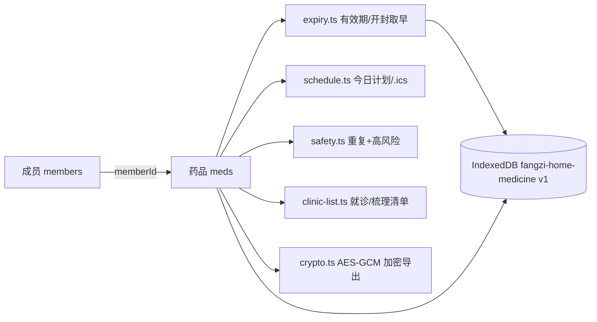

# 技术沉淀：家庭药箱与多重用药管家

- 对应 dev：dev_002_家庭药箱与多重用药管家.md
- 日期：2026-10-19
- 功能档位：**M（标准档）**——多成员/多药品链路、IndexedDB 持久化、文件导出（.ics/.txt/加密 JSON）、多端表单与列表。

## 技术选型与理由

| 选型 | 版本/来源 | 商用授权 | 理由 |
| --- | --- | --- | --- |
| Vue 3 + `<script setup lang="ts">` | 仓库既有 | 项目内 | 与 fangzi 全部工具一致，经 `registry.ts` 的 `import.meta.glob` 自动发现，零路由改动 |
| Vite | 仓库既有 | MIT | 统一构建 / PWA 插件 |
| IndexedDB（原生封装 `lib/store.ts`） | 浏览器原生 | 内置 | 零新增依赖；members/meds 两表 + memberId/active 索引；写库前深度 `toRaw`，沿用 tax-deduction 范式 |
| Web Crypto（PBKDF2 100000 + AES-GCM 256） | 浏览器原生 | 内置 | 加密家庭档案导出；盐/iv 随机随密文输出，口令不落盘 |
| iCalendar 文本生成 `lib/notify.ts` | 自研 | 自有 | 每日重复 30 天（RRULE:FREQ=DAILY;COUNT=30），无第三方 ics 依赖 |
| 计费钩子 `useToolBilling(toolId)` | 仓库既有 | 内部 | 只接主方案 freemium + 买断（690 分）/订阅（月190/年1900），未重复造计费轮子 |
| SEO `useSeo` | 仓库既有 | 内部 | 标题/描述/keywords + type WebApplication |

- **零新增 npm 依赖、零大资产**（纯 JS/CSS），不触碰 Service Worker / manifest / 现有路由。
- 无任何 NC（非商用）许可资源；规则文案为说明书层面/公开健康科普口径的自研保守表述，规则版本可溯源 `cn-2026-10`。

## 关键实现

- **有效期与开封取早（`lib/expiry.ts`）**：`effectiveExpiry` 分别算包装到期日与开封后到期日（滴眼液默认 28 天），取更早者并标注 basis；`expiryInfo` 输出 expired/near(≤90d)/ok/none 四级。
- **安全梳理（`lib/safety.ts`）**：仅对 `active` 且显式勾选已知成分的药参与成分判断，杜绝凭空误报；
  - 同成分/同组重复：按 `IngredientGroup` 聚合，**同一药品不与自身配对**，需 ≥2 种不同药品才提示；
  - 跨组高风险：`HIGH_RISK_RULES` 枚举“抗凝/抗血小板 × NSAID”等组合，同样要求来自不同药品；
  - 结论一律 danger/warn/info，文案固定“建议咨询医生或药师”，不给剂量/停药建议。
- **服药计划（`lib/schedule.ts`）**：`isTakingOn` 用 active + 起止日期过滤，`todayPlan` 按 早→中→晚→睡前 固定顺序聚合，停用/未到期/已结束不出现；漏服建议为常量保守文案。
- **就诊清单（`lib/clinic-list.ts`）**：按处方药/非处方药/中成药/保健品分组输出通用名、规格、每次剂量、频次与起止；另产出季度梳理文本。
- **数据模型简化**：architect 设想的 schedules/intakes 两表在 V1 折叠进 `Med.slots/startDate/stopDate`（计划是规则派生而非录入实体），降低存储与迁移面；库结构保持 v1，字段全部可选以便前向兼容。
- **医疗合规护栏**：UI 每个风险卡、说明页、漏服提示均强调“不诊断/不开药/不调整处方/咨询医生或药师”；规则宁少勿错，未勾选成分不判断。

## 踩坑记录

1. **`IngredientGroup` 导入来源错误**：该类型定义在 `rules-cn.ts` 而非 `models.ts`，误从 models 导入导致 TS2305，并连带索引处 TS7053；改正 import 来源后两处同时消除。
2. **`noUncheckedIndexedAccess` 索引报错**：`members.value[0].id`、`INGREDIENTS[k].name` 等数组/Record 索引需 `?.`/非空保护；模板内把 `SLOT_LABEL` 常量当 ref 用了 `.value`（TS2339），改为在 script 暴露 `slotNames()` 辅助函数，模板直接调用。
3. **E2E 选择器与真实标签不一致**：时段按钮文案是 早/中/晚/睡前（不是“早上/中午/晚上”），且“添加药品”按钮仅在「药箱」tab 内；在 `addMed` 内统一切 tab 并按真实短标签点击后稳定通过。
4. **避免自配对误报**：安全规则若在“同一药品含多组”场景与自身配对会误报，强制要求命中组合来自两种不同药品。
5. **浏览器通知不可靠**：移动后台常杀掉页面通知，主推 .ics 系统日历（COUNT=30），通知仅作可选权限请求。

## 验证覆盖

档位 M。质量门全部通过：

- 类型检查 `npx vue-tsc --noEmit`：**0 错误**。
- 单元测试 `npm test`：**307 通过 / 0 失败**（本工具新增 18 例：跨月日期、开封默认/自定义、取早、分级、成分重复命中/单药不误报、抗凝+NSAID、自配对排除、已停用不参与、未勾选零误报、计划排序与起止过滤、就诊清单内容）。
- `npm run verify:tools`：校验工具数 **27**，manifest/插件包/示例提问回归全部通过。
- 生产构建 `npm run build`：成功（vue-tsc + vite build + postbuild 清理 wasm）。
- Playwright 三视口 E2E（`scripts/e2e-home-medicine-20261019.mjs`）：PC 1280×860、平板 834×1112、手机 375×812，全业务链路通过且无 pageerror。
  - 免费态：建成员→第 2 位成员升级门拦截→建药（早/晚、有效期）→今日计划→药箱有效期标签→安全梳理/就诊清单显示升级卡。
  - 专业态（seed `fangzi:billing:v1` 已支付订单）：5 种药→今日计划→编辑表单→安全梳理命中 3 条 danger（开封超期/对乙酰氨基酚重复/抗凝+布洛芬）且含“医生或药师”→就诊清单含成员名与药名→说明页含“不诊断/医生药师”免责。
  - 横向溢出检测 `scrollWidth - clientWidth <= 2`：PC/手机/平板 **全部 0 溢出**。

### 多端尺寸结论

| 视口 | 尺寸 | 关键场景 | 结论 |
| --- | --- | --- | --- |
| PC | 1280×860 | 计划/药箱表单/安全梳理/就诊清单/说明 | 正常，无溢出 |
| 平板 | 834×1112 | 安全梳理 | 正常，无溢出 |
| 手机 | 375×812 | 成员切换、今日用药、大字阅读 | 正常，触控目标足够、无溢出 |

移动端适配：表单输入 `font-size:1rem` 防 iOS 聚焦缩放；成员栏与分段吸顶可横滑；主操作按钮为大块触控区；长药品名/规格在卡片内换行不撑破布局。

### EdgeOne Pages 免费版限额核查（构建后实测）

| 指标 | 实测（整站 dist） | 限额 | 结论 |
| --- | --- | --- | --- |
| 存储总量 | 约 131 MiB | 5 GiB | 达标 |
| 文件总数 | 131 | 20000 | 达标 |
| 单文件最大 | 24,010,842 字节（约 22.9 MiB，bge onnx；构建期已清理 25.6MiB asyncify wasm） | 25 MiB | 达标 |

本工具零大资产（仅 JS/CSS/少量文案），对整站三项指标几乎无增量。

### guide 截图有效性验证（全部为真实构建界面，非 0 字节、PNG 完整、与描述一致）

| 截图文件 | 像素 | 大小 | 是否通过 |
| --- | --- | --- | --- |
| shot-01-pc-plan-free.png | 1280×882 | 91,591 B | 通过 |
| shot-02-pc-cabinet-free.png | 1280×860 | 68,155 B | 通过 |
| shot-03-pc-plan-pro.png | 1280×1118 | 96,658 B | 通过 |
| shot-04-pc-edit-form.png | 1280×1900 | 205,404 B | 通过 |
| shot-05-pc-safety.png | 1280×1087 | 156,422 B | 通过 |
| shot-06-pc-clinic.png | 1280×995 | 118,838 B | 通过 |
| shot-07-pc-about.png | 1280×860 | 133,973 B | 通过 |
| shot-08-mobile-plan.png | 375×908 | 68,650 B | 通过 |
| shot-09-tablet-safety.png | 834×1112 | 92,681 B | 通过 |

已逐张 Read 抽看 PC 安全梳理与手机今日用药，内容与 guide 文案一致、确为真实渲染。

## 可复用经验

- **“显式勾选才判断”的保守安全规则范式**：适用于任何“用户自录条目 + 规则匹配”的工具（用药、饮食禁忌、证件年检等），从数据结构上避免对未知字段凭空告警；规则常量与 SOURCES 绑定，便于版本化与溯源。
- **包装期限 × 开封期限取早**：`effectiveExpiry` 的“多到期口径取更早 + basis 标注”可复用到化妆品开封保质期、食品保质期、耗材效期等场景。
- **零依赖 .ics 每日提醒**：自研最小 VEVENT（RRULE COUNT=30 + VALARM）足够覆盖“短期重复提醒”，可沉淀为通用模块供其它提醒类工具复用。
- **IndexedDB 写库前 toRaw + 可选字段前向兼容**：沿用 tax-deduction 已验证范式，新工具直接套，避免 Vue reactive 结构化克隆报错与后续字段迁移成本。
- **M 档节奏**：纯逻辑用毫秒级 node:test 全量拦截（18 例），浏览器 E2E 只跑一条完整链路 + 三视口溢出与真实截图，避免在截图环节反复耗时。
