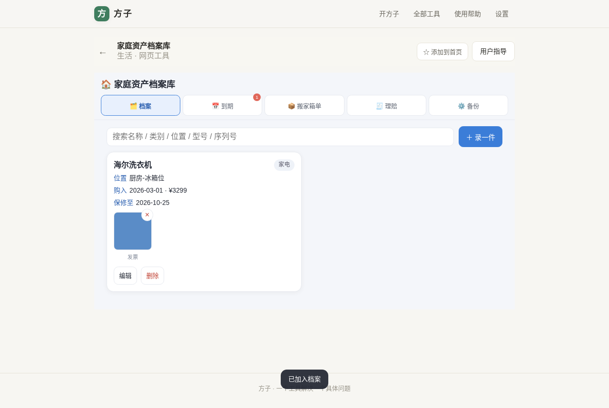
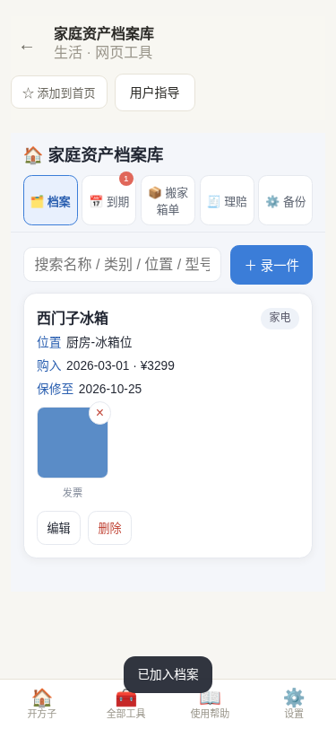
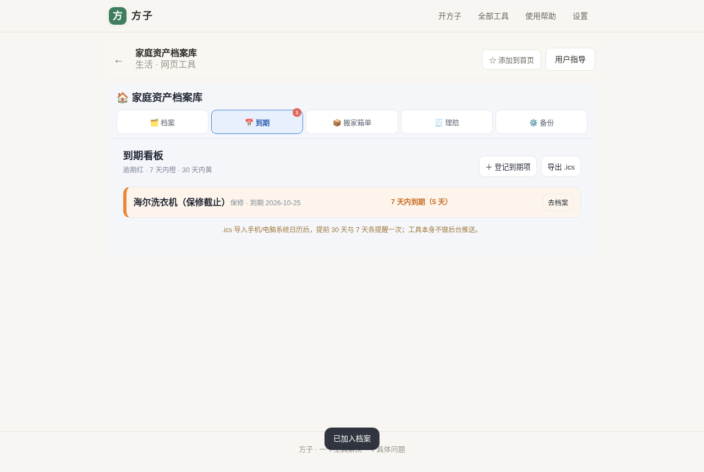
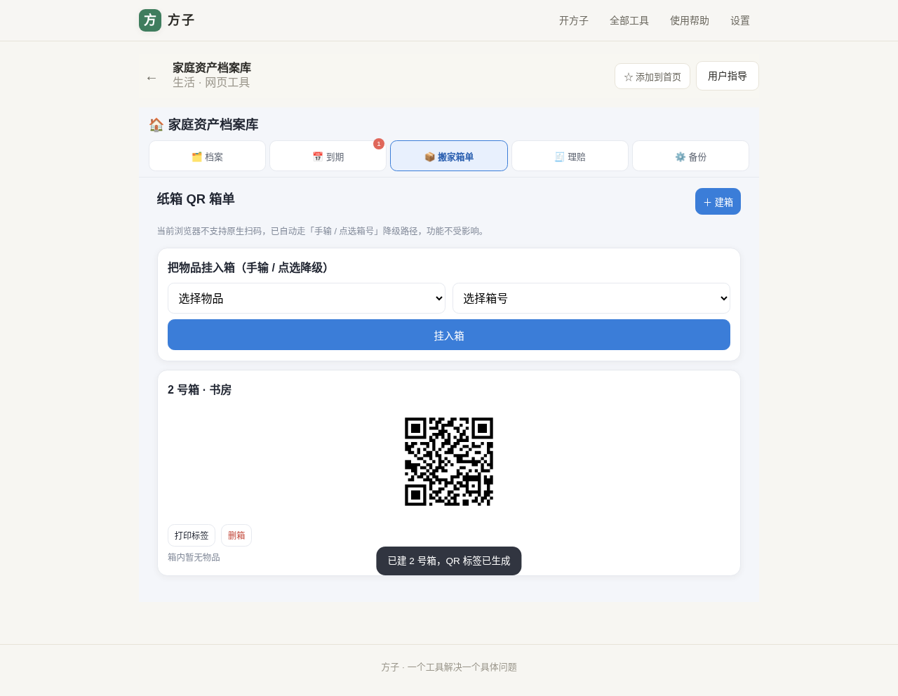
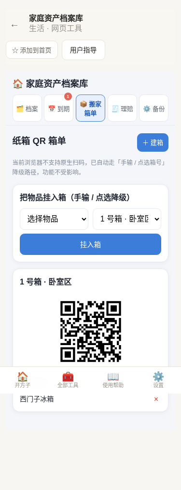
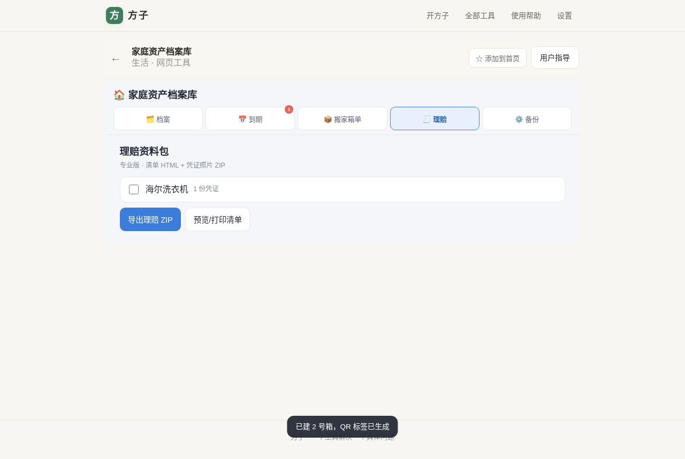
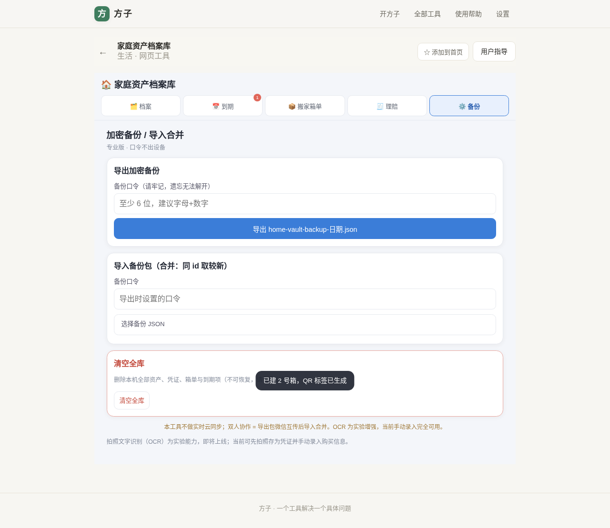
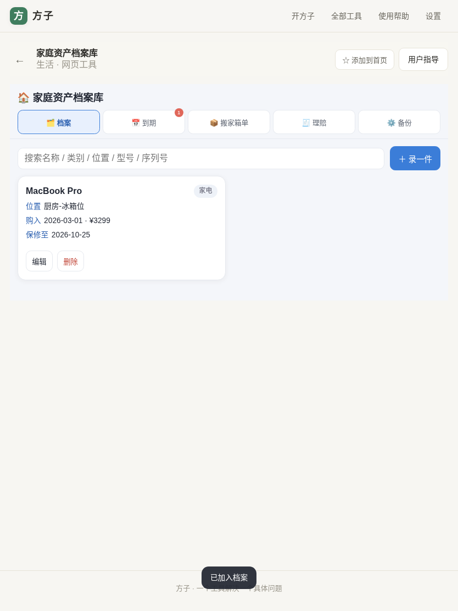

# 用户使用指导书：家庭资产档案库

- 对应 dev：dev_004_家庭资产档案库.md
- 日期：2026-10-20
- 版本：v1.0.0

## 功能简介

把家里的家电、数码、家具、证件、保单、车辆等贵重/关键物品录成一张档案卡，发票、保修卡、说明书、维修记录拍照挂到卡片上；保修/证件/保险/年检到期自动分级提醒并可导出系统日历；搬家时给纸箱生成 QR 标签、扫码或搜索即知物品在几号箱；勾选资产一键导出理赔资料包 ZIP；全库可口令加密备份、换机导入合并。**所有数据只存在你这台设备的浏览器里，不上云、不注册账号。**

## 运行环境要求

- 现代浏览器（Chrome/Edge 桌面与安卓、Safari/iOS 近两个大版本）；需要 IndexedDB 与 Canvas。
- 无需安装、无需后端、无需联网即可使用已录入数据；首次打开工具页需联网加载。
- 隐私模式/无痕窗口不持久化，请勿在隐私模式下长期使用。

## 安装与启动

本工具随方子 PWA 整体发布，打开工具页 `/#/t/home-vault` 即用，无安装步骤。专业版一次买断 ¥12.90（也可订阅 月 ¥3.9 / 年 ¥29.9）；免费版可录 50 张资产卡片并使用基础到期看板与搬家箱单。

## 使用说明

### 1. 录一件资产（档案页）

点右上角「＋ 录一件」，填写名称（必填）、类别、存放位置、购入日期、购入价（元）、品牌型号、序列号、保修截止日、备注；可直接拍照或从相册选图作为发票/保修卡等凭证（自动压缩、剥离 EXIF/GPS），保存后卡片显示凭证缩略图，可单独删除。

手机端同样可用，照片按钮支持相机拍摄：

### 2. 到期看板与系统日历提醒（到期页）

资产的「保修截止」会自动进入看板：**逾期红色、7 天内橙色、30 天内黄色**。证件/保险/年检等非保修项点「＋ 登记到期项」手动录入。点「导出 .ics」把全部到期项导入手机/电脑系统日历，每项含提前 30 天与 7 天两条提醒。

### 3. 搬家箱单与 QR 标签（搬家箱单页）

点「＋ 建箱」填箱号与目的地房间（如「1 号箱 · 卧室区」），自动生成矢量 QR 标签，可「打印标签」贴到纸箱。当前浏览器支持原生扫码时可扫码直接进该箱；不支持（Safari/iOS/无头环境）自动隐藏扫码按钮，走「选择物品 + 选择箱号」点选降级路径，功能不受影响。挂入物品后，在档案页搜索物品名即可看到「📦 在 N 号箱 · 目的地」。

### 4. 理赔资料包（专业版，理赔页）

勾选要理赔的资产，点「导出理赔 ZIP」得到：`manifest.json` + 自含打印样式的 `清单.html`（浏览器打开可直接打印/另存 PDF）+ `凭证/<资产id>/<凭证id>.jpg` 全部照片，可直接发给保险公司；也可先「预览/打印清单」。

### 5. 加密备份与导入合并（专业版，备份页）

- **导出**：设置备份口令 → 导出 `home-vault-backup-YYYYMMDD.json`（PBKDF2 10 万次 + AES-GCM-256 加密，照片以 base64 内联）。
- **导入**：换机/家人互传后选文件、输入口令；按 id 合并，同 id 取更新时间晚者，反馈「新增 X 条，更新 Y 条」，照片不丢。
- **清空全库**：需二次点击确认，不可恢复，请先导出备份。

平板自适应布局示例：

## 常见问题（FAQ）

- **Q：照片会不会被上传？**
  A：不会。照片压缩后只存本机 IndexedDB，工具无后端、无云同步；导出备份也是在本机加密成文件由你自己保管。
- **Q：换手机怎么办？**
  A：旧机导出加密备份 JSON → 新机打开工具 → 备份页输入口令导入，自动合并。
- **Q：扫码用不了？**
  A：Safari/iOS 不支持原生 BarcodeDetector，属预期行为，用「点选箱号」即可。
- **Q：忘记备份口令？**
  A：口令由你本人设置、本地派生，开发者也无法找回，遗忘则备份包不可解，请牢记。
- **Q：免费版能录多少？**
  A：50 张资产卡片；到期看板、手动登记、搬家箱单与 QR 均免费可用；理赔 ZIP、加密备份/导入合并、无限卡片为专业版。

## 注意事项

- 定期（如每季度）导出一次加密备份存到微信文件传输助手或其它本地介质；清理浏览器站点数据会删除本机档案。
- 照片建议总量控制：每张已压到 300KB 内，本机 IndexedDB 容量有限，超量可先导出归档再删除本机记录。
- 本工具只管理你本人录入的物品与本人拍摄的凭证，不参与保险定损，赔付以保险公司核定为准。
- 拍照文字识别（OCR）为实验能力，当前未默认启用，手动录入完全可用。
