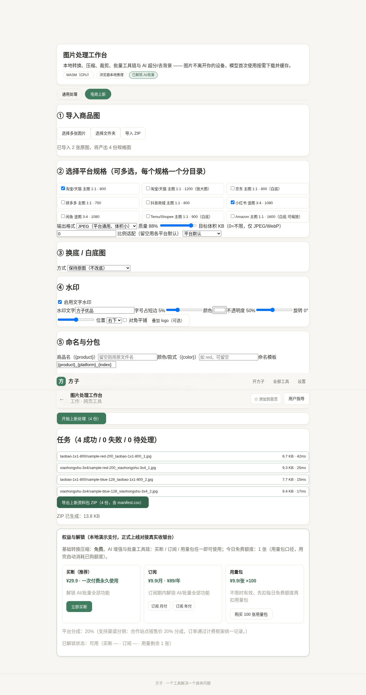
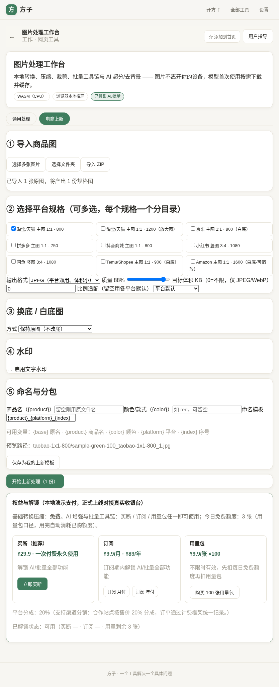
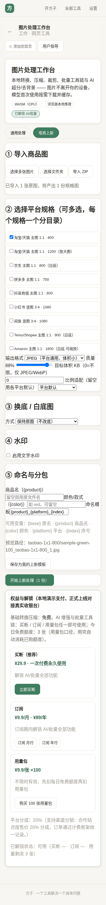

# 用户使用指导书：电商商品图批量处理工作台（图片处理工作台 · 电商上新模式）

- 对应 dev：`dev_002_电商商品图批量处理工作台.md`
- 日期：2026-10-16
- 版本：v1.2.0（在「图片处理工作台 image-converter」内新增「电商上新」模式）

## 功能简介
面向电商/跨境卖家的上新批量出图：一批商品原图，一次导出多个平台规格（主图/竖图、指定边长、可选目标体积），自动完成比例裁剪或留白、AI 换白底/底色、文字或 logo 水印、按规则批量重命名，并按平台分目录打包成 ZIP（含 `manifest.csv` 清单）。全程在本机浏览器处理，**商品图、底图、logo 都不上传**；AI 抠图复用已内置的本地 MODNet 模型。

## 运行环境要求
- 较新版 Chrome / Edge / Safari / Firefox（手机浏览器同样可用）。
- 需要 HTTPS 访问（站点已具备）；AI 换底首次使用会下载本地模型（约 10MB，之后离线可用）。
- 不换底（规格/水印/打包）无需模型，低端设备也可流畅批量处理。

## 安装与启动
无需安装。打开「方子」→ 工作类工具 →「图片处理工作台」，顶部选择 **电商上新** 模式即可。可在浏览器菜单将方子「添加到主屏幕/安装应用」离线使用。

## 使用说明

### 第 1 步：导入商品图
点击「选择多张图片」，或「选择文件夹」「导入 ZIP」。支持 PNG / JPEG / WebP 等常见格式。导入后会提示「原图数 × 选中规格数 = 产出份数」。



### 第 2 步：勾选平台规格（可多选）
内置淘宝/天猫（800/1200）、京东（白底 800）、拼多多、抖音商城、小红书 3:4、闲鱼、Temu/Shopee、Amazon（白底 1600）等规格。可再统一设置：
- 输出格式 JPEG / WebP / PNG（要透明留白选 PNG）；
- 编码质量与**目标体积 KB**（仅 JPEG/WebP，自动二分质量逼近，例如系统限 300KB）；
- 比例适配：`cover 裁剪铺满` 或 `contain 完整留白`（留空则用各平台默认）。

每个勾选的规格会在 ZIP 内生成一个同名分目录。

### 第 3 步：换底 / 白底图（可选）
- 保持原图：不改底；
- 纯色底：本地 AI 抠出主体后合成到指定底色（常用纯白 #ffffff，符合多数平台白底主图要求）；
- 自定义底图：上传一张场景/品牌底图（仅在本机内存，不保存不上传），主体合成其上。

> 发丝、网状等极精细边缘以实际效果为准；复杂边缘建议配合均匀光线拍摄的原图。

### 第 4 步：水印（可选）
打开「启用文字水印」，填写店铺/品牌名，设置字号占比、颜色、不透明度、旋转角、九宫格位置，或勾选「对角平铺」做全幅防伪水印；也可叠加一张 logo 图（可选，仅本机内存）。

### 第 5 步：命名与分包
- 商品名 `{product}`、颜色/款式 `{color}`、命名模板，默认 `{product}_{platform}_{index}`；
- 可用变量：`{base}` 原文件名、`{product}`、`{color}`、`{platform}` 平台规格键、`{index}` 序号（按原图数自动补零）；
- 界面会实时给出 ZIP 内路径预览；可「保存为我的上新模板」，下次打开自动恢复全部设置（仅存本机）。

点击「开始上新处理」，逐份处理并显示进度与每份体积/耗时；完成后「导出上新资料包 ZIP」。ZIP 结构示例：

```
上新资料包.zip
├─ taobao-1x1-800/
│  ├─ 茶杯_red_taobao-1x1-800_01.jpg
│  └─ 茶杯_red_taobao-1x1-800_02.jpg
├─ xiaohongshu-3x4/
│  ├─ 茶杯_red_xiaohongshu-3x4_01.jpg
│  └─ 茶杯_red_xiaohongshu-3x4_02.jpg
└─ manifest.csv   （源文件、输出路径、规格、宽、高、字节）
```

### 移动端 / 平板
界面自适应，手机上同样可选规格、换底、加水印并导出；建议大批量（上百张）在电脑端运行更快。





## 计费与解锁
电商上新是「图片处理工作台」的专业批量能力，随工作台权益解锁：基础转换免费；批量/电商上新/AI 增强需**买断 / 订阅 / 用量包**任一。未解锁时可先完成导入与配置，点击处理会引导至下方权益面板；用量包口径下每个**原图**每轮只计一次（不会因选了多个规格而重复扣费）。

## 常见问题（FAQ）
- **目标体积压不到怎么办？** 已在合理质量区间（30%–95%）自动逼近；若内容复杂无法无损达标，会按可达到的最佳质量输出，建议同时减小边长或改用 WebP。
- **PNG 能限体积吗？** PNG 为无损格式，不参与目标体积压缩；需要限体积请选 JPEG/WebP。
- **jpeg 留白处发黑？** 不会。未换底且用 contain 留白导出 JPEG 时，留白区自动填白。
- **批量很多会卡吗？** 处理为串行限流、逐份释放内存；如设备较慢可分批（每批几十张）操作。
- **平台规格会变吗？** 规格集中维护，后续可随各平台最新规范更新发版；也可用「比例适配/边长/目标体积」自行微调。

## 注意事项
- 商品图、底图、logo 仅在本机内存处理与导出，不会上传，请勿在公共电脑留存导出包。
- AI 换底首次需联网下载本地模型，之后可离线；不换底功能本身无需联网。
- 录音/拍摄他人商品或模特图请自行确保版权与授权合规。
