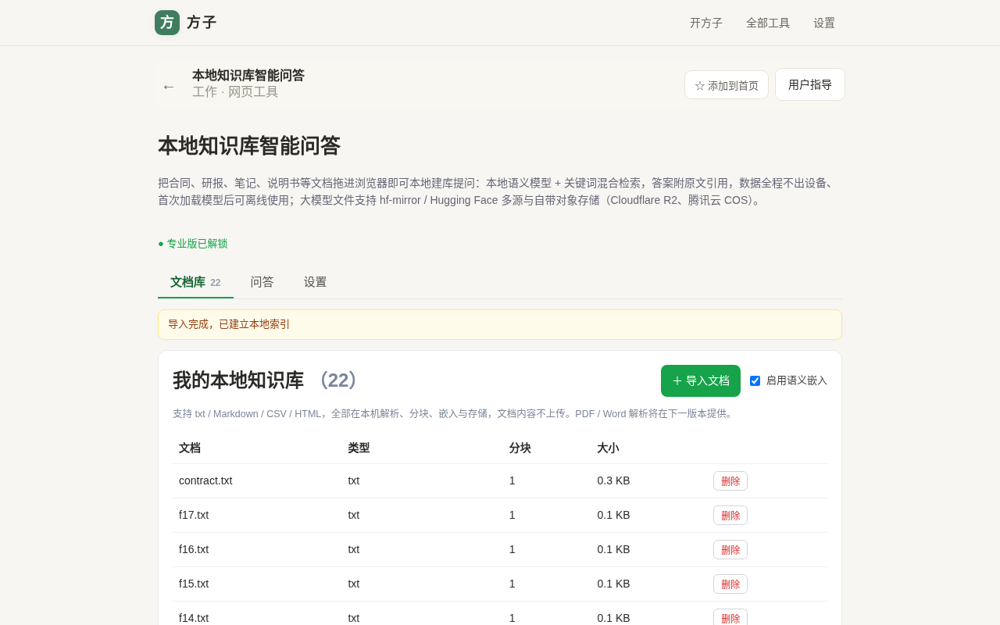
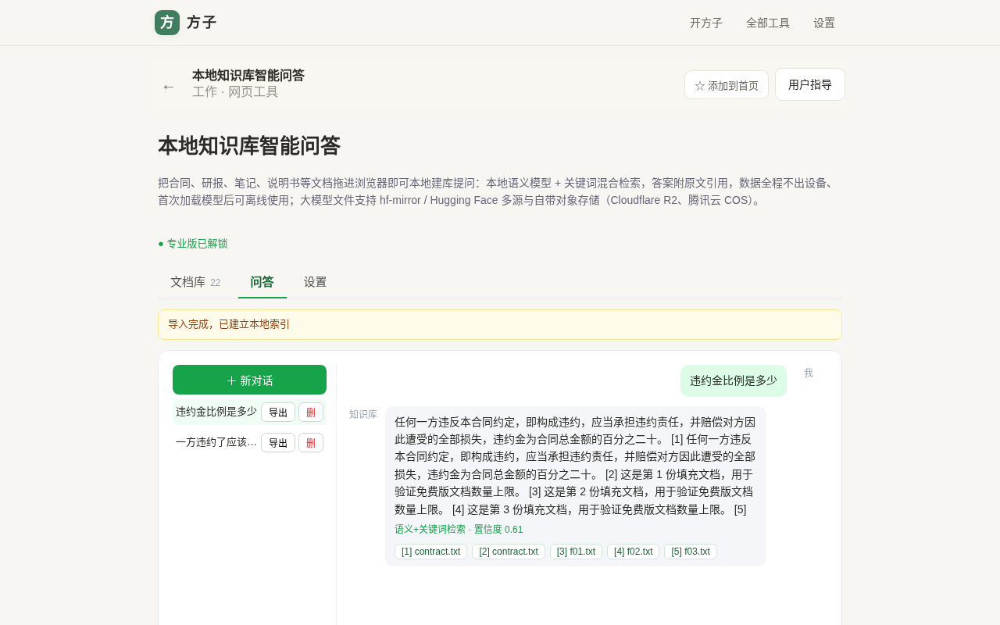
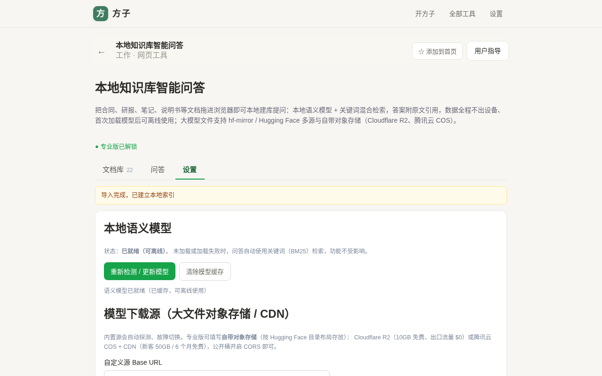
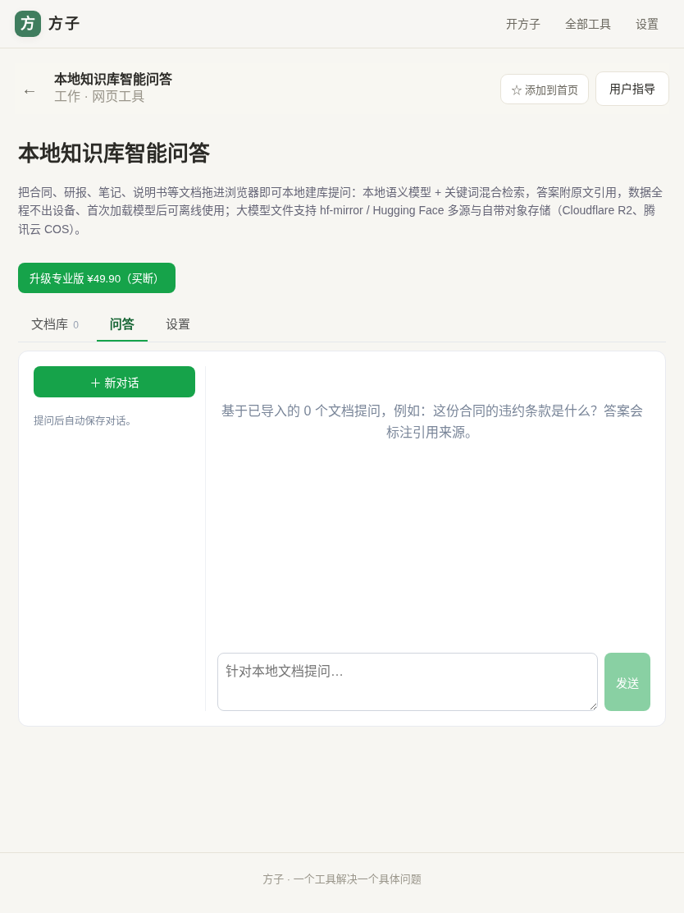
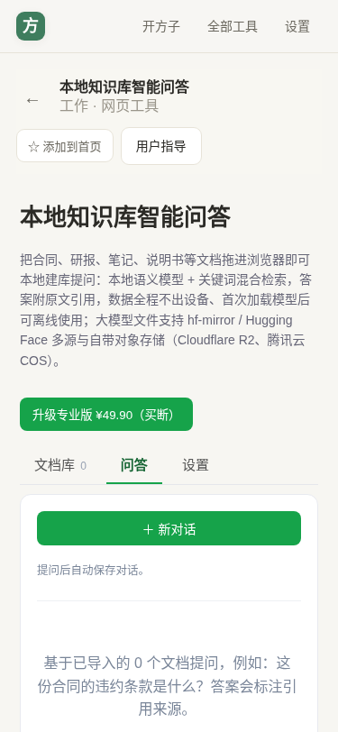

# 用户使用指导书：本地知识库智能问答

- 对应 dev：dev_003_本地知识库智能问答.md
- 日期：2026-10-15
- 版本：v1.0.0（H 档，本期为可运行 checkpoint：语义检索已端到端验证）

## 功能简介

把合同、研报、笔记、说明书、数据表等文档直接拖进浏览器，在本机完成解析、分块、语义嵌入与索引，随后像聊天一样对自己的资料提问。系统用「本地语义向量 + 关键词（BM25）」混合检索，答案直接引用原文片段并可点开核对，**文档、向量、对话全程留在你的设备上，不上传任何服务器**；语义模型首次下载缓存后即可离线使用，大模型文件支持多个公共镜像以及你自带的对象存储 / CDN。

## 运行环境要求

- 现代浏览器：Chrome / Edge 109+、Safari 16+、Firefox 较新版本（需支持 IndexedDB、Cache Storage、WebAssembly SIMD）。
- 首次使用「语义检索」需要联网下载约 24MB 的嵌入模型（bge-small-zh-v1.5 量化版）；之后走本地缓存，可离线。
- 不需要安装任何软件、不需要注册、不需要 API Key；纯前端 PWA，无后端。
- 建议单次导入文档为纯文本类文件；超大文件请先拆分（本期单文件建议 5MB 以内）。

## 安装与启动

- 在线打开方子 PWA，进入「工作」分类，选择「本地知识库智能问答」；路由 `/#/t/local-knowledge-base`。
- 可在浏览器菜单选择「安装应用 / 添加到主屏幕」，作为 PWA 离线使用。
- 无需配置即可使用关键词检索；语义模型在你首次勾选「启用语义嵌入」或在设置页点击下载时自动准备。

## 使用说明

### 1. 导入文档建立本地知识库

进入「文档库」，点击「＋ 导入文档」，可多选 `.txt / .md / .csv / .html / .htm` 文件。导入时会依次完成解析、智能分块、（可选）语义嵌入与本地保存，顶部进度条显示当前阶段；模型下载阶段会显示下载百分比。

- 勾选「启用语义嵌入」：导入时用本地模型生成向量，检索更懂「换个说法」的问法。
- 不勾选：只用关键词（BM25）建库，**零下载、立即可用**，适合先体验或弱网环境。
- 免费版最多 20 个文档；专业版不限数量并支持批量导入更大知识库。

### 2. 对文档提问并核对引用

切到「问答」，在底部输入框提问（回车或点「发送」）。答案从最相关的原文片段中抽取句子组成，每句末尾带 `[n]` 角标，下方列出对应来源文件。

- 答案下方标注当前使用的是「语义+关键词检索」还是「关键词检索」，以及置信度。
- 点击来源按钮（如 `[1] contract.txt`）弹出该片段**原文**，可逐字核对答案出处后再决定是否采纳。
- 提问会自动保存为对话，左侧可切换历史对话、一键「导出」为 Markdown。

### 3. 准备 / 管理语义模型与下载源

在「设置」页查看模型状态，点击按钮即可探测最快下载源并下载、初始化模型；模型存于浏览器 Cache Storage，二次使用离线可跑，也可「清除模型缓存」后重新下载。

模型下载源按优先级自动探测、故障切换：

1. **自定义对象存储 / CDN（专业版）**：按 Hugging Face 目录布局存放模型文件，填 Base URL 即可。推荐 Cloudflare R2（10GB 存储免费、出口流量 $0）或腾讯云 COS + CDN（新客 50GB / 6 个月免费），公开桶开启 CORS。
2. **hf-mirror.com**：国内镜像，默认优先。
3. **huggingface.co**：官方源兜底。

### 4. 平板与手机

界面为响应式三栏降单栏布局，手机上对话、文档库、设置均可正常操作，无横向溢出。

## 常见问题（FAQ）

- **问：文档会上传到云端吗？**
  不会。解析、嵌入、存储全部在浏览器本地完成（IndexedDB + Cache Storage），服务端只在你首次下载公开模型文件时被访问，且不携带你的文档内容。
- **问：不下载模型能用吗？**
  能。关闭「启用语义嵌入」即走纯关键词检索，无需任何下载；语义模型未就绪或失败时也会自动降级为关键词检索，问答不中断。
- **问：第一次点下载提示某个源失败？**
  系统会自动按优先级切换镜像 / 官方源；全部失败时多为临时网络问题，稍后在设置页重试即可，已下载的文件会缓存不重复下载。
- **问：换电脑 / 清浏览器数据后资料还在吗？**
  数据存于本机浏览器，清理站点数据会删除本地知识库与模型缓存；重要资料请保留原文件，可重新导入。
- **问：支持 PDF / Word 吗？**
  本期 checkpoint 支持 txt / Markdown / CSV / HTML；PDF（pdf.js）与 Word（mammoth）解析已列入 V1.1 计划。

## 注意事项

- 本地嵌入模型 `bge-small-zh-v1.5` 为 MIT 许可、可商用；推理运行时 onnxruntime-web 为 MIT。所有模型文件来自公开镜像或你自带的合规对象存储。
- 本期答案为「检索 + 原文抽取合成」，不调用生成式大模型，因此不会编造内容，但也不会做跨段推理式改写；请结合 `[n]` 引用原文判断。
- 免费版 20 个文档上限；自定义模型源、不限文档数为专业版买断功能（¥29.90）。
- EdgeOne Pages 免费额度内：整个站点 dist 约 29MB、71 个文件、单文件最大约 13.6MB，远低于 5GB / 20000 文件 / 25MB 单文件限额。
