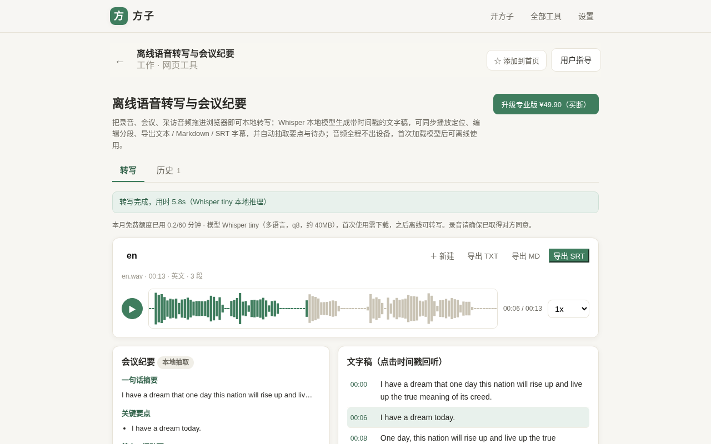
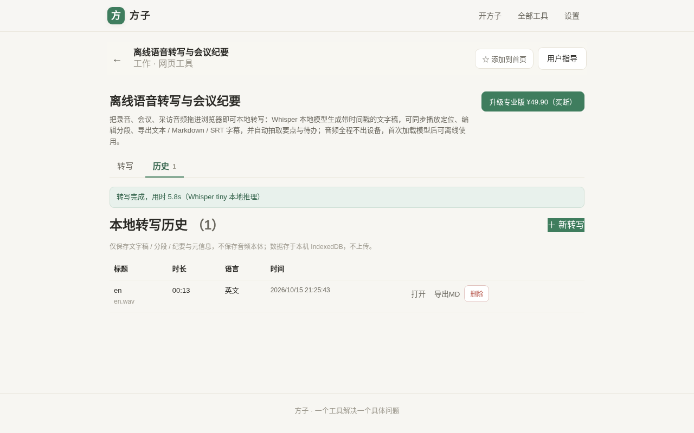
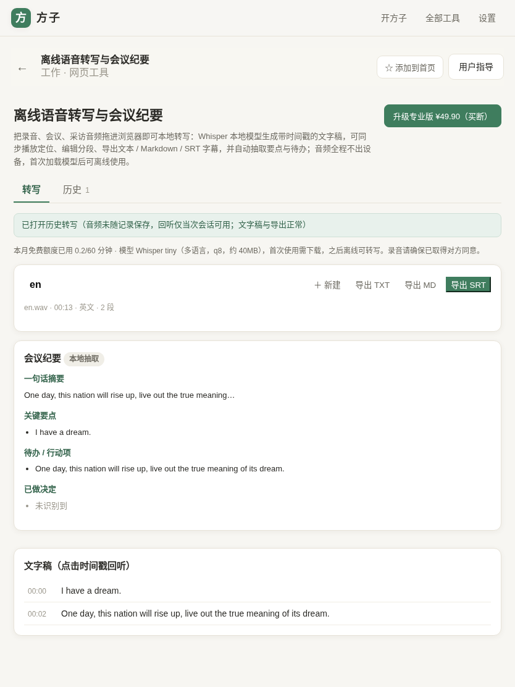
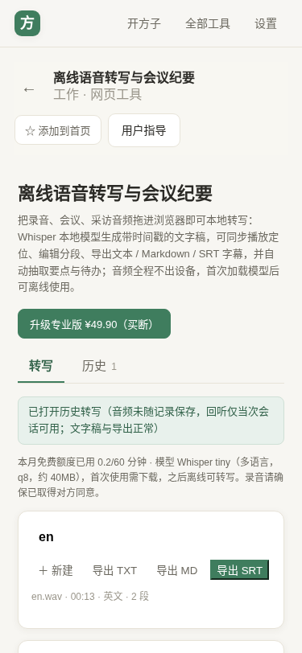

# 用户使用指导书：离线语音转写与会议纪要

- 对应 dev：`docs/stage/dev_004_离线语音转写与会议纪要.md`
- 日期：2026-10-15
- 版本：v1.0.0（beta，H 档首个可运行 checkpoint）
- 工具位置：`src/tools/local-transcribe/`，路由 `/#/t/local-transcribe`，方子第 17 个工具

## 功能简介

把会议、采访、课堂、通话录音拖进浏览器（或直接用麦克风录制），**全程在本机完成语音识别**：生成带时间戳、可点击回听的文字稿，自动抽取会议要点 / 待办 / 决定，并导出文本、Markdown、SRT 字幕。音频与文字稿都不出设备，首次下载模型后可离线转写，无需按分钟为云端服务付费。

## 运行环境要求

- **浏览器**：桌面端 Chrome / Edge 105+、Firefox、Safari 16+；手机 / 平板现代浏览器均可。无需跨域隔离（COOP/COEP）头，未开启多线程时自动回退单线程 WASM。
- **网络**：模型（约 40MB）与推理内核 WASM 均**由方子站点同源自托管**，不依赖 huggingface.co 等境外源，**大陆移动/电信/联通网络与 WiFi 都能直连下载**；仅**首次使用**需联网加载（之后由浏览器/Service Worker 缓存，离线可转写）。
- **存储**：转写历史存于浏览器 IndexedDB（仅文字稿/分段/纪要/元信息，不保存音频本体）；清理浏览器站点数据会同时清空历史。
- **输入格式**：wav / mp3 / m4a / ogg / flac / webm（浏览器原生 `decodeAudioData` 解码，统一重采样到 16kHz 单声道）；麦克风经 MediaRecorder 录制。

## 安装与启动

本工具是方子 PWA 的内置网页工具，无需单独安装：

1. 打开方子站点，进入「全部工具 → 工作 → 离线语音转写与会议纪要」，或直接访问 `/#/t/local-transcribe`。
2. 第一次转写时页面会自动下载模型（可先点「提前下载模型」），下载完成后即可断网使用。
3. 建议在浏览器中「安装应用 / 添加到主屏幕」，以 PWA 方式离线打开。

无任何需要用户填写的配置项；模型源会自动探测可达的 Hugging Face 官方 CDN。

## 使用说明

### 1. 导入音频或麦克风录音

进入工具默认在「转写」页。可点击麦克风直接录音（再次点击停止，可放弃），或点击「选择音频文件」/ 直接把音频拖入虚线框。导入后显示音频时长，并选择语言（英文场景建议手动选 English，避免 tiny 自动检测偏差）。

> 合规提示：录制他人讲话前，请确保已取得对方同意，页面上亦有常驻提醒。

### 2. 开始转写与结果页

点击「开始转写」，进度条显示模型下载 / 推理进度。完成后顶部提示实际推理耗时，右侧出现结果区。

- **文字稿**：按时间戳分段，点任意时间戳即可让播放器跳到该位置回听核对；点文字可就地修改错别字。
- **波形播放器**：Canvas 波形 + 播放/暂停、0.75×–2× 变速、点击波形任意位置跳转；绿色为已播放部分。
- **会议纪要（本地抽取）**：纯规则在本地抽取「一句话摘要 / 关键要点 / 待办行动项 / 已做决定」，不调用任何云端大模型。

### 3. 导出

结果页右上角可导出 **TXT**（纯文字稿）、**Markdown**（含纪要与分段）、**SRT**（带序号与时间轴的字幕文件，可直接用于剪辑软件）。

### 4. 历史记录

顶部「历史」标签列出本机所有转写记录（标题、时长、语言、时间），可「打开」回看文字稿、「导出MD」或「删除」。历史记录不含音频本体，打开后仅展示文字（无波形回听）。

### 5. 平板 / 手机

页面自适应，移动端播放器自动换行、波形占整行，单手可操作；无横向溢出。

## 计费说明

- **免费版**：每自然月 60 分钟本地转写、Whisper tiny 多语模型、麦克风 + 常见音频导入、TXT/MD/SRT 导出、本地历史与抽取式纪要。
- **专业版（买断 ¥29.90）**：转写时长不限，适合长会议 / 批量音频。额度按自然月在本机统计，专业版与买断共享同一套权限校验。

## 常见问题（FAQ）

- **第一次为什么要加载、还比较慢？** 模型约 40MB，仅首次从本站加载（同源直连，国内网络可用）；之后浏览器缓存，断网也能用。
- **英文很准，中文为什么一般？** 当前是 Whisper **tiny** 最小模型，英文近完美、中文可识别但准确率有限。更大的 base/small 模型已列入 V1.1。重要中文录音请结合时间戳回听人工校对。
- **模型加载失败怎么办？** 模型由站点同源提供（不依赖境外网站），一般国内网络即可；若偶发失败请切换网络（WiFi/流量）或稍后点「提前下载模型」重试。极个别企业内网拦截大文件下载时，可换网络加载一次后离线使用。
- **历史会占云空间 / 会泄露吗？** 不会。历史只存在你本机浏览器 IndexedDB，站点没有后端，音频也从不保存或上传。
- **能转视频里的声音吗？** V1 暂不支持直接读视频（需先提取音轨）；ffmpeg.wasm 视频提音轨列 V1.1。

## 注意事项与当前边界（V1 checkpoint 如实声明）

- 模型固定为 Xenova/whisper-tiny 多语 q8，**中文准确率有限**，以英文 / 清晰录音效果最佳。
- 会议纪要为**纯规则抽取式**（基于句式 / 关键词），不是生成式 AI 摘要，不会编造内容，但也不会改写润色。
- 无跨域隔离头时使用**单线程 WASM**，长音频推理速度一般；解码依赖浏览器能力，极少数特殊编码可能无法解码。
- V1.1 规划（本次未实现，不留半成品）：Qwen2.5 本地生成式纪要、whisper-base/small 模型、说话人分离、ffmpeg.wasm 视频提音轨、术语 initial_prompt、批量队列。
- 麦克风录音功能在自动化无头环境未模拟，已在 postmortem 列为建议真机人工复测项。
