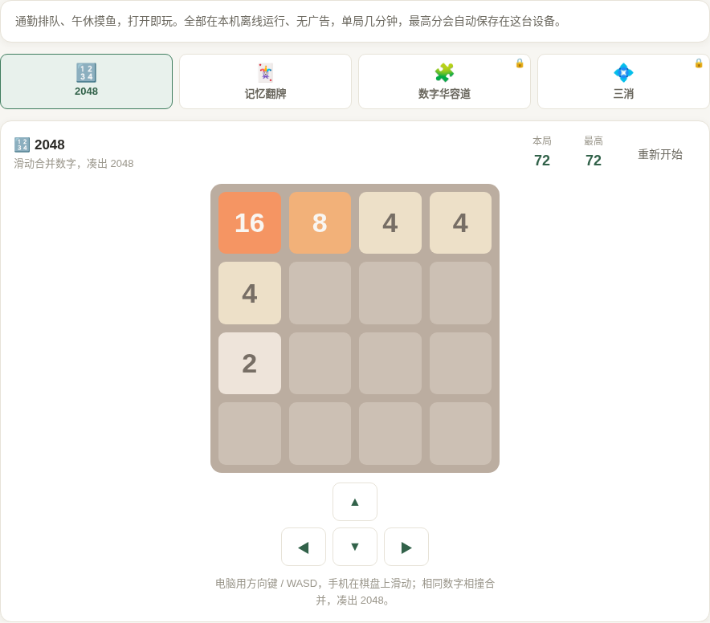
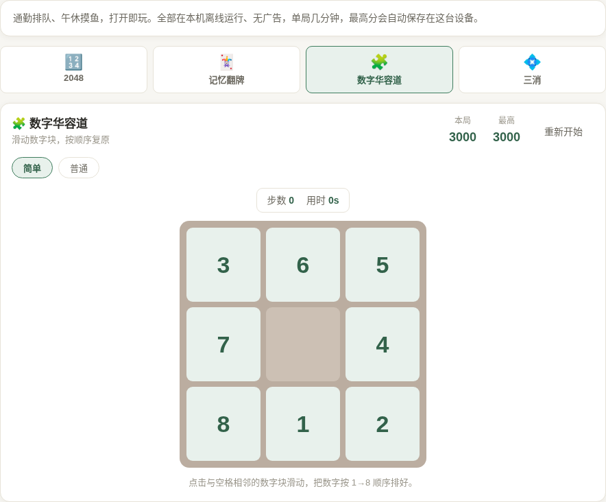
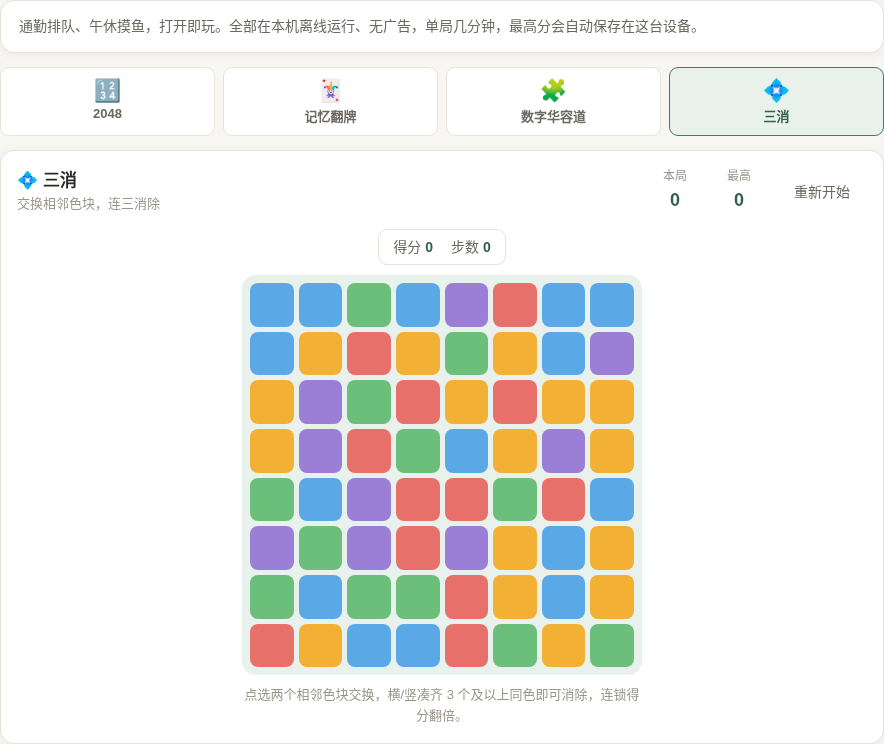
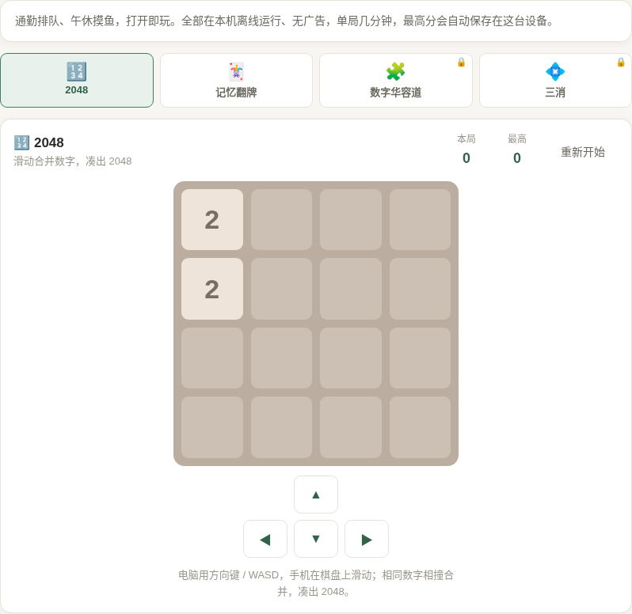
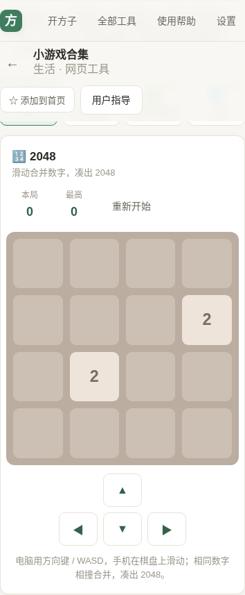

# 用户使用指导书：小游戏合集

- 对应 dev：dev_001_网页小游戏合集.md
- 日期：2026-10-17
- 版本：v1.0.0
- 工具入口：方子首页搜索「小游戏 / 打发时间 / 摸鱼 / 2048 / 翻牌 / 华容道 / 消消乐」，或「全部工具 → 生活 → 小游戏合集」

## 功能简介

通勤排队、午休摸鱼时打开即玩的轻量益智小游戏合集。首批内置 4 款经典玩法，全部纯前端、离线运行、无广告、无诱导，单局几分钟，最高分按「游戏 + 难度」自动保存在本机。

## 运行环境要求

- 任意现代浏览器：Chrome / Edge / Firefox / Safari（含手机端）。
- 无需注册、无需联网（安装为 PWA 并加载过一次后可离线打开）。
- 最高分依赖浏览器 IndexedDB；隐私模式下可正常玩，但分数可能不持久化。

## 安装与启动

无需安装。在方子首页搜索「小游戏」进入本工具，点击顶部标签即可切换游戏；也可点工具页右上角「☆ 添加到首页」固定到方子首页。

## 使用说明

### 2048（免费）

- 电脑：方向键或 `W/A/S/D`，也可点击屏幕上的方向按钮；手机：在棋盘上上下左右滑动。
- 相同数字相撞合并并累加得分，目标是凑出 2048。
- 棋盘填满且无法再合并时本局结束，可点「再来一局」。

### 记忆翻牌（免费，三档难度）

- 每次点开两张牌，图案相同则配对成功并常亮，不同则短暂展示后盖回。
- 顶部「简单 / 普通 / 困难」分别为 6 / 8 / 12 对；步数越少、用时越短，分数越高。

### 数字华容道（专业版，3×3 / 4×4）

未升级时显示付费墙：

升级后可玩，点击与空格相邻的数字块滑动，把数字按 1→n 顺序复原：

### 三消（专业版）

点选两个相邻色块交换，横或竖凑齐 3 个以上同色即消除；自动连续消除形成连锁，得分翻倍。没有可走的步时自动洗牌。

### 平板与手机

自适应布局，手机端标签、棋盘、按钮均可触控操作，无横向滚动。

## 常见问题（FAQ）

- **打不开 / 黑屏？** 使用较新的浏览器；本工具为纯网页，无需安装任何东西。
- **最高分不见了？** 分数只存在当前浏览器本地，换设备/浏览器或清理站点数据不会同步。
- **付费后换设备还有吗？** 当前为本地模拟下单（LocalMock），权益跟随当前浏览器；正式支付网关上线后以账号/服务端权益为准。
- **离线能玩吗？** 作为方子 PWA 的一部分，加载过一次后即可离线游玩。

## 注意事项

- 请适度放松、合理安排时间。
- 游戏不收集、不上传任何个人数据；无第三方素材与第三方脚本。
