# 用户使用指导书：炫酷全屏沉浸小游戏（炫光 NEON 系列）

- 对应 dev：`dev_007_炫酷全屏沉浸小游戏.md`
- 所属工具：小游戏合集 `mini-games`（对原工具的重构升级，非新增并列工具）
- 日期：2026-10-19
- 版本：v1.2.0（M2 里程碑：两款 GPU 游戏上线 + 手势修复 + 屏幕常亮 + 特效档位）

## 功能简介

在原有「2048 / 记忆翻牌 / 数字华容道 / 三消」之上，小游戏合集新增 **炫光 NEON** 系列：用 GPU 实时渲染霓虹粒子、辉光、震屏，并配合程序化合成音效与触感振动，带来**全屏、零干扰**的游戏沉浸感。点进任意游戏即进入专注全屏，画面里**只保留游戏本身 + 极简分数与一个控制钮**，不展示任何与游戏无关的信息。设备不支持高端渲染时自动、无感地逐级降级（WebGL2 → Canvas2D），低端机也能流畅可玩。

本系列**完全本地运行、没有任何服务器后端**：粒子与音效全部由代码实时生成，不下载素材、不联网、不上传任何数据。代码里的“渲染后端”指的是本机的 WebGL2 / Canvas2D 图形渲染器，不是网络服务器。

目前炫光 NEON 共三款：

| 游戏 | 免费/专业版 | 玩法 |
| --- | --- | --- |
| ✨ 炫光连消 Glow Match | 免费 | 点选或滑动交换宝石，三连消除、连锁全屏爆炸 |
| 🎵 霓虹脉冲 Neon Pulse | 专业版 | 三轨下落节奏，在判定线点中光拍、连击爆分 |
| 🌠 星轨穿梭 Orbit Surge | 专业版 | 按住拖动光体，穿越不断加速的粒子光障、生存计分 |

## 运行环境要求

- 任意现代浏览器：Chrome / Edge / Firefox / Safari（桌面与移动端均可）。
- 推荐支持 WebGL2 的设备获得完整辉光；不支持时自动降级 Canvas2D，玩法与计分不受影响。
- 无需联网即可游玩（炫光游戏代码已进入 PWA 预缓存）；音效与振动为设备本地能力。
- 已安装为 PWA 后，游戏内可请求系统全屏（由点击手势触发，被浏览器拒绝时仍保留应用内全屏沉浸）。
- 游戏进行中会请求**屏幕常亮（Wake Lock）**，避免玩到一半自动锁屏；不支持的浏览器会静默跳过。

## 安装与启动

1. 打开方子 → 全部工具 → 生活 → **小游戏合集**（路由 `#/t/mini-games`）。
2. 在「炫光 NEON · GPU 粒子全屏」分区点击想玩的游戏：炫光连消免费即玩；霓虹脉冲、星轨穿梭为专业版。
3. 无需安装任何素材：粒子、光障与音效全部由代码实时生成，零图片/音频文件。

## 使用说明

### 1. 选游戏页

分为「经典益智」与「炫光 NEON」两区。炫光连消带“免费”角标；霓虹脉冲、星轨穿梭带“🔒 专业版”角标，点击未购买时弹出买断付费墙。

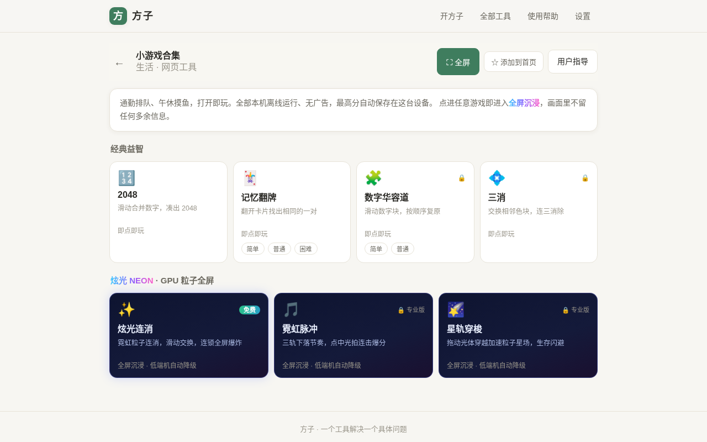

### 2. 进入全屏沉浸

点击游戏后进入 **FocusStage 专注层**：纯黑底铺满整屏（含移动端安全区避让），屏幕上只有：

- 左上角：当前分数（部分游戏有“×N 连击”）；
- 右上角：一个半透明小控制钮 ❚❚；
- 中央：游戏画面与下层全屏粒子画布。

应用顶栏、底部 Tab、返回条、说明文字等全部隐藏，不占游戏空间。游戏进行期间自动保持屏幕常亮。

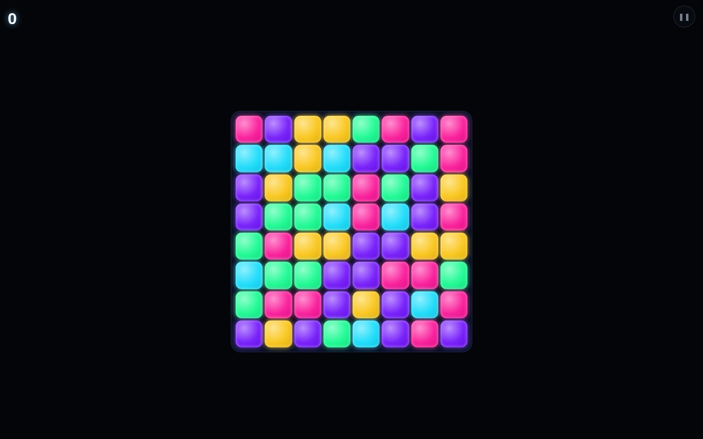

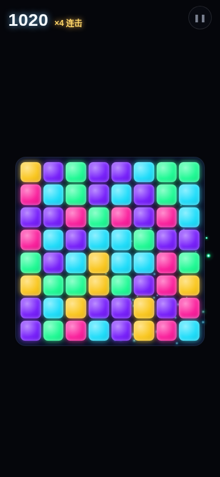

### 3. 玩法

**✨ 炫光连消（免费）**，两种手势都可以：

- **点选**：点第一颗宝石高亮，再点与它相邻的一颗即可交换；再点同一颗或空白处取消选择；点到非相邻格会改为选中新格。
- **短滑 / 拖拽**：在宝石上按住并朝上下左右滑动超过一小段距离，立即与该方向相邻格交换。
- 形成横/竖三连及以上即消除并下落补充，得分 = 消除数 × 20，连锁波次加权；被消除格位爆发对应色相的霓虹粒子，连锁越高震屏与音效越强。不构成三连的交换原地弹回、不扣分；无解时自动洗牌。
- **重要**：轻点/滑动棋盘都只用于游戏操作，**不会**再误弹暂停菜单；暂停菜单只能由右上角 ❚❚ 按钮打开。

**🎵 霓虹脉冲（专业版）**：三条光轨不断下落音符，在判定线处**点击/触摸对应轨道**击中光拍。正中为“完美”（100 分）、稍偏为“良好”（60 分），连击越高每击加分越多；空点不扣分。漏掉 3 个音符本局结束，可一键“再来一首”。速度随时间逐渐加快。

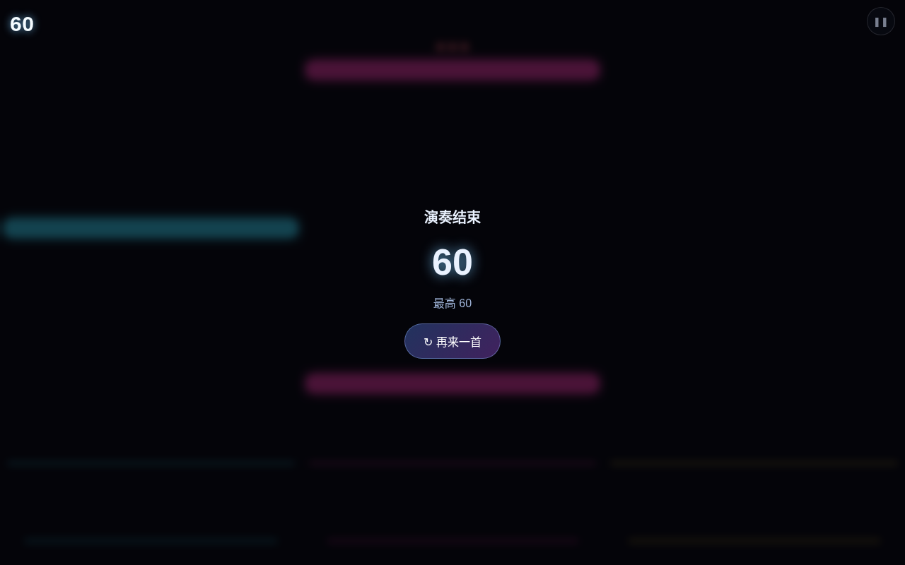

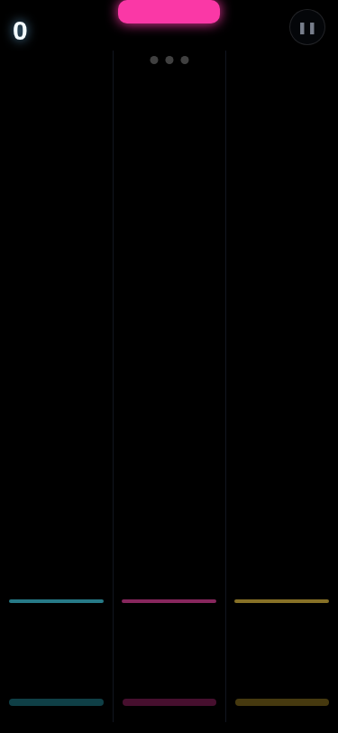

**🌠 星轨穿梭（专业版）**：在屏幕任意位置**按住并左右拖动**，蓝色光体横向跟随手指，躲避自上而下的粉色光障。坚持越久得分越高（每秒 100 分），障碍速度与密度随时间提升；撞到光障本局结束，可“再来一局”。

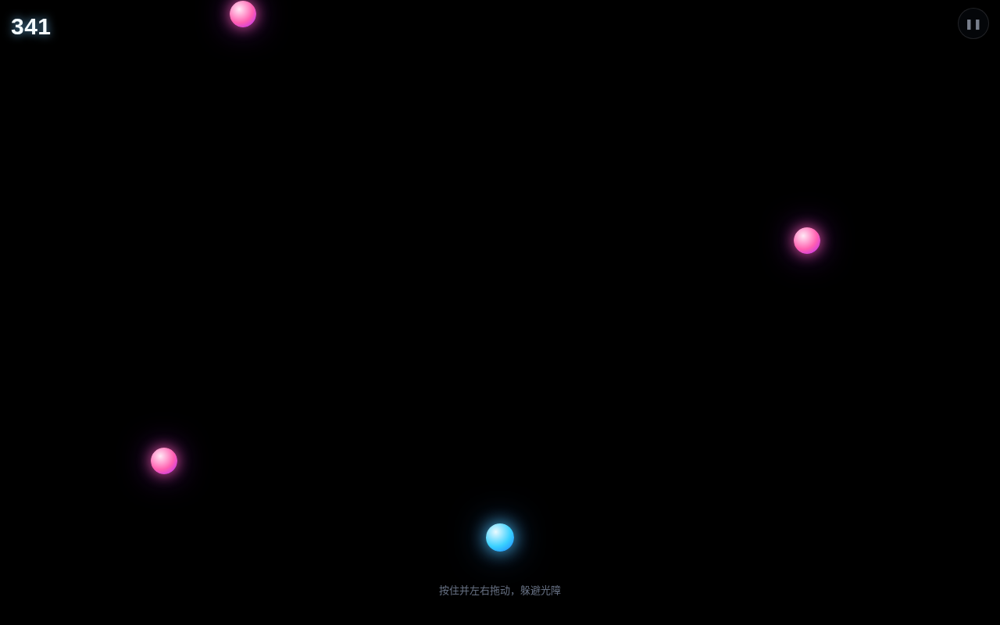

### 4. 控制浮层（暂停 / 继续 / 重开 / 特效 / 音效 / 退出）

点右上角 ❚❚ 唤出居中浮层，可：暂停/继续、重新开始、切换**特效档位**（自动 / 高（更炫）/ 低（省电），GPU 游戏即时生效）、开关音效、退出游戏。暂停时会释放屏幕常亮，继续后自动重新申请。

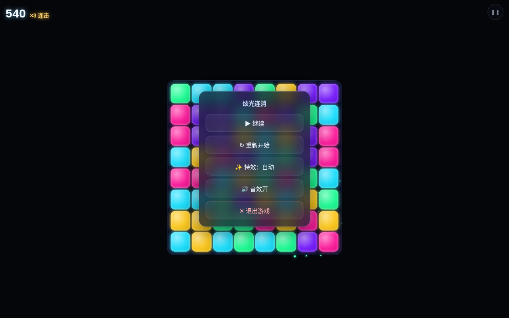

退出后回到选游戏页，最高分会自动保存到本机（IndexedDB），并在选游戏卡片上显示。

### 5. 专业版游戏与付费墙

免费即可玩 2048、记忆翻牌、炫光连消。一次买断专业版（¥19.90，本版未调价）解锁数字华容道、三消以及霓虹脉冲、星轨穿梭等 GPU 炫光游戏，后续持续加入，无广告。

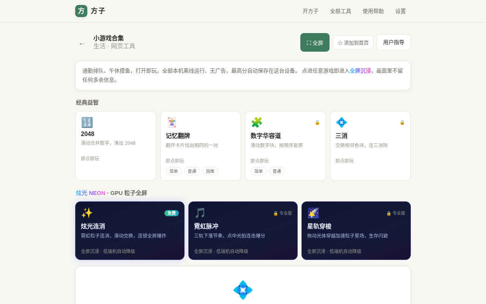

已购后进入专业版 DOM 游戏（如三消）时同样全屏沉浸，但不会重复显示 GPU 分数 HUD，避免与游戏自带记分重复。

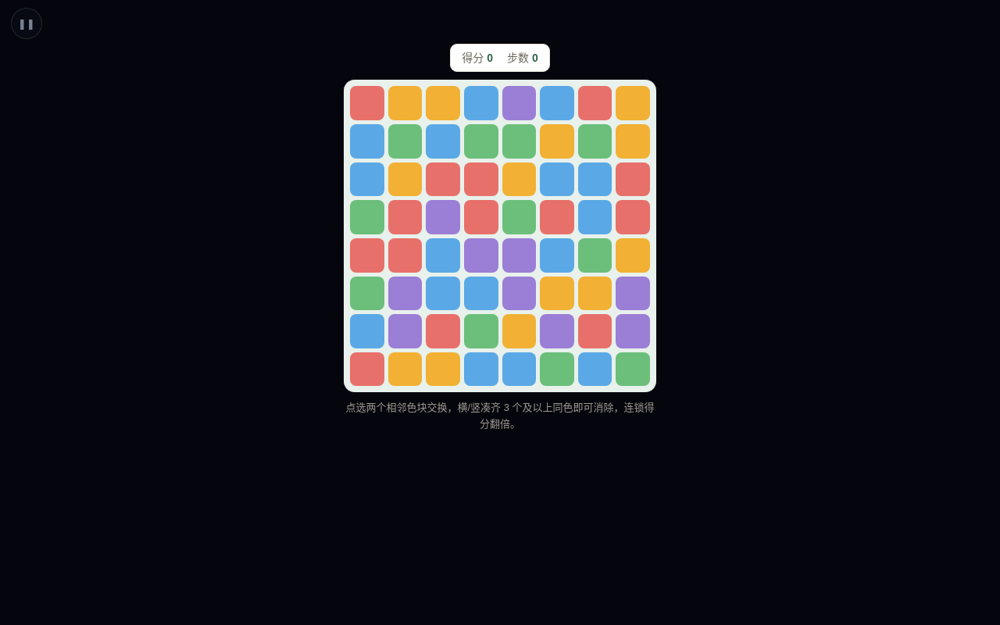

### 6. 平板与手机自适应

各游戏按视口自适应、控制钮与浮层避让刘海 / Home 指示条，三档视口（PC 1280、平板 834、手机 375）均无横向溢出；节奏轨道与闪避操作区铺满全屏，触摸目标足够大、支持单手拇指点按。

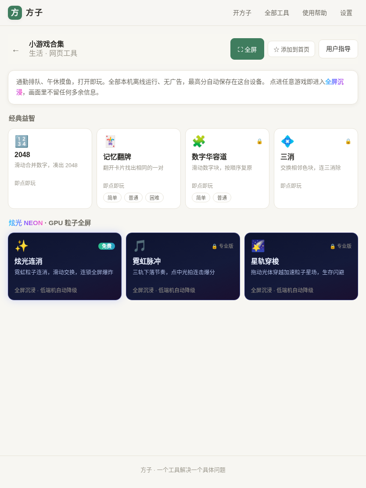

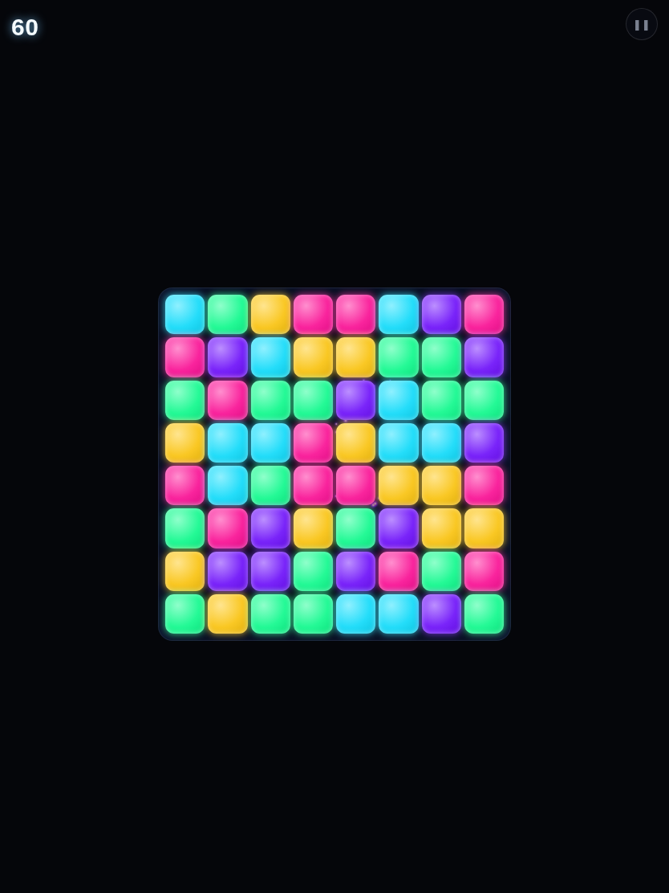

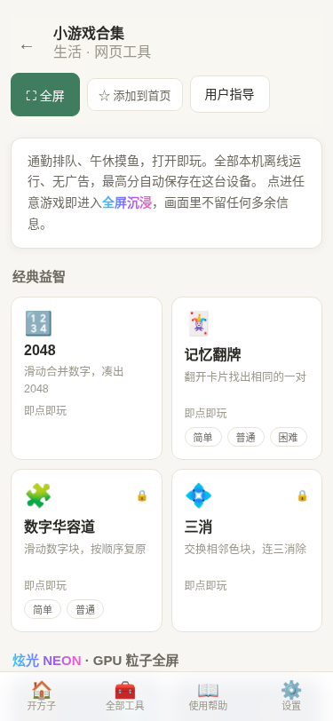

## 常见问题（FAQ）

- **游戏需要联网 / 后端吗？** 不需要。三款炫光游戏全程本地运算与渲染，没有任何网络请求、没有服务器；所谓“渲染后端”只是本机的 WebGL2 / Canvas2D 图形引擎。
- **为什么没有粒子辉光、画面更朴素？** 设备浏览器未提供 WebGL2 或其初始化失败，引擎自动降级到 Canvas2D 兼容渲染，玩法、计分、音效完全一致，属于预期保护。
- **玩炫光连消一点屏幕就弹暂停？** 已修复。现在轻点是“选中宝石”、滑动是“交换”，暂停只能点右上角 ❚❚；若你之前安装过旧版，刷新 / 等 PWA 更新到最新即可。
- **进入游戏没有声音？** 浏览器要求先有用户手势才允许出声，在画面上点一下即可解锁；也可用控制浮层的音效开关检查（偏好会被记住）。
- **会很耗电 / 卡顿吗？** 引擎按设备核数、内存、DPR 选择粒子规模，并在连续低帧率（低于约 45fps）时自动按“辉光 → 分辨率 → 粒子数”逐级降档；也可在控制浮层手动把特效设为“低（省电）”。切到后台自动暂停 RAF 并释放屏幕常亮，不耗电。
- **分数会丢吗？** 不会。沿用本机库 `fz-mini-games-v1`，设置仅新增可选字段，历史最高分零迁移保留。
- **玩久了会自动锁屏吗？** 支持 Wake Lock 的浏览器在游戏中会保持常亮；退出、暂停或切到后台时自动恢复系统锁屏策略。

## 注意事项

- 当前图形渲染链为 WebGL2 → Canvas2D（均为本地渲染器）；WebGPU/WGSL 原生后端为后续规划项，不影响当前完整观感与玩法。
- 屏幕常亮依赖浏览器 `navigator.wakeLock` 能力与页面可见状态；个别浏览器或非安全上下文可能不提供，属正常策略，不影响游玩。
- 系统全屏由点击手势触发，个别浏览器可能不授予，属正常策略，不影响应用内全屏沉浸与游玩。
