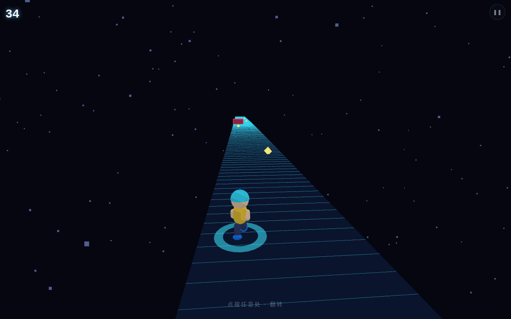
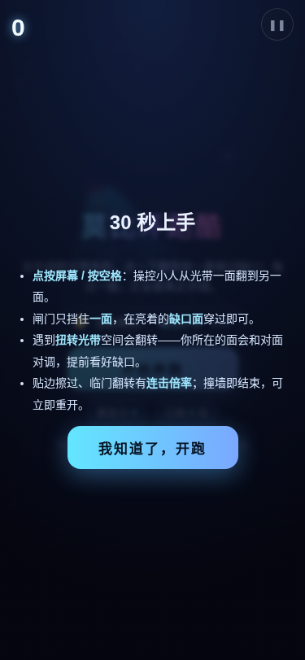
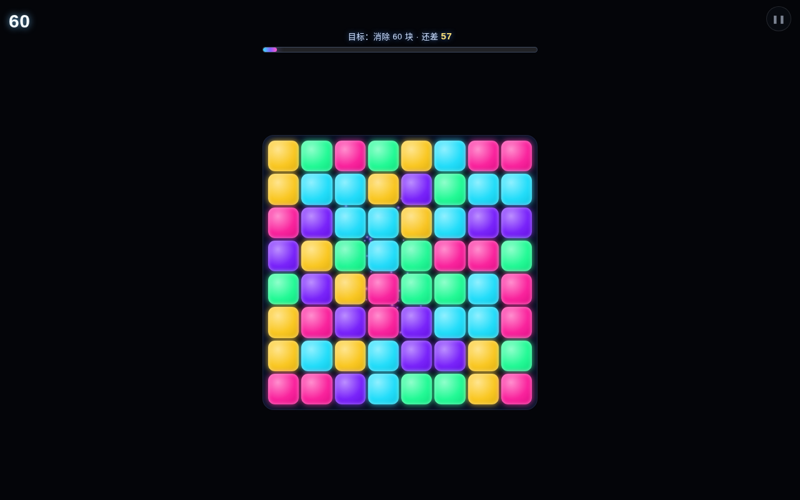
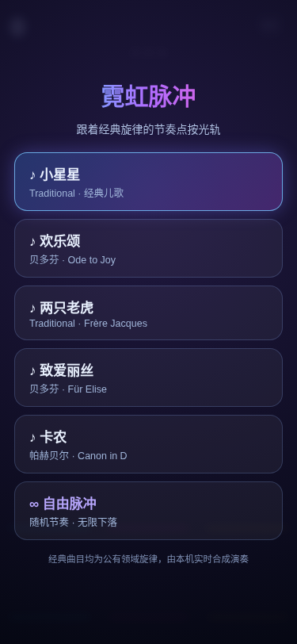
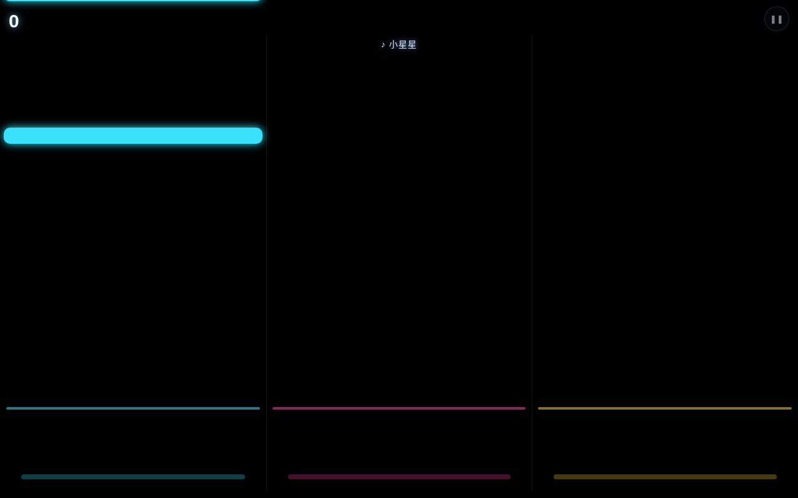
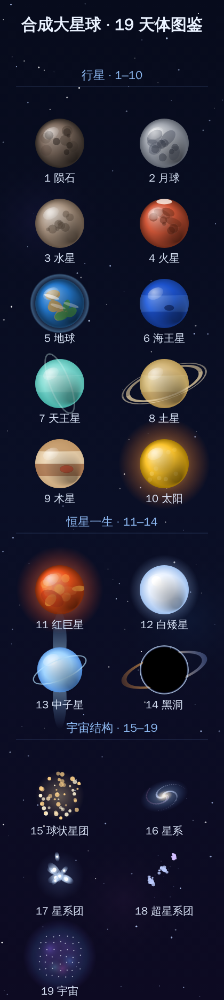

# 用户使用指导书：炫酷全屏沉浸小游戏（炫光 NEON 系列）

- 对应 dev：`dev_007_炫酷全屏沉浸小游戏.md`
- 所属工具：小游戏合集 `mini-games`（对原工具的重构升级，非新增并列工具）
- 日期：2026-10-20
- 版本：v1.4.0（莫比环跑酷角色美化 + 约 45° 俯瞰追尾解决视线遮挡；炫光连消加入 60 块目标与结束点、强化消除冲击；霓虹脉冲融入公有领域经典旋律选曲）

## 功能简介

在「2048 / 记忆翻牌 / 数字华容道」等经典益智游戏之外，小游戏合集新增 **炫光 NEON** 系列：用 GPU 实时渲染霓虹粒子、辉光、震屏，并配合程序化合成音效与触感振动，带来**全屏、零干扰**的游戏沉浸感。点进任意游戏即进入专注全屏，画面里**只保留游戏本身 + 极简分数与一个控制钮**，不展示任何与游戏无关的信息。设备不支持高端渲染时自动、无感地逐级降级（WebGL2 → Canvas2D），低端机也能流畅可玩。

> M3 更新：早期经典区曾有一款「三消」，因与免费的炫光连消玩法重复，已下线，连消类体验统一由炫光连消承接；两个分区的小游戏卡片也统一为同一视觉风格（白底卡片 + 免费 / 🔒专业版 / ✓已解锁徽标）。

本系列**完全本地运行、没有任何服务器后端**：粒子与音效全部由代码实时生成，不下载素材、不联网、不上传任何数据。代码里的“渲染后端”指的是本机的 WebGL2 / Canvas2D 图形渲染器，不是网络服务器。

目前炫光 NEON 共四款：

| 游戏 | 免费/专业版 | 玩法 |
| --- | --- | --- |
| 🌀 莫比环跑酷 Mobius Runner | 免费 | Three.js 3D 莫比乌斯光带跑酷，Q 版卡通小人一指翻转、收集宝石躲避光障 |
| ✨ 炫光连消 Glow Match | 免费 | 点选或滑动交换宝石，三连消除、连锁全屏爆炸，60 块达成通关 |
| 🎵 霓虹脉冲 Neon Pulse | 专业版 | 跟着经典旋律的三轨节奏光轨，点中光拍即奏响该音符 |
| 🌠 星轨穿梭 Orbit Surge | 专业版 | 按住拖动光体，穿越不断加速的粒子光障、生存计分 |

> v1.4 更新：①莫比环跑酷主角由简单方块升级为带大眼睛、腮红、圆头鞋的 **Q 版三渲二卡通小人**（5 款原创造型可选），镜头抬升为**约 45° 俯瞰追尾**，小人落在画面下方，前方整条光带、宝石与障碍一览无余，不再遮挡视线；②炫光连消不再"永无止境"，设**消除 60 块**的通关目标，顶部实时显示"还差 N 块"与进度条，消除时加入格位扩散爆圈、全屏闪光与更强震屏，达成后弹出通关结算；③霓虹脉冲新增**选曲页**，可跟随《小星星》《两只老虎》《欢乐颂》《致爱丽丝》《卡农》等**公有领域经典旋律**的节奏游玩（本机实时合成，无任何版权录音），命中音符即奏响对应音高，演奏完整曲即通关，另保留"自由脉冲"随机模式。

## 运行环境要求

- 任意现代浏览器：Chrome / Edge / Firefox / Safari（桌面与移动端均可）。
- 推荐支持 WebGL2 的设备获得完整辉光；不支持时自动降级 Canvas2D，玩法与计分不受影响。
- 无需联网即可游玩（炫光游戏代码已进入 PWA 预缓存）；音效与振动为设备本地能力。
- 已安装为 PWA 后，游戏内可请求系统全屏（由点击手势触发，被浏览器拒绝时仍保留应用内全屏沉浸）。
- 游戏进行中会请求**屏幕常亮（Wake Lock）**，避免玩到一半自动锁屏；不支持的浏览器会静默跳过。

## 安装与启动

1. 打开方子 → 全部工具 → 生活 → **小游戏合集**（路由 `#/t/mini-games`）。
2. 在「炫光 NEON · GPU 粒子全屏」分区点击想玩的游戏：炫光连消免费即玩；霓虹脉冲、星轨穿梭为专业版。
3. 无需安装任何素材：粒子、光障与音效全部由代码实时生成，零图片/音频文件。

## 使用说明

### 1. 选游戏页

分为「经典益智」与「炫光 NEON」两区。炫光连消带“免费”角标；霓虹脉冲、星轨穿梭带“🔒 专业版”角标，点击未购买时弹出买断付费墙。

### 2. 进入全屏沉浸

点击游戏后进入 **FocusStage 专注层**：纯黑底铺满整屏（含移动端安全区避让），屏幕上只有：

- 左上角：当前分数（部分游戏有“×N 连击”）；
- 右上角：一个半透明小控制钮 ❚❚；
- 中央：游戏画面与下层全屏粒子画布。

应用顶栏、底部 Tab、返回条、说明文字等全部隐藏，不占游戏空间。游戏进行期间自动保持屏幕常亮。

### 3. 玩法

**🌀 莫比环跑酷（免费，Three.js 3D）**：在一条无限扭转的莫比乌斯霓虹光带上奔跑，**点按屏幕任意处**让小人翻转到光带另一侧，收集沿途黄色宝石、躲避红色光障。主角为 Q 版三渲二卡通小人（电光小子/棉花兔/薄荷猫等造型，部分为专业版），奔跑时四肢摆动、跳跃与前空翻。镜头为约 45° 俯瞰追尾，小人始终在画面下方，前方整条光带、宝石与障碍清晰可见。支持越久越快的节奏，坚持/收集越多分越高，撞到光障本局结束可重开。

**✨ 炫光连消（免费）**，两种手势都可以：

- **点选**：点第一颗宝石高亮，再点与它相邻的一颗即可交换；再点同一颗或空白处取消选择；点到非相邻格会改为选中新格。
- **短滑 / 拖拽**：在宝石上按住并朝上下左右滑动超过一小段距离，立即与该方向相邻格交换。
- 形成横/竖三连及以上即消除并下落补充，得分 = 消除数 × 20，连锁波次加权。
- **通关目标**：每局目标是**消除 60 块**宝石。屏幕顶部实时显示"目标：消除 60 块 · 还差 N"和一条渐变进度条；每次消除会在格位炸开扩散光环、点亮全屏闪光并震屏，连锁时棋盘中心还有更大爆发。**累计消除满 60 块即通关**，弹出显示总分的结算卡，可"↻ 再来一局"；过程不再无限延续。不构成三连的交换原地弹回、不扣分；无解时自动洗牌。
- **重要**：轻点/滑动棋盘都只用于游戏操作，**不会**再误弹暂停菜单；暂停菜单只能由右上角 ❚❚ 按钮打开。

**🎵 霓虹脉冲（专业版）**：进入后先在**选曲页**挑一首——儿歌《小星星》《两只老虎》、古典《欢乐颂》《致爱丽丝》《卡农》（旋律均为公有领域，由本机 Web Audio 实时合成，不内置任何受版权保护的录音），或选"∞ 自由脉冲"回到经典随机模式。选曲后，音符严格按该旋律的**音高（映射到三条光轨）与节奏**下落：在判定线处**点击/触摸对应轨道**击中光拍，**命中即奏响这一音符**，连击整首旋律等于你亲手把曲子弹奏出来。正中为"完美"（100 分）、稍偏为"良好"（60 分），空点不扣分。经典旋律模式允许带着少量漏击把整曲演奏完，**完整演奏即通关**；自由脉冲模式仍为漏掉 3 个音符结束。结算页可"↻ 再来一首"或"♫ 换一首"。

**🌠 星轨穿梭（专业版）**：在屏幕任意位置**按住并左右拖动**，蓝色光体横向跟随手指，躲避自上而下的粉色光障。坚持越久得分越高（每秒 100 分），障碍速度与密度随时间提升；撞到光障本局结束，可“再来一局”。

**🪐 合成宇宙（免费，matter.js 真实物理）**：待投球固定在顶部安全区窄滑轨上，手指在顶部横条（或屏幕任意处）水平拖动改瞄准 X，半透明引导线标出落点列，松手即投；**左右可全宽贴边投放**（无"下一个"预告胶囊，左上分数以半透明衬底浮于上层，不缩减可投范围）。两颗同级天体接触即合成上一级，共 19 级：陨石→月球→水星→火星→地球→海王星→天王星→土星→木星→太阳→红巨星→白矮星→中子星→黑洞→球状星团→星系→星系团→超星系团→宇宙；连锁有连击加分，**合成宇宙即通关**。顶部投放池随你的进度动态扩大：开局只掉陨石，随着你合成出更高级天体，顶部可直接掉落的天体逐步上移（约每推进 2–3 级抬 1 级上沿），低级仍常见，既保留低级合成乐趣又不会让后期从最低级一颗颗堆起；星球越过红色警戒线并持续约 1.75 秒才判负（瞬时擦过不算）。在暂停菜单「重力感应」开关中开启后，左右倾斜手机（gamma）让落底星球向低侧缓慢滚动、回正后停下（iOS 13+ 首次在菜单开关手势内请求授权，拒绝/不支持/非 HTTPS 静默回退垂直重力）；PC 无传感器，用 `A/D` 键模拟同样的横向倾斜。

**存档 / 读档 / 重开**：暂停面板提供「💾 存档（覆盖旧档）」与「📂 读取存档（含存档时间）」，单槽覆盖并显示存档时间；选卡页检测到有效存档时出现「▶ 继续游戏（存档于 MM-DD HH:mm）」，刷新或关掉页面后下次可从存档继续，完整恢复局面、分数与当前待投球。「↻ 重新开始 / 再来一局」只清空当前局，**不会删除手动存档**，直到再次「存档」才覆盖；存档与本机最高分完全独立、互不影响。

下面是游戏内全部 19 个天体的进化图鉴（手机竖版长图，可保存查看）：同级两个天体碰撞合成下一级，从陨石逐级进化，合成『宇宙』即通关。顶部投放池随进度动态扩大（开局只掉陨石，越往后越能直接掉落更高级天体），首通约 25–30 分钟。

行星 1–10 ｜ 恒星一生 11–14 ｜ 宇宙结构 15–19

### 4. 控制浮层（暂停 / 继续 / 重开 / 特效 / 音效 / 退出）

点右上角 ❚❚ 唤出居中浮层，可：暂停/继续、重新开始、切换**特效档位**（自动 / 高（更炫）/ 低（省电），GPU 游戏即时生效）、开关音效、退出游戏。暂停时会释放屏幕常亮，继续后自动重新申请。

退出后回到选游戏页，最高分会自动保存到本机（IndexedDB），并在选游戏卡片上显示。

### 5. 专业版游戏与付费墙

免费即可玩 2048、记忆翻牌、炫光连消。一次买断专业版（¥19.90，本版未调价）解锁数字华容道以及霓虹脉冲、星轨穿梭等 GPU 炫光游戏，后续持续加入，无广告。

已购后进入专业版 DOM 游戏（如数字华容道）时同样全屏沉浸，但不会重复显示 GPU 分数 HUD，避免与游戏自带记分重复。

### 6. 平板与手机自适应

各游戏按视口自适应、控制钮与浮层避让刘海 / Home 指示条，三档视口（PC 1280、平板 834、手机 375）均无横向溢出；节奏轨道与闪避操作区铺满全屏，触摸目标足够大、支持单手拇指点按。

## 常见问题（FAQ）

- **游戏需要联网 / 后端吗？** 不需要。三款炫光游戏全程本地运算与渲染，没有任何网络请求、没有服务器；所谓“渲染后端”只是本机的 WebGL2 / Canvas2D 图形引擎。
- **为什么没有粒子辉光、画面更朴素？** 设备浏览器未提供 WebGL2 或其初始化失败，引擎自动降级到 Canvas2D 兼容渲染，玩法、计分、音效完全一致，属于预期保护。
- **玩炫光连消一点屏幕就弹暂停？** 已修复。现在轻点是“选中宝石”、滑动是“交换”，暂停只能点右上角 ❚❚；若你之前安装过旧版，刷新 / 等 PWA 更新到最新即可。
- **进入游戏没有声音？** 浏览器要求先有用户手势才允许出声，在画面上点一下即可解锁；也可用控制浮层的音效开关检查（偏好会被记住）。
- **会很耗电 / 卡顿吗？** 引擎按设备核数、内存、DPR 选择粒子规模，并在连续低帧率（低于约 45fps）时自动按“辉光 → 分辨率 → 粒子数”逐级降档；也可在控制浮层手动把特效设为“低（省电）”。切到后台自动暂停 RAF 并释放屏幕常亮，不耗电。
- **分数会丢吗？** 不会。沿用本机库 `fz-mini-games-v1`，设置仅新增可选字段，历史最高分零迁移保留。
- **玩久了会自动锁屏吗？** 支持 Wake Lock 的浏览器在游戏中会保持常亮；退出、暂停或切到后台时自动恢复系统锁屏策略。

## 注意事项

- 当前图形渲染链为 WebGL2 → Canvas2D（均为本地渲染器）；WebGPU/WGSL 原生后端为后续规划项，不影响当前完整观感与玩法。
- 屏幕常亮依赖浏览器 `navigator.wakeLock` 能力与页面可见状态；个别浏览器或非安全上下文可能不提供，属正常策略，不影响游玩。
- 系统全屏由点击手势触发，个别浏览器可能不授予，属正常策略，不影响应用内全屏沉浸与游玩。
