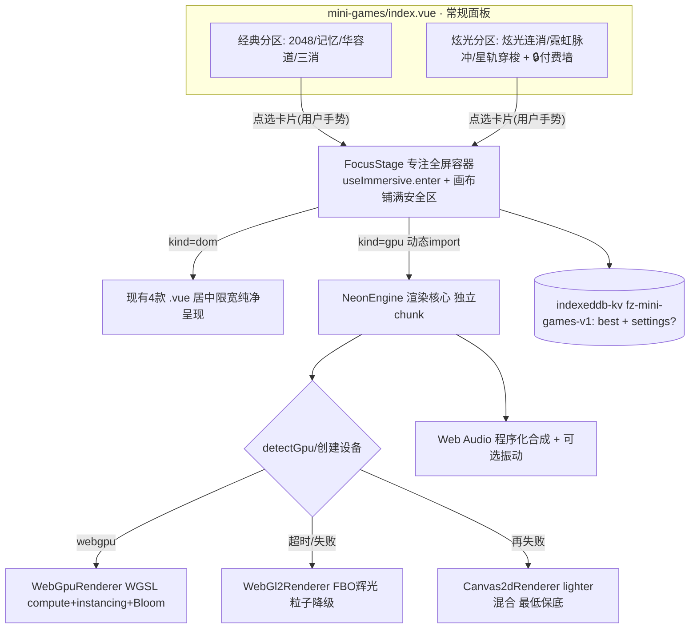

# 架构方案：炫酷全屏沉浸小游戏（WebGPU 炫光游戏系列）

- 对应 innovator：innovator_007_炫酷全屏沉浸小游戏.md
- 对应 pm：pm_007_炫酷全屏沉浸小游戏.md（结论：可集成——重构升级原功能 `mini-games`）
- 设计日期：2026-10-19

## 需求回顾与设计依据

在现有工具 `mini-games` 内：① 新增 WebGPU 优先、WebGL2/Canvas2D 降级的 GPU「炫光」游戏系列（首批 3 款：炫光连消 / 霓虹脉冲 / 星轨穿梭）；② 新增"游戏内纯净全屏专注态"，游戏进行中屏幕上不出现任何与当前操作无关的信息；③ 现有 4 款 DOM 益智游戏纳入同一专注容器、玩法不变；④ 零新增 npm 运行时依赖、零素材、零后端、可离线；⑤ 存量最高分与设置零迁移。

设计依据：用户两次强调"全屏/沉浸/无关信息不要占屏"；2025 年 WebGPU 已全主流浏览器可用；平台已有 `reusable-module/gpu-detect`、`use-lazy-init`、`useImmersive`、`lib/match3-core.ts`、`indexeddb-kv`、`useToolBilling` 与 GPU 无头验证规范可复用。

## 技术方案

### 系统架构



- **两层结构**：`index.vue` 仍是选游戏页（保留介绍/分区/付费墙/最高分概览）；点选某游戏（用户手势）→ 挂载 `FocusStage` 进入专注态；退出（手势/结算后返回）→ 卸载并 `useImmersive.exit()`。
- **游戏中屏幕只有**：满屏画布 + 极简化发光 HUD（左上小号分数/连击）+ 轻触中央短暂唤出的半透明控制浮层（暂停/重开/退出，无操作 ~2.5s 自动隐去）。选游戏页、介绍、外部品牌/导航在游戏中**完全不渲染在游戏层**。

### 模块设计（均在 `src/tools/mini-games/` 内增量）

```
mini-games/
  index.vue                 # 改：两层结构（选游戏页 + <FocusStage>）
  manifest.ts               # 改：tagline/keywords/features；billing 主价格不变
  components/
    FocusStage.vue          # 新：专注全屏容器 + HUD + 控制浮层 + 进出场生命周期
    Game2048/GameMemory/GameKlotski/GameMatch3.vue  # 不变（被 FocusStage 包裹）
  engine/                   # 新：GPU 渲染核心（仅进入 GPU 游戏时动态 import）
    types.ts                # Renderer/Particle/Scene 抽象接口与共享类型
    neon-engine.ts          # NeonEngine：RAF 循环、自适应 DPR/帧率、后端选择与热降级
    backend-webgpu.ts       # WGSL：compute 更新粒子 + instanced/point 渲染
    backend-webgl2.ts       # WebGL2：FBO 亮部提取+高斯模糊+加法合成 Bloom；CPU/顶点降级粒子
    backend-canvas2d.ts     # Canvas2D 保底：radial-gradient 精灵 + 'lighter' 混合
    shaders.ts              # WGSL/GLSL 字符串常量（不发额外文件）
    bloom.ts                # 通用 Bloom/后处理参数（各后端共用口径）
    fx.ts                   # 粒子池、爆炸/拖尾/涟漪、屏幕震动、缓动（纯逻辑可单测）
    quality.ts              # 设备分级与粒子/DPR 规格（可单测的纯函数）
  gpu-games/                # 新：3 款 GPU 游戏（各自独立 chunk）
    glow-match/
      logic.ts              # 复用/包装 ../../lib/match3-core（网格/交换/消除/连锁判定，纯逻辑）
      glow-match.vue        # 表现层：棋盘输入 + 调 NeonEngine 做消除爆炸/Bloom/震屏
    neon-pulse/
      chart.ts              # 谱面/判定时序纯逻辑（可单测：命中窗口/分数/连击）
      neon-pulse.vue        # 光轨飞来 + 判定圈 + 音频反应背景
    orbit-surge/
      orbit-surge.vue       # 拖动/重力感应引导光体穿行星场
  audio/
    synth.ts                # Web Audio 程序化音效/节拍（五声音阶、命中、爆炸），零音频文件
  lib/storage.ts            # 扩展（向后兼容）：best 不变 + 可选 settings 字段
```

**核心抽象接口（`engine/types.ts`，示意）**：

```ts
export type BackendKind = 'webgpu' | 'webgl2' | 'canvas2d'
export interface Particle { x:number; y:number; vx:number; vy:number; life:number; maxLife:number; size:number; hue:number }
export interface Renderer {
  readonly kind: BackendKind
  init(canvas: HTMLCanvasElement): Promise<void>
  resize(cssW:number, cssH:number, dpr:number): void
  setPalette(hues:number[]): void
  emitBurst(x:number,y:number,opts?:{count?:number;power?:number;hue?:number}):void
  setShake(mag:number):void
  render(dt:number, bgBeat?:number): void   // bgBeat 0..1 驱动背景呼吸
  dispose(): void
}
```

- `NeonEngine` 持有一个 `Renderer` 实现与粒子池；`fx.ts` 的爆发/拖尾是**与后端无关的纯逻辑**（位置积分、生命衰减、调色），可在 node:test 直接断言，符合 GPU 无头"逻辑单测先行"。
- 游戏只面向 `NeonEngine` 编程，不直接碰具体后端 → 后端降级对游戏透明。

### 关键技术路线

1. **后端选择与降级**：进入 GPU 游戏先 `detectGpu()`（复用 gpu-detect，只到 adapter、4s 超时）。
   - WebGPU：`requestDevice` 放在渲染器创建链，try/catch + 8s 超时，失败即降级；**绝不在探测阶段 requestDevice 后 destroy**。
   - 降级链 `webgpu → webgl2 → canvas2d`；运行中若上下文丢失（`webglcontextlost`/device.destroy）也热重启到下一后端，任何环境不白屏。
   - 视觉一致性：三后端共用同一套色板、粒子语义与 Bloom 口径，仅粒子上限/模糊次数不同（保真降级而非缺功能）。
2. **WebGPU 表现**：计算着色器统一积分粒子（位置/生命），渲染用 point-list 或 instanced quad，片元把方形平滑成发光圆点（抗锯齿）；Bloom = 亮部提取 → 横/纵分离高斯（1–2 级 mip 降分辨率省开销）→ 与原帧 additive 合成；HUD 用 DOM（发光文字）而非画进纹理，省 GPU 且清晰。
3. **WebGL2 表现**：粒子位置 CPU 更新到一个 `Particle` 缓冲（按 quality 上限截断），点精灵/实例化；FBO 离屏做 Bloom；是**无头 CI 的权威可视后端**（强制 WebGL2 截图）。
4. **Canvas2D 保底**：少量粒子（百级）+ 预生成 radial-gradient 精灵 + `globalCompositeOperation='lighter'`，保证极老/软渲染环境仍有"发光连消"。
5. **设备分级（`quality.ts` 纯函数 + 运行时帧率反馈）**：按后端、`navigator.hardwareConcurrency`、`deviceMemory`、初始 DPR 与实测帧率给出 `{particleScale, dprCap, bloomPasses}`；连续低帧自动降档（先降 DPR→粒子数→关 Bloom 第二趟），高帧不回涨以免抖动。
6. **程序化音频（`audio/synth.ts`）**：首次用户手势后 `new AudioContext()` 并 resume；用 OscillatorNode+GainNode 包络合成五声音阶（消除上行、命中清脆、爆炸噪声+低通）；背景脉冲用低频 LFO 驱动 `bgBeat` 传进 render；`muted` 写入 settings，默认尊重系统静音并提供开关。
7. **触感**：命中/爆炸在用户手势延续内 `navigator.vibrate?.(ms)`（可关）；不支持静默。
8. **纯净全屏（FocusStage）**：
   - 挂载即 `useImmersive.enter()`（隐藏应用顶栏/底部 Tab + 渐进系统全屏，失败保底应用内全屏）；容器 `position:fixed;inset:0`、`100dvh`、`env(safe-area-inset-*)` 避让刘海/Home 条、背景纯黑，canvas 边到边。
   - 游戏进行中 HUD 仅左上角小号分数/连击（低透明度发光），其余控件隐藏；轻触中央切换控制浮层（半透明、毛玻璃），无操作自动隐去；`Esc`/系统手势退出全屏时联动 `exit`。
   - DOM 游戏在 FocusStage 内用居中、最大宽度容器（手机满宽，PC 限 ~520px）承载，保留其原有键盘/触摸。
   - 卸载/路由离开统一 `cancelAnimationFrame`、`renderer.dispose()`、解绑监听、`useImmersive.exit()`、恢复 theme-color，杜绝 GPU 资源泄漏与全屏状态残留。

### 盈利模式（沿用 freemium，配置即可）

- 不改 `billing.mode` 与 `priceCents`；新增 features 权益并在 FocusStage/分区入口用 `useToolBilling.canUse('neon-library')` 判权：
  - 免费：2048、记忆翻牌 + **炫光连消（含基础主题）**——作为画质引流款；
  - 专业版（既有买断权益扩充）：霓虹脉冲、星轨穿梭、进阶难度、全部霓虹主题、最高粒子规格、色盲模式；已购用户免费获得。
- 其余订阅/用量/分成等模式属于统一计费框架"配置即可开启"，本工具不额外实现。

## 与 fangzi 现有代码的集成方式

- **不改**：`src/core/registry.ts`（glob 自动发现，slug 仍为 `mini-games`）、路由表、`manifest.webmanifest`、`vite.config.ts`、SW 策略、其它工具。
- **复用**：`@/composables/useImmersive`、`@/composables/useToolBilling`、`reusable-module/gpu-detect`、`reusable-module/use-lazy-init`、`reusable-module/indexeddb-kv`、`lib/match3-core.ts`。
- **改动文件仅**：`src/tools/mini-games/index.vue`、`src/tools/mini-games/manifest.ts`、`lib/storage.ts`（向后兼容加可选 settings）；其余为新增目录。
- **按需 chunk 与离线**：`index.vue` 用 `const m = await import('./gpu-games/glow-match/glow-match.vue')` 形式动态加载 GPU 游戏与其内部 import 的 `engine/*`；Vite 自动分包，主包与 DOM 游戏路径不增重；产物 `.js` 命中现有 workbox `globPatterns`（单文件远小于 5MB 的 `maximumFileSizeToCacheInBytes`）进入预缓存，**首次在线进入后断网可玩**（专项验证）。
- 工具内禁止自带 fixed 底部导航（避免与 FocusStage/应用底栏叠），toast 等沿用现有安全区偏移。

## 软硬件/依赖选型（逐项授权）

| 选型 | 来源 | 商用授权 | 说明 |
| --- | --- | --- | --- |
| WebGPU / WGSL | 浏览器原生标准 | 免授权（开放标准） | 主力 GPU 后端；类型用已在 devDependencies 的 `@webgpu/types`（BSD-3-Clause，仅构建期） |
| WebGL2 / GLSL ES 3.00 | 浏览器原生 | 免授权 | 兼容/无头可视后端 |
| Canvas2D | 浏览器原生 | 免授权 | 最低保底 |
| Web Audio API | 浏览器原生 | 免授权 | 程序化音效，零音频素材 |
| Fullscreen API / Screen Wake Lock（可选）/ Vibration API | 浏览器原生 | 免授权 | 全屏、游戏时防息屏（可关）、触感 |
| Vue3 + Vite + vite-plugin-pwa | 仓库既有 | MIT 生态 | 不新增运行时依赖 |
| 自研 engine/fx/quality | 本项目新增 | MIT（项目内） | 零新增 npm 运行时依赖 |

- **本地 AI**：本功能不涉及本地 AI，无模型/推理引擎选型。
- 全程无图片/音频/字体/外部 CDN 资源，无 NC（非商用）授权内容。

## 开发方案

- 语言/环境：TypeScript（strict，沿用仓库）、Vue3 SFC、Vite；`@webgpu/types` 已具备。
- 里程碑（H 档拆三 checkpoint，每个都可独立交付与推送）：
  - **M1（可运行 checkpoint）**：engine 抽象 + WebGL2/Canvas2D 后端 + fx/quality + FocusStage 纯净全屏 + 炫光连消（复用 match3-core）+ 音频；三端与离线验证通过即可先上线（此时高端机也走 WebGL2，视觉已"炫酷"）。
  - **M2**：WebGPU/WGSL compute 后端 + Bloom 全档 + 霓虹脉冲（含谱面/判定）。
  - **M3**：星轨穿梭（重力感应可选）+ 主题/色盲/粒子规格/防息屏设置 + 分享/收尾打磨。
- 人员分工：独立开发者单人，按里程碑提交。

## 测试方案

- **纯逻辑毫秒级单测（node:test，左移拦截）**：`fx.ts`（粒子积分/生命/爆发计数守恒）、`quality.ts`（分级与降档纯函数）、`glow-match/logic`（复用 match3-core 的交换/消除/连锁，含跨后端输入）、`neon-pulse/chart`（命中窗口、perfect/good/miss、连击与计分）；storage 兼容用例（旧 `best` 无 `settings` 时回退、新键追加不覆盖旧键）。
- **挂载/生命周期**：FocusStage 在"初始无 canvas → 异步尺寸就绪"都能正确初始化（use-lazy-init）；进入/退出全屏成对、dispose 后无 RAF/监听残留；`webglcontextlost` 触发降级不白屏。
- **GPU 无头（严格按 `references/gpu-headless-testing.md`）**：WebGPU compute 正确性用缓冲读回断言（粒子守恒/计数），**不截无头 WebGPU 上屏**；可视/布局/降级/三端一律强制 WebGL2 用 Playwright 截图断言；用仓库 `scripts/_gpu-ctx.mjs`（abort sw/registerSW 保证加载新产物）。
- **三视口 E2E（无 pageerror、无横向溢出）**：PC ≥1280、平板 768–1024、手机 320–480（重点 375×812）；覆盖 选游戏页→进入专注全屏（DOM 游戏与 GPU 游戏各一）→HUD 隐去/唤出→暂停/重开/退出→付费墙（免费款可玩、专业款未解锁拦截）→断网重开 GPU chunk 可加载→退出后应用顶栏/底栏恢复。
- **回归（不破坏存量）**：现有 4 款游戏全部玩法/最高分不变；其它 26 工具冒烟；`npm run verify:tools`、整站 build 与 PWA 安装/识别正常。
- 真机/独显 Chrome 上线前后各肉眼复核一次 WebGPU 上屏与移动端全屏/安全区。

## 实施部署方案

- 沿用 EdgeOne Pages：代码合入 main 即自动构建部署；无环境变量/密钥/服务端配置。
- 灰度：M1 先随版本发布（默认 WebGL2/Canvas2D，风险最低）；M2 上线 WebGPU 后端时，用 quickGpuGuess/detectGpu 只在确认支持的设备启用，其余保持 WebGL2，相当于按设备能力天然灰度。
- 监控：前端无后端，依赖降级时本地统计（可选 localStorage 计数：实际命中后端/降级原因），不采集隐私；线上问题以用户反馈与真机复核为主。
- 回滚：纯增量提交，出问题 `git revert` 对应提交重新部署即可；因不改 SW/manifest/注册与存量数据，回滚不影响已缓存用户与本地最高分；新 chunk 在旧版本下不被引用即自然失效（cleanupOutdatedCaches）。

## 风险与反思

- **用户真的需要吗？** 需要——需求由用户主动、明确提出，且目标是"沉浸/炫酷"体验本身；免费款让所有用户零成本感知价值。
- **会不会把 fangzi 搞复杂？** 不会——GPU 引擎与游戏全部动态 import、独立目录、仅在进入时加载；选游戏页信息架构保持简单，复杂被关在 FocusStage 之后。
- **真能省时间/资金吗？** 省下载安装、省广告、即点即玩；情绪价值是主收益。
- 主要风险与对策：① WebGPU 设备差异大 → 三后端 + 分级 + 运行时降档 + 无头强制 WebGL2 验证；② H 档一次做不完 → 三里程碑，M1 即可独立上线；③ 玩法红海 → 靠画质、纯净全屏、零广告离线与持续上新维持；④ 全屏/音频权限限制 → 全部在用户手势内、失败静默保底；⑤ 长时 GPU 耗电/发热 → 帧率/DPR 自适应 + 可选 WakeLock 默认关 + 切后台自动暂停（`visibilitychange` 停 RAF）。
