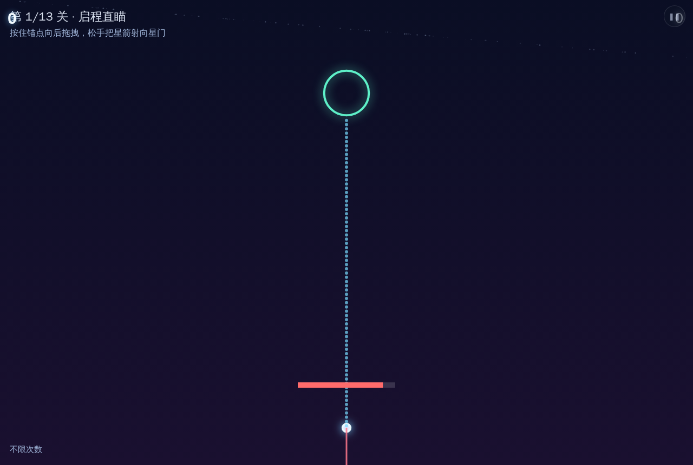
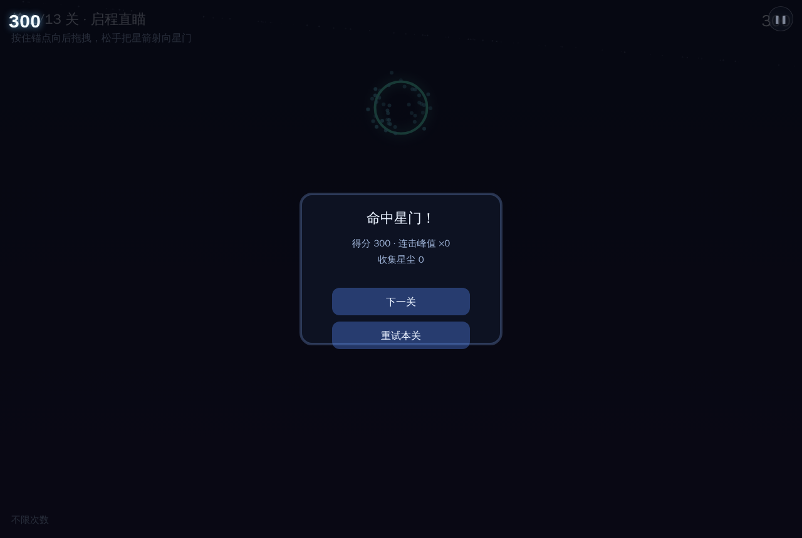
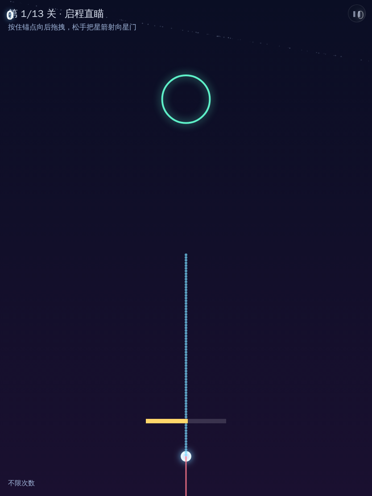
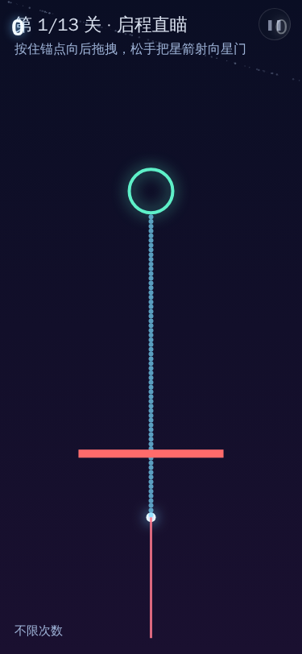

# 用户使用指导书：《挽星弓》（gravity-sling · 007 太空弹弓）

- 对应 dev：`dev_007_太空弹弓.md`
- 日期：2026-10-22
- 版本：v1.0.0
- 位置：小游戏合集 → 炫光 NEON 分组 🏹 挽星弓；路由 `/#/t/mini-games`

## 功能简介

《挽星弓》是一款原创极简太空引力弹弓关卡游戏：按住屏幕底部锚点**反向拖拽**完成力度与角度双自由度瞄准，屏幕实时显示**预测轨迹虚线**；松手发射，利用恒星引力偏折、借力加速，绕过陨石/黑洞、穿过推斥星与周期开合的星门，13 关逐级命中星门过关。全程本地运行、无账号、无广告、不联网也能玩。

## 运行环境要求

- 支持 Web 标准 Canvas 2D 与 Pointer Events 的现代浏览器（Chrome / Edge / Firefox / Safari 最新版；手机内置浏览器优先系统 Chrome/Edge）。
- PWA 离线缓存生效后，无网络也可进入本局；无需安装任何依赖，不读取相册、不请求定位。
- 桌面 PC、平板、手机均可单指/鼠标操作。

## 安装与启动

1. 在方子首页或「小游戏合集」卡片进入 `/#/t/mini-games`。
2. 在炫光 NEON 分组点击 **🏹 挽星弓** 卡片，进入纯净全屏游戏。
3. 首局点一下屏幕跳过引导；之后直接拖拽锚点开始。

## 使用说明

### 1. 瞄准与发射

- 按住底部发光锚点（星箭出生点），向**与期望发射方向相反**的方向拖拽：向下拖 = 向上射，向左下拖 = 向右上射。
- 拖拽距离决定力度（力度条在锚点上方，绿 → 黄 → 红表示由弱到强）；拖拽方向决定角度。
- 拖拽过程中蓝色虚线为数值积分预演的预测轨迹；松开手指/鼠标即发射。
- 松手前若力度或方向不满意，拖出范围后松开即取消，不会消耗发射次数（限次关卡除外）。

### 2. 关卡通缉目标与天体

- **青色圆环星门**：发射轨迹命中即过关；部分关卡星门沿椭圆移动，部分按周期开合，需预判时机与提前量。
- **蓝色恒星**：产生反平方引力，会把轨迹压弯；贴近掠过可触发「借力」计入 combo。
- **品红色推斥星**：反向推开星箭，可顺势借力改向。
- **黑色黑洞**：近距吞噬直接失败，绕行避让。
- **灰色陨石**：实体碰撞失败。
- **金色星尘**：沿途拾取加分，combo 倍率会放大得分。

### 3. 得分、连击与过关奖励

- 借力（近距掠过恒星/黑洞引力场）触发 combo：1.5 秒内连续借力连击累加，倍率最高 ×4；普通借力 +60×倍率，拾取星尘 +100×倍率。
- 命中星门基础奖励 300 分；限时关卡按剩余秒数、限次关卡按剩余发射次数追加奖励。
- 最高分会按「游戏 + 难度」自动保存在本机合集高分库，退出后可在合集卡片看到最高分。

### 4. 平板与手机自适应

布局按世界坐标 1000×1500 等比缩放并居中，横竖不拉伸；拖拽热区围绕锚点约 110 世界像素，触控目标不小于 44 CSS 像素。切到后台合集会自动暂停，回前台点「继续」即可；中途退出再进入，可选择「继续上一局」恢复快照。

### 5. 暂停 / 重开 / 静音

- 右上角 ❚❚ 按钮呼出合集控制菜单：暂停/继续、重新开始、特效档位、音效开关、退出游戏。
- 游戏中切后台自动暂停并挂起音频；回前台保持暂停，由你手动继续。
- 本游戏本体 13 关全部免费；主题皮肤、常驻预测轨迹线、高级挑战关卡包为后续预留解锁项，beta 阶段不设付费墙。

## 常见问题（FAQ）

**Q：为什么拖下去星箭不向上飞？**
A：弹弓是反向蓄力：拖拽方向与发射方向相反。想朝上射，请把锚点向下拖；想朝右上射，请向左下拖。

**Q：轨迹被恒星压弯，预测虚线没进星门怎么办？**
A：恒星引力会让实际轨迹弯向恒星，瞄准时比预测直瞄再偏出一段，先让虚线接近恒星边缘借力，再观察二次偏折；限次关卡先想清楚再松手。

**Q：第 8 关星门时开时合？**
A：该关为周期星门，约每 6 秒开启前 3 秒，等圆环亮起再发射。

**Q：中途退出会丢进度吗？**
A：进行中的关卡、分数、连击与已拾取星尘会在隐藏/定时节流时写入本机快照；重新进入可选择「继续上一局」。通关、失败或主动「重新开始」后旧快照会清除。快照只存在本机，不上传。

**Q：断网能玩吗？**
A：可以。游戏代码与合集资源已进入 Service Worker 预缓存；首次加载成功后离线可再次进入并游玩。

**Q：手机内置浏览器打不开或卡顿？**
A：请优先使用系统 Chrome / Edge 或 Safari；内置 WebView 若不支持 Pointer Events，可能无法拖拽。低端机可在合集菜单降低特效档位。

## 注意事项

- 本游戏不读取通讯录、相册、位置，也不上传任何对局数据；最高分与自动快照均存于本机浏览器。
- 限次关卡发射次数用尽即失败；限时关卡倒计时结束即失败；坠入世界边界、撞陨石、坠入黑洞均判负。
- 长时间游玩注意休息；合集支持屏幕常亮（Wake Lock），退出游戏后自动释放。
- 后续计划：高级关卡包、主题皮肤、常驻预测线；不售弹药、无敌或跳关，不做付费碾压。
