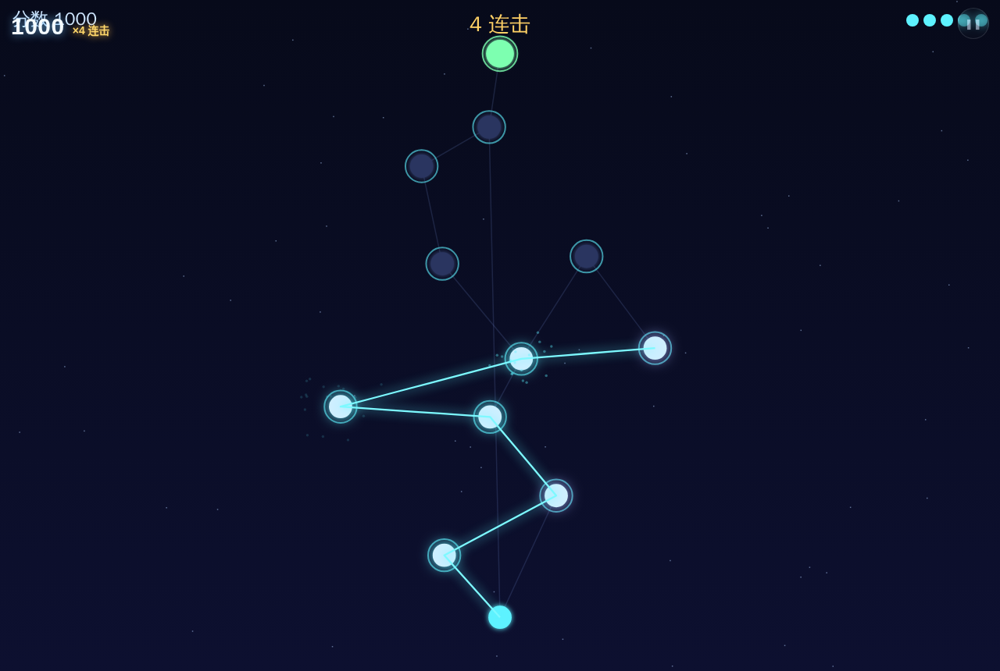
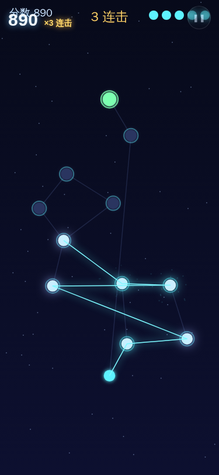
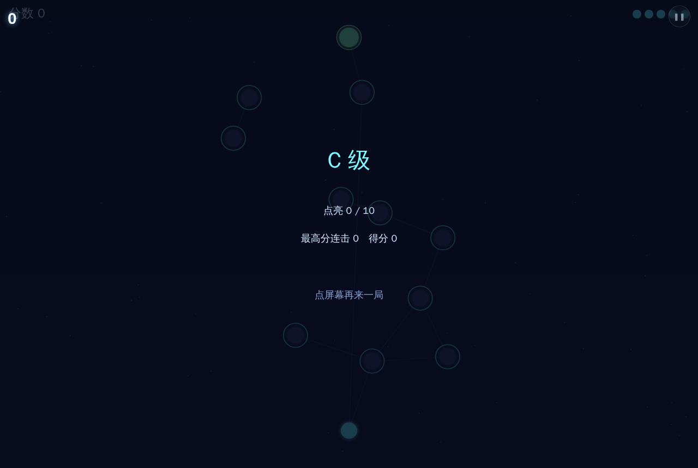

# 用户使用指导书：星脉（StarVein）

- 对应 dev：`docs/stage/dev_001_星脉.md`
- 日期：2026-10-29
- 版本：v1.0.0

## 功能简介
《星脉》是一款单指、单局 1–3 分钟的原创街机游戏：按住拖动画出光脉，在黑暗潮汐吞掉星辰之前点亮整片星网；在星星脉冲的瞬间穿过它，会炸开粒子并奏响一个五声音阶音符。

## 运行环境
现代手机/桌面浏览器（支持 Canvas2D、Web Audio、Pointer Events）；纯本地、离线可玩，无账号无广告。

## 使用说明
1. 在「炫光 NEON」合集里点「星脉」进入全屏。
2. **按住拖动**：一道光脉从底部核心亮起，随手指流动；光脉扫过的星星会被点亮。
3. **卡点 PERFECT**：星星随 BPM 周期性脉冲放大，在脉冲瞬间穿过 = PERFECT（粒子 + 音符 + 连击）；错过窗口仍点亮，但不连击。
4. **黑暗潮汐**：黑暗从核心沿网络吞掉未点亮的星星，每吞一颗扣 1 格能量（共 5 格）；能量见底本局结束。
5. **收线**：把光脉引到顶部绿色出口门，本局得分 ×1.5 落袋。
6. 抬起手指可停顿，但潮汐会短暂加速；再次落下从最近点亮节点继续画。

## 常见问题
- **Q：为什么点亮不连击？**　A：只有在星星脉冲窗口内穿过才算 PERFECT；跟随节拍慢慢拖，看脉冲环最亮时穿过。
- **Q：能量扣光了怎么办？**　A：优先沿通路多点亮、尽早收线；被吞的是没点亮的星，已点亮的不会再被吞。
- **Q：切后台/锁屏会丢进度吗？**　A：自动暂停并快照，回来选「继续上一局」即可恢复。

## 注意事项
- 全程单指，勿双指缩放；建议竖屏游玩。
- 最高分保存在本机；无需联网，断网可玩。
