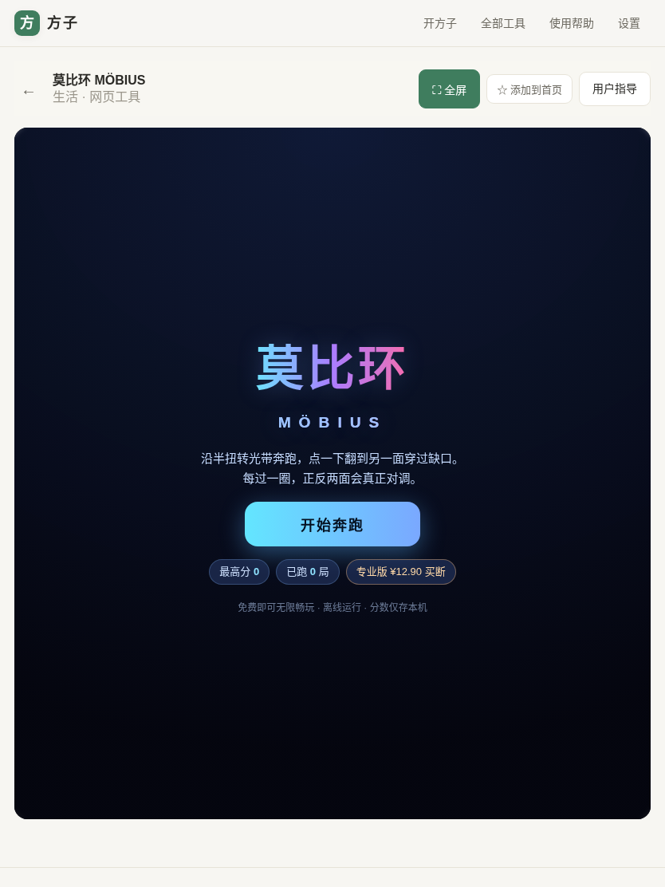
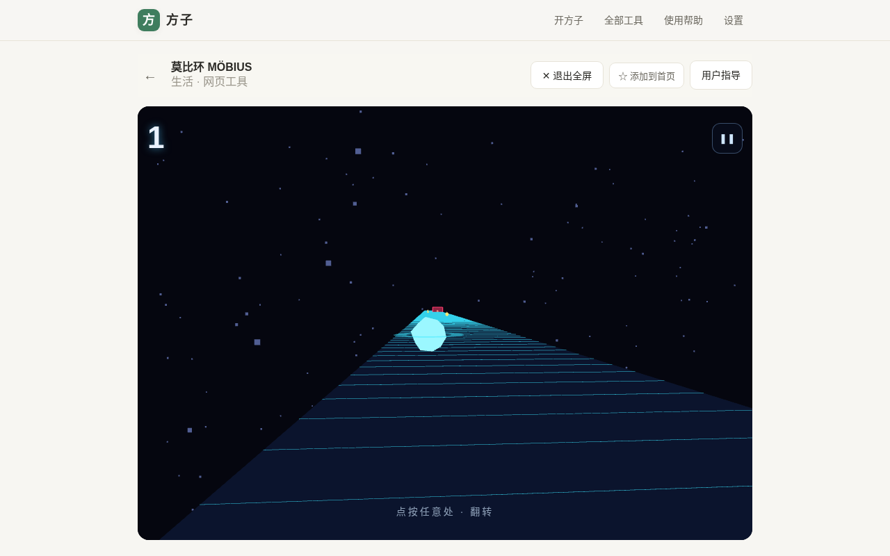
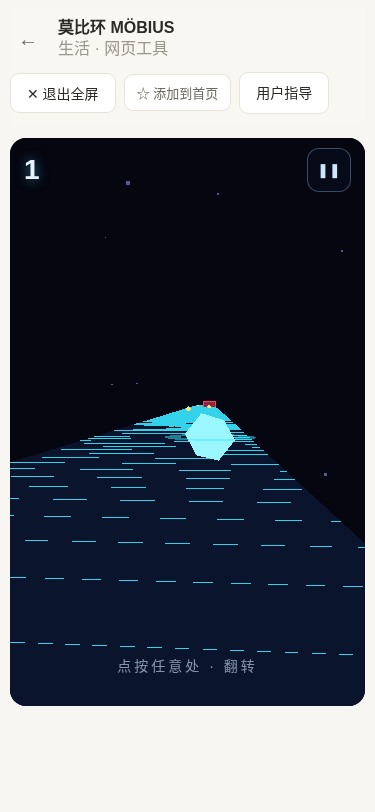
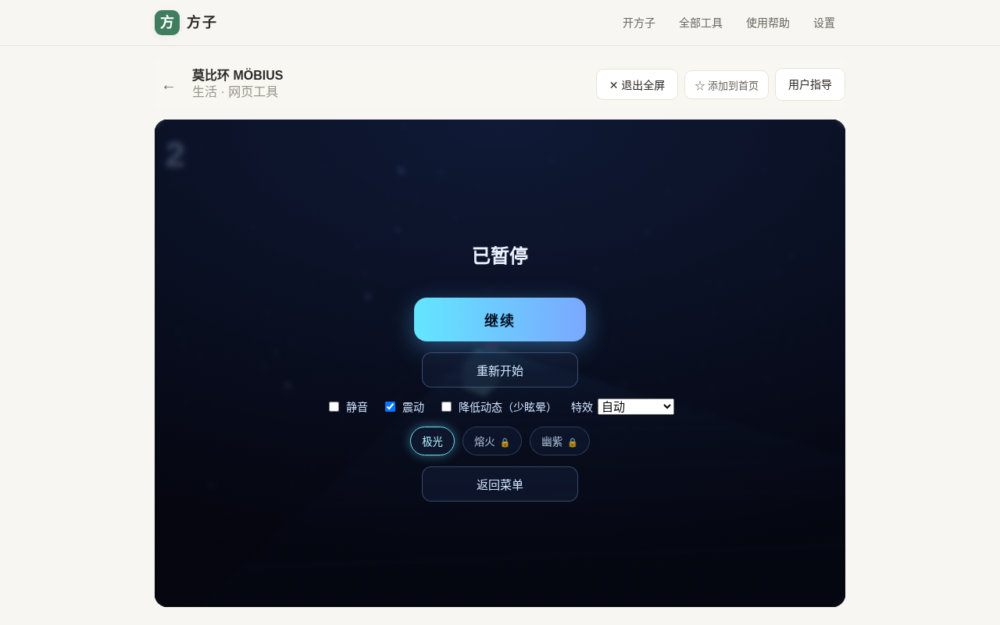
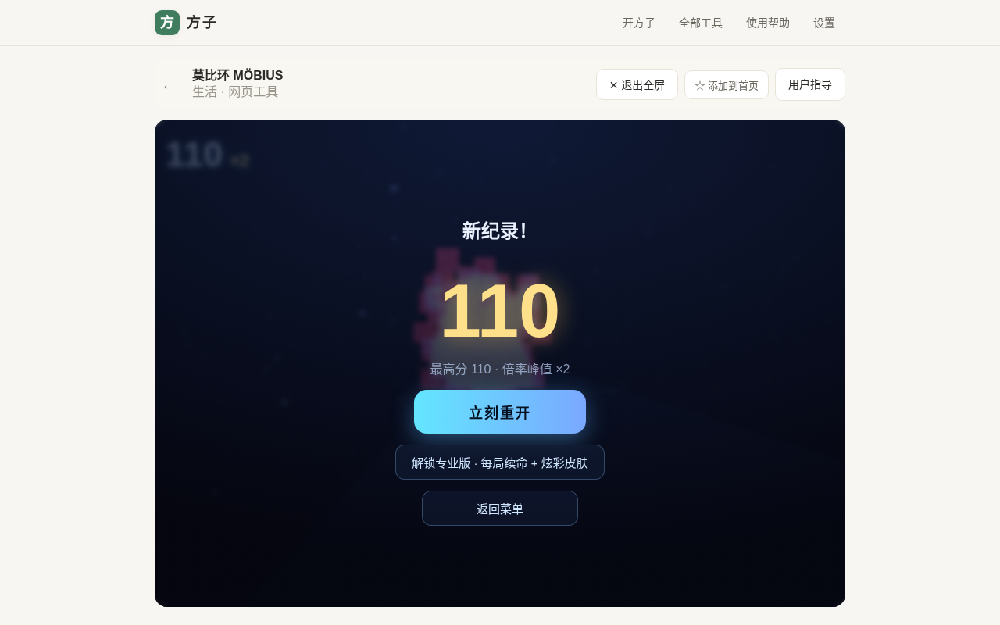
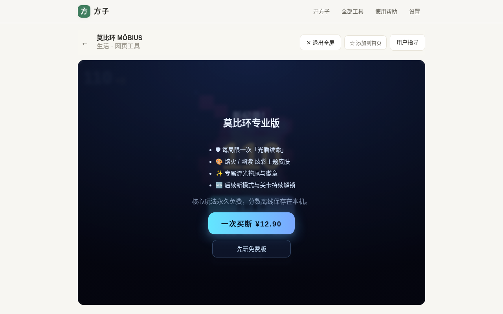
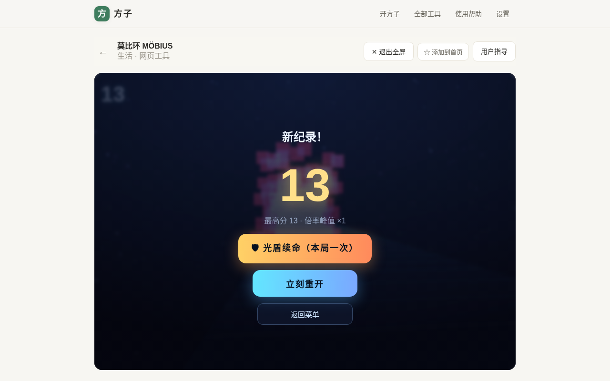
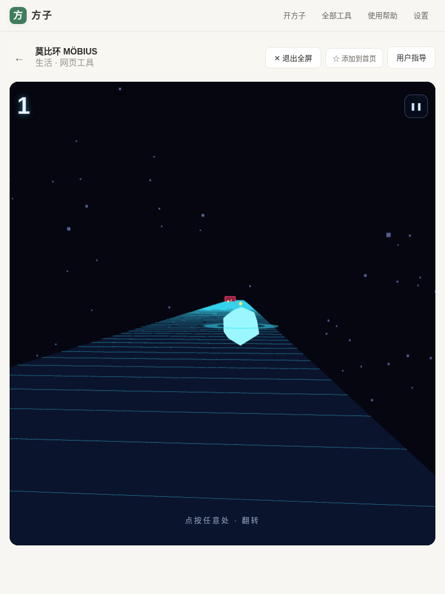
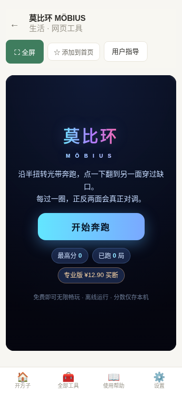

# 用户使用指导书：莫比环 MÖBIUS（莫比环3D翻转跑酷）

- 对应 dev：dev_008_莫比环3D翻转跑酷.md
- 日期：2026-10-19
- 版本：v1.0.0（Beta）
- 工具位置：方子 PWA → 全部工具 → 莫比环 MÖBIUS（路由 `/#/t/mobius-runner`）

## 功能简介

「莫比环 MÖBIUS」是一款一指就能玩的 **3D 莫比乌斯光带跑酷**。你是一颗沿无限半扭转光带前进的光球：光带每转过一处半扭转，正反面会真正对调。点一下屏幕翻到另一面，从闸门挡住的缺口面穿过去；贴边擦过、临门翻面对齐打出连击倍率，跑得越远分数越高。

- 纯前端、**零后端、无账号、无联网请求**；
- 首次打开后**可离线游玩**（PWA，可安装到桌面/主屏）；
- 分数与设置只保存在**本机浏览器**（IndexedDB `fz-mobius-runner-v1`）。

## 运行环境要求

- 支持 **WebGL** 的现代浏览器：Chrome / Edge / Safari / Firefox 近年版本。
- 桌面、平板、手机均可；手机建议「添加到主屏」以全屏沉浸方式启动。
- 不支持 WebGL / 关闭硬件加速时，显示友好兜底提示而非白屏。
- 渲染依赖 three.js（MIT，可商用），由工具页**按需懒加载**，不增加首屏负担。

## 安装与启动

- 在线打开 `https://www.fangzi.asia` → 全部工具 → 莫比环 MÖBIUS，点「开始奔跑」即可，无需安装。
- 想要全屏沉浸/离线：浏览器菜单选择「添加到主屏 / 安装应用」，从桌面图标启动。
- 进入对局会自动请求系统全屏；退出对局自动还原，不影响方子其它页面。

## 使用说明

### 1）主菜单

打开后看到标题、玩法一句话说明与「开始奔跑」。下方展示本机最高分、已跑局数与专业版状态。

### 2）首次教学

第一次进入会先弹出「30 秒上手」：点按翻转、闸门只挡一面、半扭转时两面对调、贴边擦过有倍率。点「我知道了，开跑」正式开始。

### 3）对局操作（核心）

- 手机：**点按画面任意位置**翻转到另一面；
- 电脑：**点按画面**或按 **空格 / ↑** 翻转，**Esc** 暂停；
- 前方闸门红色实墙挡住一面，在亮着的绿色缺口面穿过即可；
- 撞到实墙即结束，可立即重开。

画面顶部只有极简分数与暂停键，无任何与游戏无关的信息；进入半扭转前会出现「扭转带 · 准备翻转」提示。

### 4）暂停与设置

点右上角 ❚❚ 或按 Esc 暂停。可切换静音、震动、**降低动态**（关闭相机翻滚与大幅震屏，防眩晕）、特效档位（自动/高/低，低档更省电），并选择主题。

### 5）结算与重开

撞墙后弹出结算：本局分数、是否新纪录、历史最高与倍率峰值；可「立刻重开」。

### 6）专业版（可选买断 ¥12.90）

核心玩法永久免费。一次买断获得：每局限一次**光盾续命**、熔火/幽紫炫彩主题、专属流光拖尾与徽章、后续新模式持续解锁。免费态在结算页点「解锁专业版」打开付费墙。

已购专业版死亡后出现「🛡 光盾续命（本局一次）」按钮，点后短暂无敌继续奔跑。

平板与手机对局均为全屏自适应布局，无横向溢出：

## 常见问题（FAQ）

- **黑屏或提示不支持 3D？** 更新浏览器、开启硬件加速，或更换支持 WebGL 的设备。
- **玩起来晕？** 暂停中打开「降低动态」，特效调到「低」。
- **高分丢失？** 分数按浏览器/设备本地保存，清理浏览器数据或换浏览器会重置。
- **要联网吗？** 游玩不需联网；首次加载页面需联网缓存资源。
- **付费后换设备还有吗？** 权益跟随方子统一计费在本地/账号体系记录；核心玩法始终免费。

## 注意事项

- 游戏为固定步长（120Hz 逻辑）+ 插值渲染，不同刷新率下速度一致；切到后台会自动暂停。
- 长时间游玩会请求屏幕常亮（WakeLock）；退出对局自动释放。
- 低端设备可在暂停里把特效设为「低」以保证流畅与省电。
