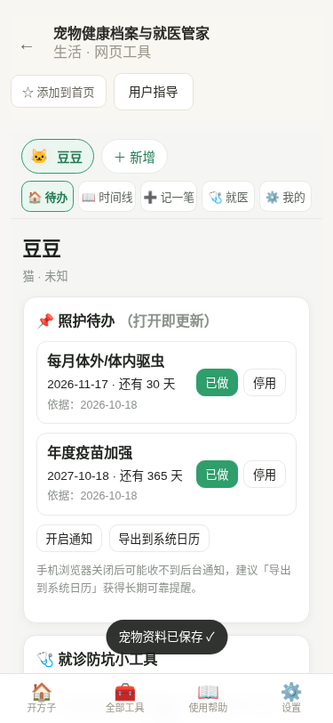
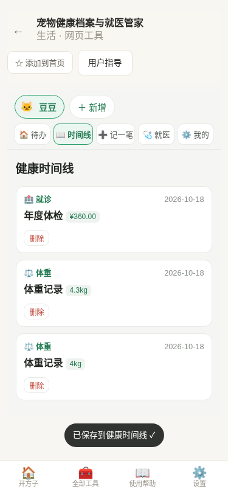
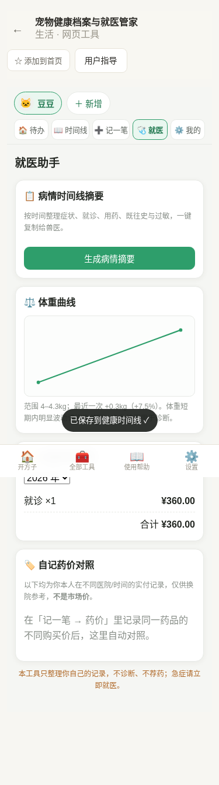
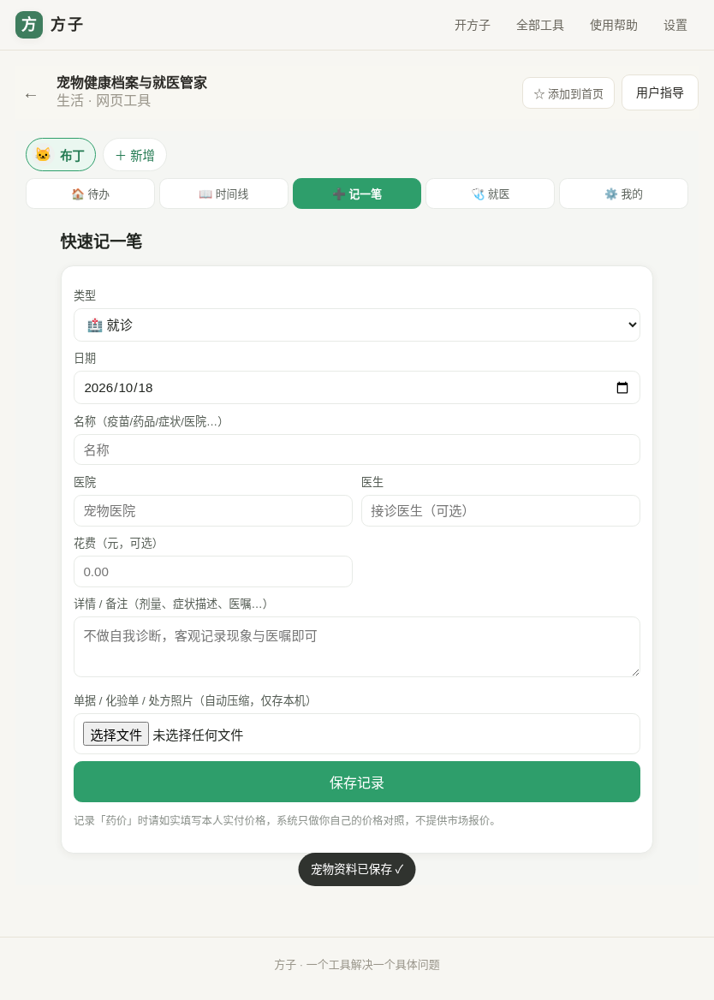
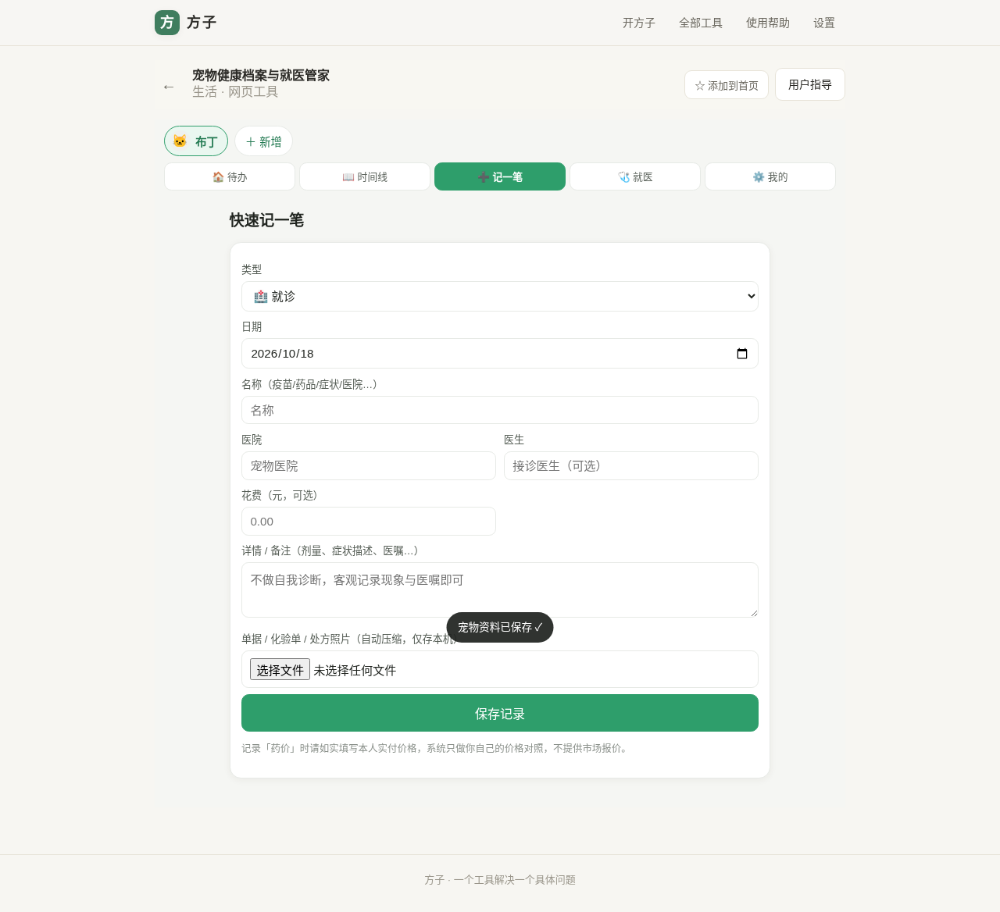

# 用户使用指导书：宠物健康档案与就医管家

- 对应 dev：dev_006_宠物健康档案与就医管家.md
- 日期：2026-10-18
- 版本：v1.0.0
- 工具入口：方子 → 生活 → 宠物健康档案与就医管家（路由 `#/t/pet-health`）

## 功能简介

给猫、狗等宠物建立一份**只存在本机**的健康档案：多宠管理、疫苗/驱虫/用药/就诊/症状/体重/饮食/药价 9 类健康事件时间线、照护计划到期自动顺延与提醒、化验单/处方照片压缩存档、体重曲线、年度养宠花费汇总、自记药价对照、一键生成给兽医的病情摘要，以及加密/明文家庭档案包导入导出。

**医疗边界（务必知悉）**：本工具只做「记录、提醒、整理」，**不做疾病诊断、不推荐用药、不承诺疗效**，不能替代执业兽医；宠物出现异常请及时就医。药价是你本人手动记录的实付价，仅供换院参考，**不是市场报价**；疫苗/驱虫节奏是常见参考，请以执业兽医建议和当地规定为准。

## 运行环境要求

- 任意现代浏览器：Chrome / Edge / Safari / Firefox 近两个大版本（手机与 PC 均可）。
- 以 PWA 形式安装到手机桌面后体验最佳；数据保存在浏览器本地 IndexedDB。
- 通知能力依赖系统通知授权；后台通知受移动系统限制，长期提醒建议导出到系统日历。
- 无需注册、无需联网使用（首次打开后），无后端、无账号，数据不上传。

## 安装与启动

1. 用手机或电脑浏览器打开方子站点，进入「全部工具 → 生活 → 宠物健康档案与就医管家」。
2. 手机浏览器菜单选择「添加到主屏幕」，即可像原生 App 一样从桌面图标进入。
3. 首次进入为空状态，点「建立第一只宠物档案」即可开始；无需任何配置项。

## 使用说明

### 1. 建立宠物档案与默认照护计划

进入后点「建立第一只宠物档案」，填写名字、种类（猫/狗/其它）、性别；品种、生日、绝育、芯片、过敏史、基础病为选填。保存后会**自动生成两条常见照护计划：每月驱虫（30 天）、年度疫苗加强（365 天）**，可随时停用或修改周期。顶部为宠物切换条（专业版可多宠）与功能分段栏。

### 2. 照护待办与提醒

「待办」打开即重新计算每条计划的下次到期日、还剩几天或已逾期几天，依据（起始日或最近一次记录）也会显示。点「已做」会补一条当天记录并自动顺延一个周期；点「停用」暂停该计划。

提醒提供两种方式：

- **开启通知**：仅在应用打开期间有效；
- **导出到系统日历（推荐）**：生成标准 `.ics` 文件（`fangzi-pet-care.ics`），导入手机系统日历后由系统长期可靠提醒，规避移动 PWA 后台通知限制。

### 3. 记一笔（9 类健康事件）

点顶部「➕ 记一笔」，选择类型并填写：

- **疫苗 / 驱虫**：可在「关联照护计划」选择对应计划，保存后自动把下次到期顺延一个周期（只有显式关联计划的记录才参与顺延）。
- **体重**：填写 kg，至少 2 条后生成曲线。
- **就诊 / 用药 / 药价 / 饮食**：可填花费；「药价」建议同时填医院与规格，便于自记药价对照。
- **照片**：可选化验单/处方/疫苗本，多张上传，自动压缩为长边约 1600px 的 JPEG（质量 0.72）并**去除 EXIF 拍摄信息**，仅存本机。

### 4. 健康时间线

「时间线」按日期从新到旧展示全部记录，体重与金额以标签呈现，照片可点开查看大图，可删除单条记录。

### 5. 就医助手

- **病情时间线摘要**：选择时间范围，一键把症状、就诊、用药、既往史、过敏整理成结构化文字，可直接复制发给/念给兽医；摘要内固定附带「不能替代兽医诊断」声明，空范围有兜底文案，不会编造。
- **体重曲线**：SVG 折线展示变化，标注最小值、最大值与最近一次增减（kg 与百分比）；短期明显波动提示咨询兽医，曲线不用于诊断。
- **年度养宠花费**：按类型汇总，各类之和等于总额（守恒），可切换年份。
- **自记药价对照**：药名按归一化名称聚合，同一药品不同医院/时间的自录价并排展示并标出最大差额，明确标注「是本人实付记录，不是市场价」。

### 6. 多端自适应

同一份界面在手机、平板、PC 上均自适应：手机为单列、分段栏置于顶部并避开方子应用底部主导航与安全区；平板/PC 拉宽展示，无横向溢出。

### 7. 家庭档案包（备份 / 换机 / 家人协作）

在「我的 → 家庭档案包」：

- **导出 / 加密导出**：把全部宠物、记录、计划与照片打包为一个文件；加密导出使用口令（AES-GCM + PBKDF2，迭代 120000 次），**忘记口令无法恢复**。
- **导入**：选择档案包恢复或合并（按记录合并，不会主动清空现有数据）；加密包需输入口令。
- 页面显示本机照片占用与浏览器存储用量；清理浏览器数据/卸载会删除本地档案，请**定期导出备份**。

## 免费与专业版

| 能力 | 免费版 | 专业版 |
| --- | --- | --- |
| 单宠档案、9 类记录、照护提醒 | ✅ | ✅ |
| 多只宠物档案与切换 | — | ✅ |
| 体重曲线、年度花费分析 | — | ✅ |
| 一键病情摘要 | — | ✅ |
| 家庭档案包导入导出（含照片） | — | ✅ |

专业版支持**一次买断 ¥12.90**，也可**按月 ¥3.9 / 按年 ¥29.9** 订阅；无论是否付费，数据都只保存在本机。免费层新增第二只宠物时会弹出升级说明，不影响已有单宠数据。

## 常见问题（FAQ）

- **为什么收不到后台提醒？** 移动 PWA/Web 页面被系统完全关闭后无法保证后台通知，请用「导出到系统日历」获得可靠提醒；待办每次打开都会重新计算逾期。
- **照片存在哪里、占空间吗？** 全部存在本机 IndexedDB，拍照/选图后自动压缩到长边约 1600px、去除元数据，不上传服务器；占用情况可在「我的」查看。
- **换手机或想给家人一份怎么办？** 旧机「导出档案包」（可加密），新机打开工具「导入」即可；导入为合并，不会清空现有档案。
- **加密包口令忘了能找回吗？** 不能。加密完全在本地完成，没有任何服务器留存口令，请妥善保管；也可选择不加密的明文包自行保管。
- **能帮我判断得了什么病、该吃什么药吗？** 不能。本工具刻意不提供诊断与用药建议，只帮你把信息整理清楚，交给执业兽医判断。
- **药价对照里的价格是平台报价吗？** 不是，全部是你本人手动录入的实付价，仅用于自己换院参考。

## 注意事项

- 本工具不联网上传任何宠物或个人信息；但也因此**数据只在本设备本浏览器内**，清理浏览器数据会丢失，务必定时导出备份。
- 金额以「分」为最小单位内部存储，界面显示元；体重保留 2 位小数。
- 健康建议类信息（疫苗/驱虫节奏、体重波动）均为参考，出现急症、持续异常请立即就医。
- iOS Safari 与部分安卓浏览器对通知、文件下载支持存在差异，通知不可用时请使用系统日历方案，这是平台限制而非数据问题。
