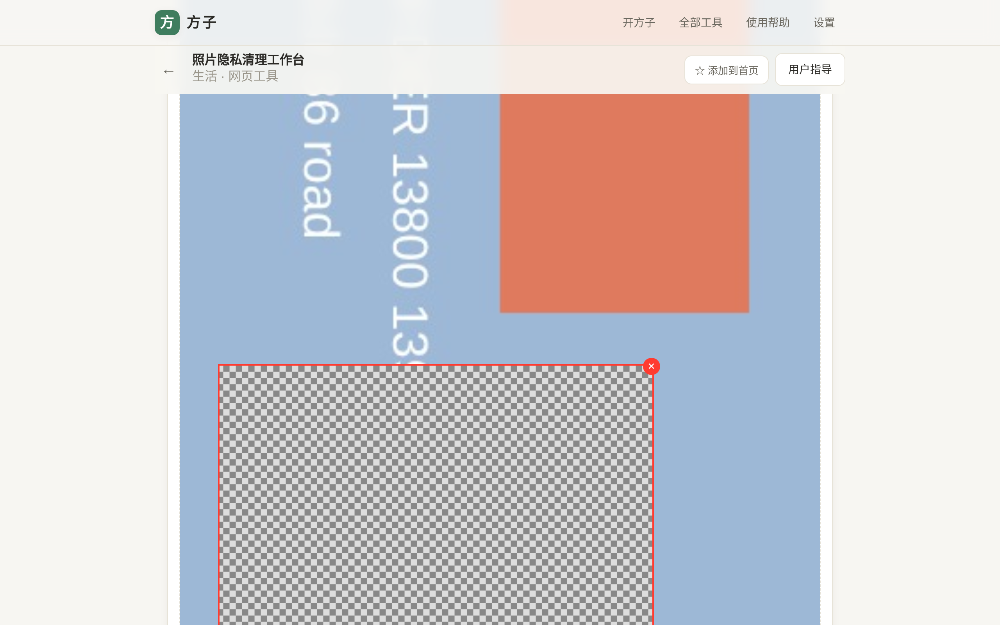
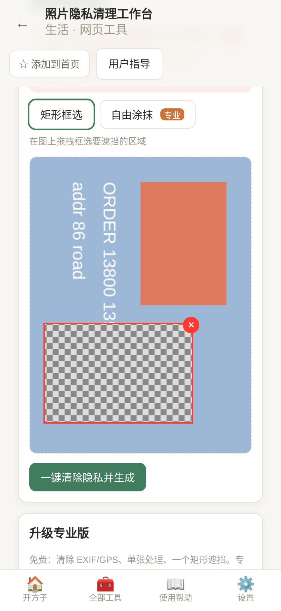
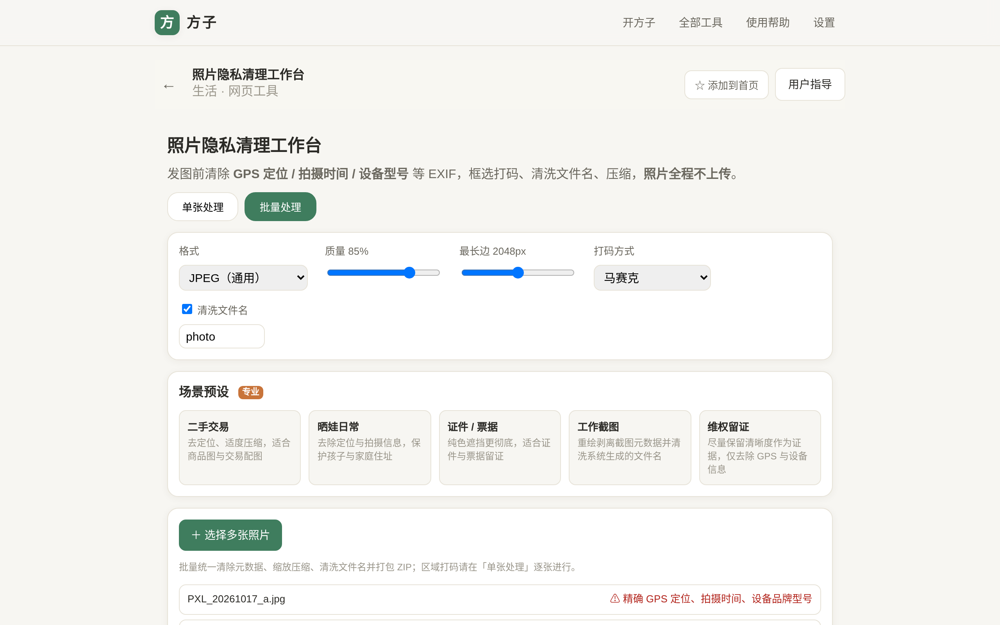
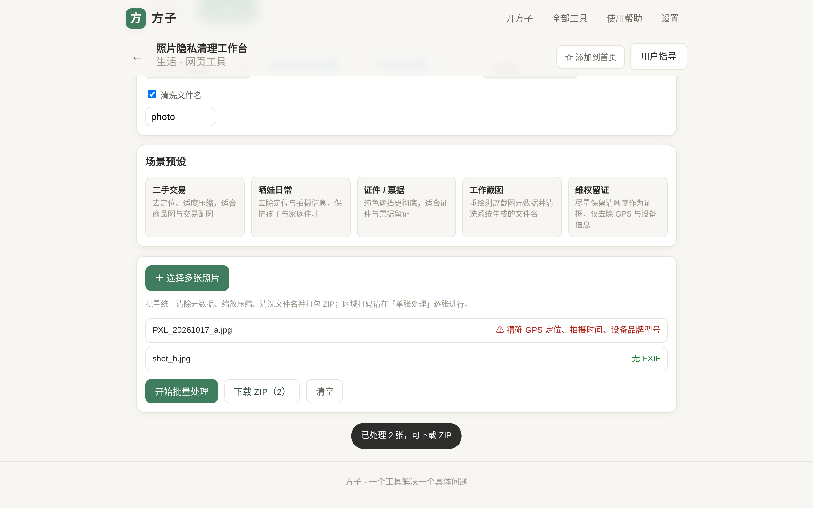
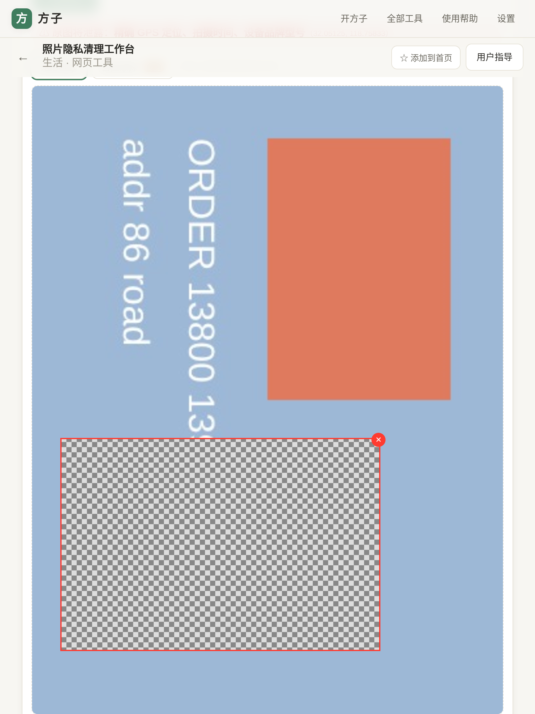

# 用户使用指导书：照片发布隐私清理（photo-privacy）

- 对应 dev：dev_006_照片发布隐私清理.md
- 日期：2026-10-17
- 版本：v1.0.0
- 访问：方子「全部工具 → 生活 → 照片隐私清理工作台」，或直接打开 `/#/t/photo-privacy`

## 功能简介

发照片前，在**本机浏览器**一键清除会泄露位置与身份的信息：精确 GPS 定位、拍摄时间、设备品牌型号、序列号等 EXIF；并可在图上框选做马赛克 / 模糊 / 纯色遮挡，统一缩放压缩、转换格式、清洗文件名，多张批量打包 ZIP。**照片全程不上传，离开页面即释放。**

## 运行环境要求

- 现代浏览器：Chrome / Edge 90+、Safari 15+、Firefox 90+（手机端与桌面端均可）。
- 支持输入：JPG / JPEG / PNG / WebP；HEIC / RAW / 视频暂不支持（请先另存为 JPEG）。
- 纯前端、无需登录、无需联网（已安装/缓存后可离线使用）；批量优先使用 Web Worker，不支持 OffscreenCanvas 的浏览器自动回退主线程。

## 安装与启动

作为方子内置工具，无需单独安装：
1. 打开方子（PWA 可在浏览器菜单“添加到主屏幕/安装应用”）。
2. 首页搜“照片 定位 / 马赛克 / 隐私 / 去 exif”等，或从「全部工具」进入。
3. 首次使用即可直接处理，无模型下载、无外部依赖。

## 使用说明

### 1. 单张处理
进入「单张处理」→ 点「＋ 选择照片」。顶部风险条会提示原图将泄露的信息，例如“精确 GPS 定位、拍摄时间、设备品牌型号”。

- 选择「矩形框选」（免费）在图上拖拽框出敏感区域；专业版可用「自由涂抹」、模糊与多区域。每个框右上角 ✕ 可删除。
- 上方可设置输出格式（JPEG/WebP/PNG）、质量、最长边、打码方式、文件名前缀与是否清洗文件名。
- 点「一键清除隐私并生成」，出现“文件不含 GPS/设备/时间等元数据（已验证清空）”后点「下载」。输出是新文件，不覆盖原图。

### 2. 场景预设
「二手交易 / 晒娃日常 / 证件票据 / 工作截图 / 维权留证」一键套用输出参数与“记得遮挡”清单（专业功能）。例如“证件票据”自动使用较高质量 + 纯色遮挡，并提示遮挡身份证号、银行卡号、二维码等。

### 3. 批量处理
切到「批量处理」→ 一次选择多张照片，列表逐张标注是否含 GPS / 设备信息；点「开始批量处理」，实时显示进度，完成后点「下载 ZIP」得到全部清理后的照片。

平板与手机端同样可用，布局自适应、无横向溢出：

### 4. 免费与专业版
- 免费：清除 EXIF/GPS、单张处理、单个矩形遮挡。
- 专业（买断 ¥12.90，另支持订阅与用量包）：模糊、多区域、自由涂抹；批量不限量与 ZIP；场景预设与文件名高级模板。

## 常见问题（FAQ）

- **处理后绝对安全吗？** 文件元数据被彻底剥离，框选区域被打码；但画面里肉眼可见的信息（招牌、门牌、人脸等）需你主动框选，发布前请再目检。
- **为什么要重新编码而不是只删 EXIF 段？** Canvas 重绘会生成全新文件，连 XMP/IPTC/缩略图/厂商私有段一并去除，比“删段”更彻底，同时完成压缩与定向。
- **iPhone 的 HEIC 怎么办？** 当前不支持 HEIC/RAW/视频，请用系统“另存为/导出 JPEG”后再处理。
- **PNG 透明背景变红/变黑？** JPEG 无透明通道会自动铺白底；要保留透明请选 PNG。
- **照片会被上传吗？** 不会。读取、重绘、打码、压缩、打包全在本机内存完成。

## 注意事项

- 工具不做人脸自动识别，遮挡区域由你手动选择；打码用户手选更合规。
- 输出为新文件，请自行保留原图，工具不修改/删除原照片。
- 请确保你对所处理与发布的图片拥有合法权利。
