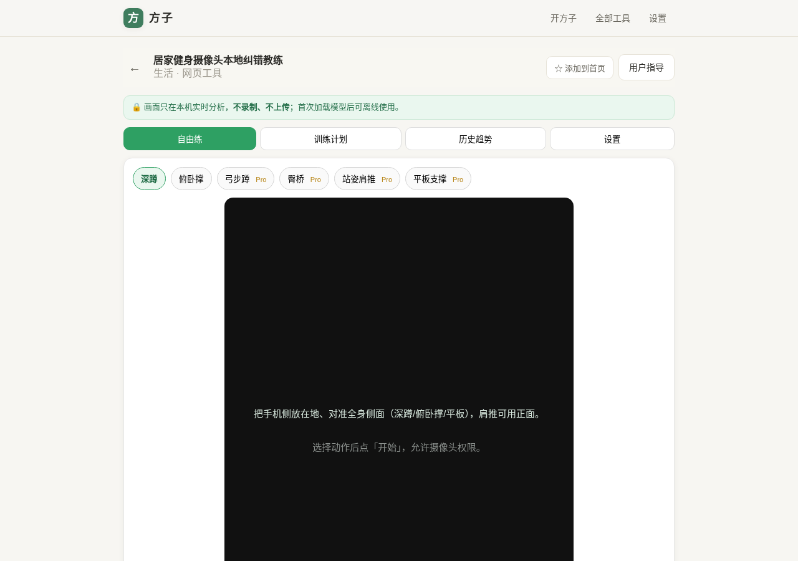
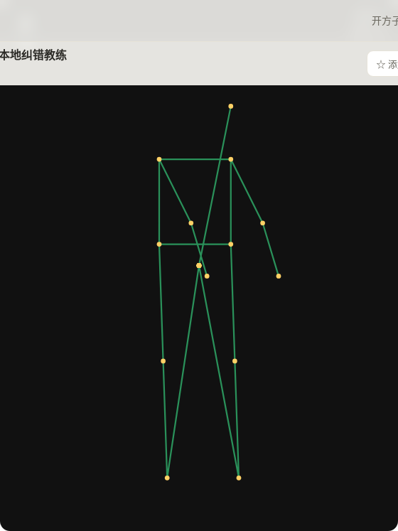
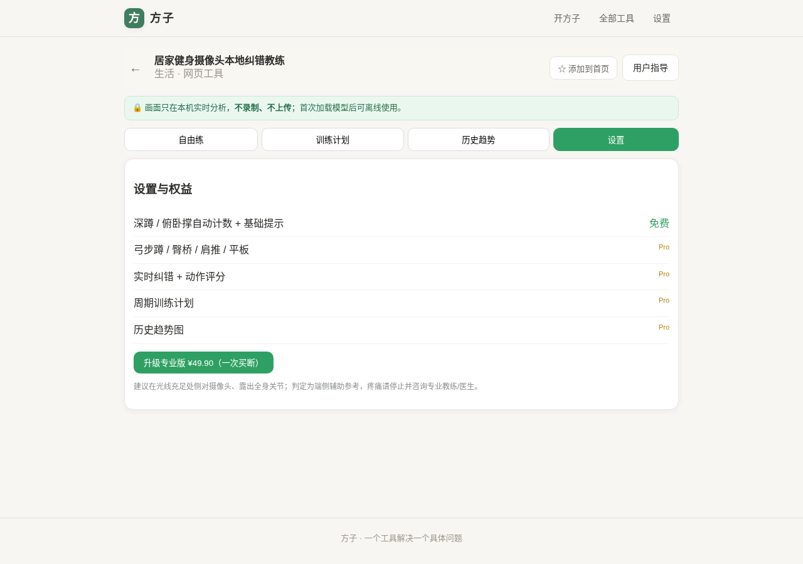
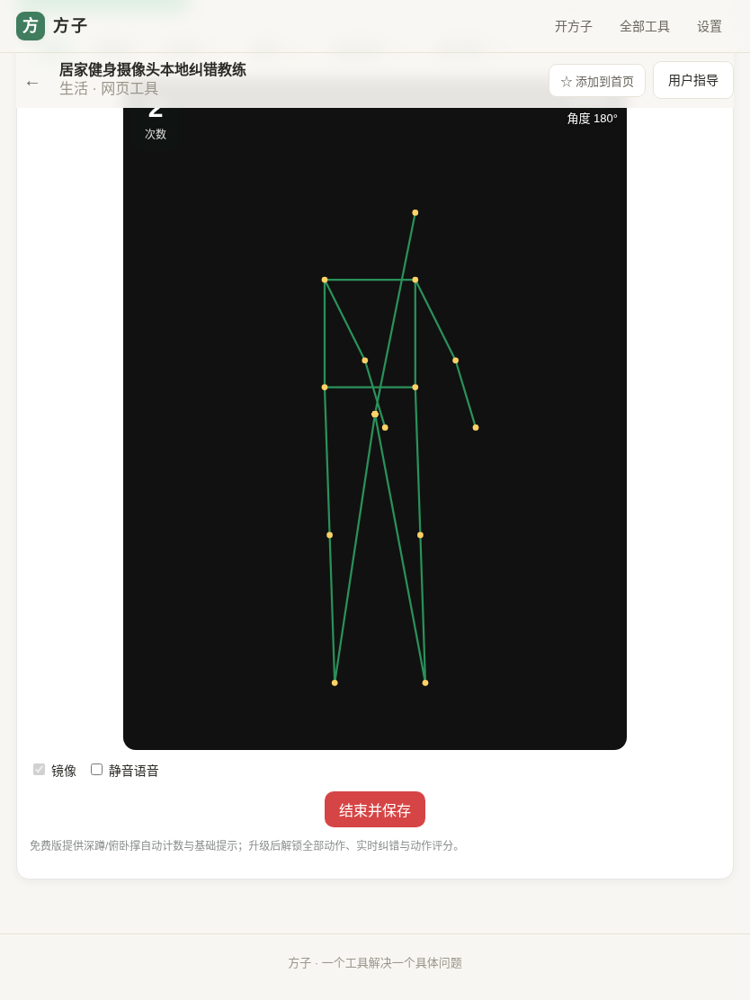
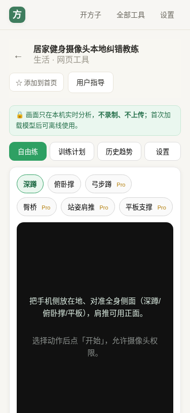

# 用户使用指导书：居家健身摄像头本地纠错教练

- 对应 dev：dev_005_居家健身摄像头本地纠错教练.md（见 `docs/stage/`）
- 日期：2026-10-16
- 版本：v1.0.0（beta）

## 功能简介

打开摄像头即可在**本机端侧**识别深蹲、俯卧撑、弓步蹲、臀桥、肩推、平板支撑六类动作，自动计数/计时、实时语音与文字纠错并打分，附带周期训练计划与历史趋势。画面只做实时分析，**不录制、不上传**，首次加载模型后可离线使用。

## 运行环境要求

- 现代浏览器：Chrome / Edge 113+（推荐，MediaPipe 支持最好）、Safari 17+、Firefox 较新版本。
- 需要摄像头权限；建议光线充足、背景简洁、露出全身关节。
- 首次使用会从站点同源下载姿态模型（约 5.8MB）与推理 wasm（约 13.5MB），之后由站点缓存，可离线。
- 端侧推理优先 GPU（WebGL/WebGPU），不可用时自动回退 CPU，功能不受影响、帧率略低。
- 手机：Android Chrome / iOS Safari；建议把手机侧放在地对准全身。

## 安装与启动

本工具是 fangzi PWA 内置网页工具，无需独立安装：

1. 打开方子站点，进入「全部工具」，找到「居家健身摄像头本地纠错教练」，或直接访问 `/#/t/pose-fitness-coach`。
2. 首次进入选择动作后点「开始跟练」，浏览器弹出摄像头授权时选择「允许」。
3. 第一次启动会加载模型，请稍候；加载完成后进入实时画面。
4. 如需像 App 一样使用，可用浏览器「添加到主屏幕 / 安装应用」。

无后端、无密钥配置；买断授权记录保存在本机。

## 使用说明

### 1. 自由练（主界面）

进入后默认是「自由练」页，顶部动作胶囊可切换：

- **免费**：深蹲、俯卧撑（自动计数 + 基础幅度提示）。
- **专业版（Pro）**：弓步蹲、臀桥、肩推、平板，以及实时纠错、动作评分、训练计划、历史趋势。

摆好机位后点「开始跟练」：

- 画面叠加绿色骨架与黄色关键点，左上角 HUD 显示次数/阶段/上次评分/关键角度。
- 动作不到位（如蹲得太浅、塌腰、膝内扣）会即时弹出纠错气泡并语音提示。
- 平板为计时型，HUD 显示已坚持秒数，身体塌腰时暂停计时。

完成后点「结束并保存」，本组数据（次数、合格次数、平均分、时长、问题统计）写入本机历史。

### 2. 计费与升级

选择 Pro 动作但未解锁时，会显示购买门控；点「升级专业版 ¥49.90（买断）」完成一次买断后，全部 Pro 能力在本机解锁，无订阅、无后续费用。

### 3. 训练计划

「训练计划」页按目标（减脂/增肌/改善体态）、器械（自重/哑铃）、每周训练天数生成周课表（Pro）。

### 4. 历史趋势

「历史趋势」页列出每次训练记录，可单条删除；Pro 显示最近 20 次平均动作分折线图。所有记录保存在浏览器 IndexedDB，不上传。

### 5. 设置

「设置」页查看各项权益解锁状态，可在自由练页切换前置/后置摄像头、镜像、静音语音。

### 多端适配

平板与手机下界面自适应，动作胶囊自动换行、舞台保持 3:4，无横向滚动：

## 常见问题（FAQ）

- **提示模型加载失败 / Failed to fetch**：多为首次下载模型时网络不稳定，点击重新开始重试；模型同源托管，正常网络可恢复。
- **一直显示「未检测到人」**：请退到能拍到全身、正对/侧对镜头，改善光线，避免背景与衣着颜色过近。
- **计数不准**：侧面机位最稳；动作放慢、幅度做满；深蹲蹲到大腿接近水平，俯卧撑胸口贴近地面。
- **画面卡顿**：设备会自动回退 CPU，可关闭其他高占用页面；六动作均为轻量 lite 模型，中端手机可流畅运行。
- **换浏览器/清缓存后专业版没了**：买断授权保存在本机，清理站点数据会移除，需要在原环境使用。

## 注意事项

- 本工具为运动姿态的**端侧辅助参考**，不能替代专业教练或医疗建议；运动中出现疼痛、眩晕请立即停止。
- 请在确保自身与周围环境安全、留有足够活动空间时使用。
- 摄像头画面不录制、不存储、不上传；训练记录仅存于本机 IndexedDB。
- 录音/拍摄他人时请先取得对方同意。

## 上线前真机人工复测清单（无头环境无法替代）

以下项依赖真实摄像头/GPU/音频，已在无头环境用合成关键点验证完整逻辑链路，正式上线前请在真机各跑一遍：

1. 真机 Chrome/Edge/Safari 授权摄像头后真实姿态计数是否准确（六动作各一组）。
2. 真机 GPU 推理与 GPU→CPU 自动回退提示。
3. `speechSynthesis` 语音纠错播报与静音开关。
4. 首次模型下载→断网→二次进入离线可用（Service Worker 缓存）。
5. iOS Safari 前置/后置切换、镜像、添加到主屏幕后的全屏体验。
