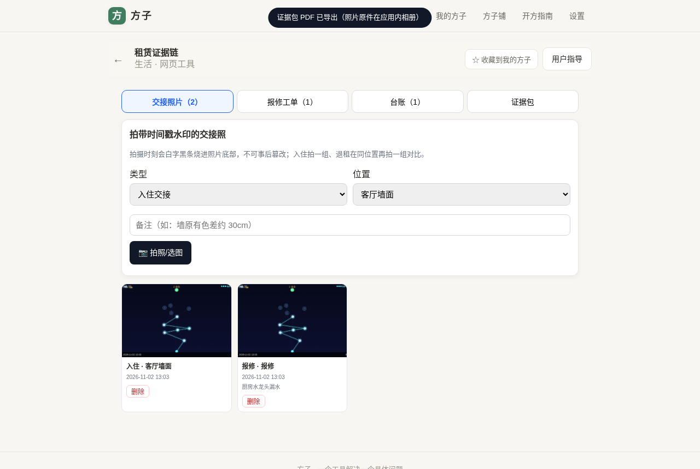
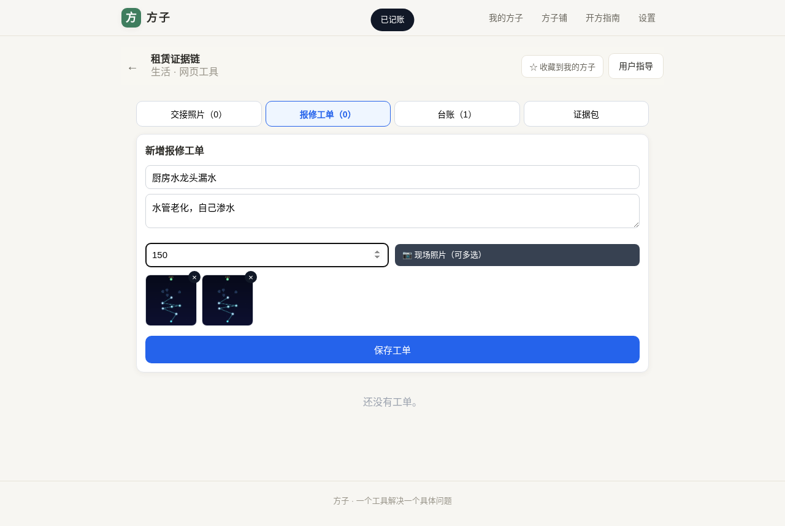
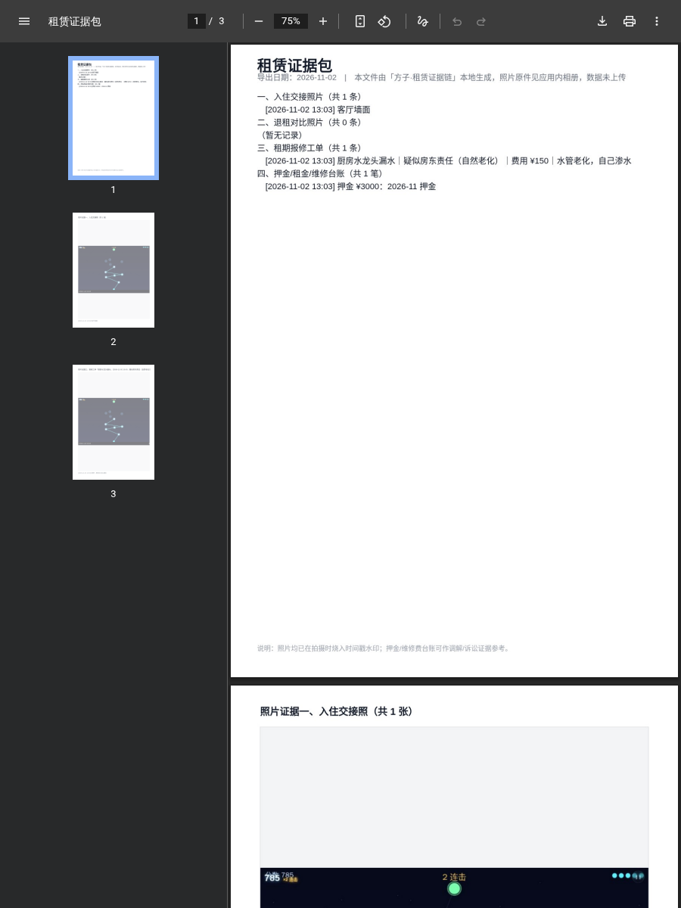
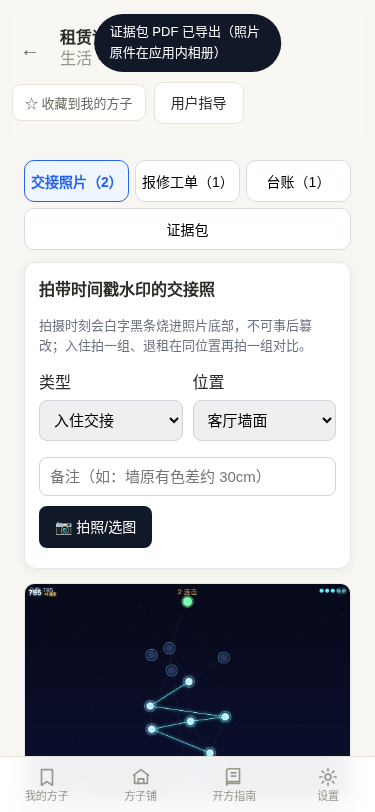
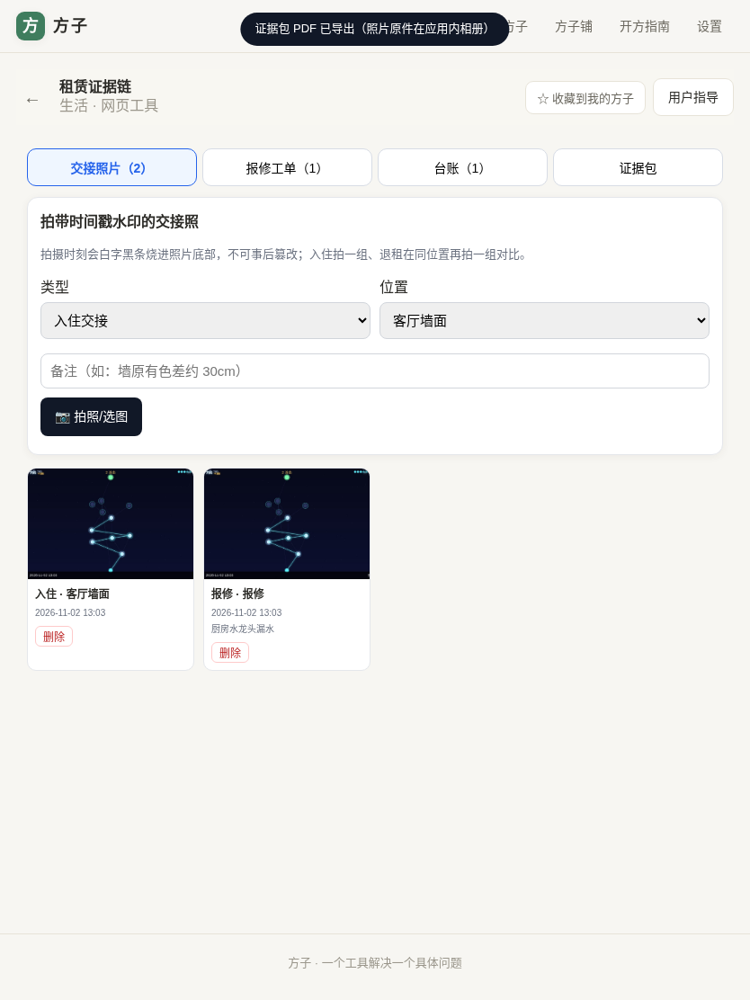

# 用户使用指导书：租赁证据链

- 对应 dev：`docs/stage/dev_006_租赁证据链.md`
- 日期：2026-11-02
- 版本：v1.0.0

## 功能简介
给手里 1–5 套房的小房东和直租租客用：入住交接拍带时间戳水印的照片留基准，租期内报修工单留痕并自动初判责任，押金/租金/维修记台账，退租同位置对比，争议时一键导出证据包 PDF。照片全程只存在本机，不上传。

## 使用说明
1. **交接照片**：进「交接照片」Tab，选「入住交接」，位置从预置清单选（客厅墙面/主卧地板/空调/水表…），写备注，点「📷 拍照/选图」。拍摄时刻会以白字黑条烧进照片底部。退租时选「退租复核」在同位置再拍一组。
2. **报修工单**：进「报修工单」，填标题（如"厨房水龙头漏水"）、描述、费用，可附多张现场照片——选完立刻在表单里出现缩略图，点右上角「×」可移除单张。保存时按描述关键词自动初判「疑似房东责任（自然老化）/疑似租客责任（人为损坏）/待定」。
3. **台账**：进「台账」，选押金/租金/维修费/中介费，填金额备注即可。
4. **证据包**：进「证据包」看统计，点「导出证据包 PDF」下载：前页是文字时间线（交接/退租/工单/台账），之后按入住交接照、退租复核照、报修工单分组逐页嵌入水印照片，每张照片下方带中文图注（拍摄时间+位置+备注），可直接给调解员/律师。

## 常见问题
- **Q：照片会被上传吗？**　A：不会。全部存在本机浏览器 IndexedDB，导出 PDF 也是本本地生成。
- **Q：时间戳能改吗？**　A：水印在拍照瞬间烧进图片像素，事后改图会露出破绽；导出前请不要再编辑原图。
- **Q：清浏览器数据会丢吗？**　A：会。重要证据请定期导出 PDF 另存，并把照片逐张保存到相册。

## 注意事项
责任初判只是关键词参考，不构成法律意见；最终责任以合同与调解/判决为准。
