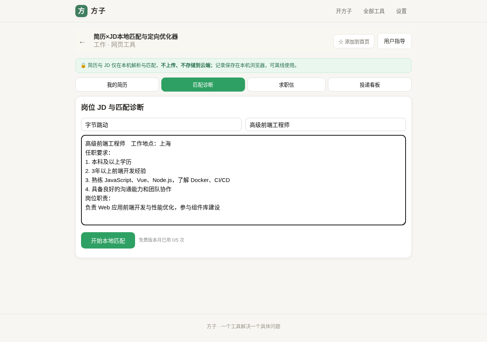
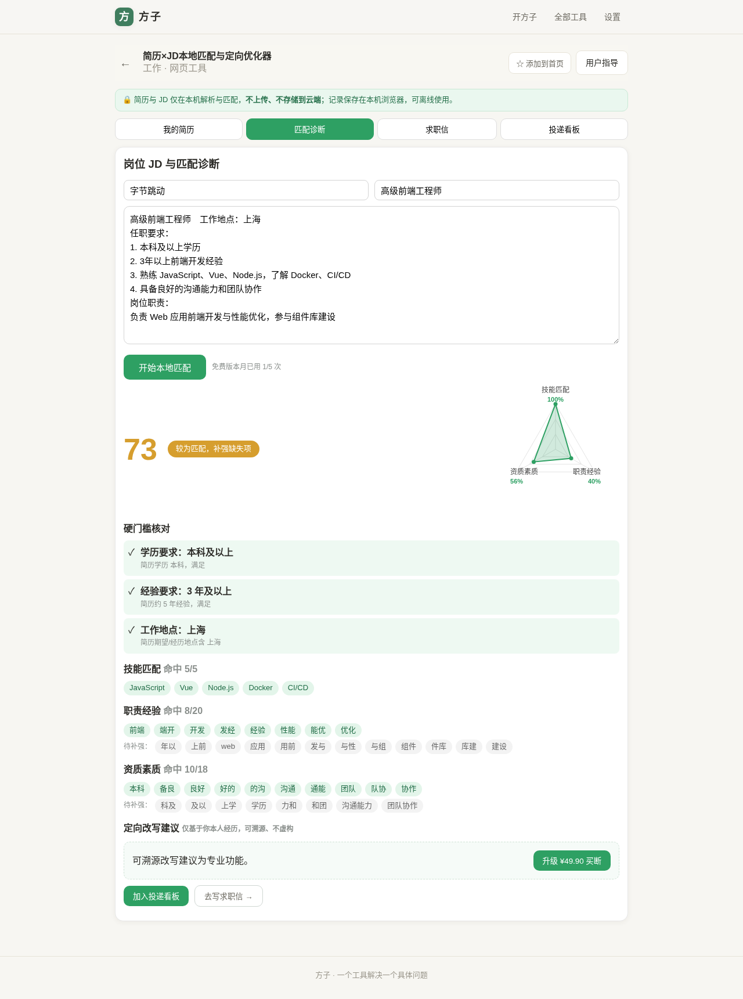
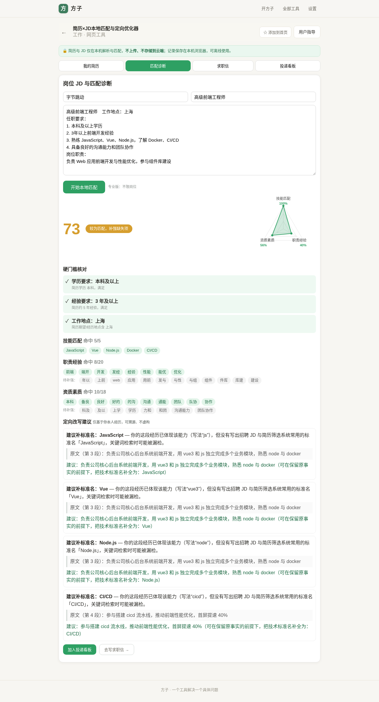
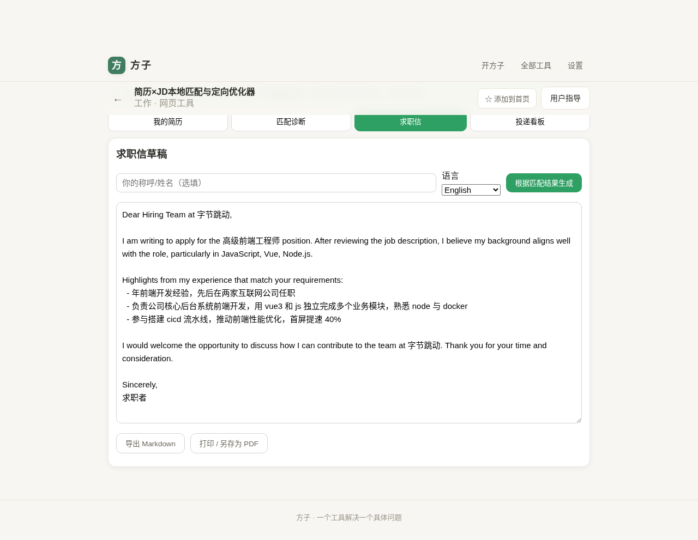
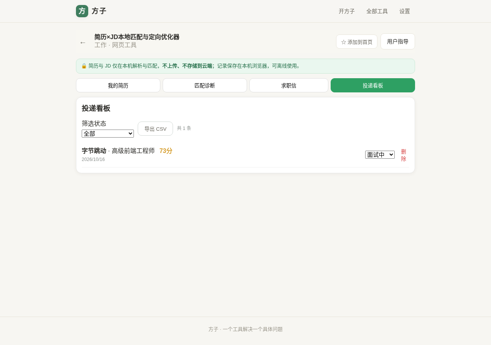
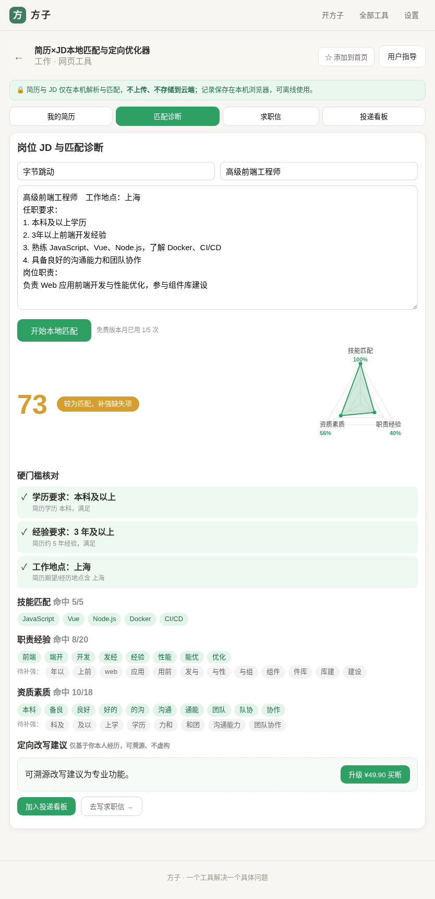
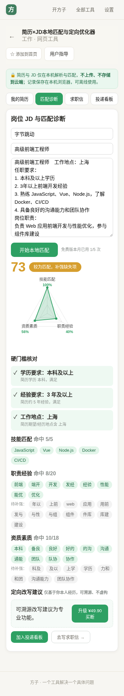

# 用户使用指导书：简历×JD本地匹配与定向优化器

- 对应 dev：dev_001_简历JD本地匹配优化器.md
- 日期：2026-10-16
- 版本：v1.0.0（beta）
- 工具入口：方子「全部工具 → 工作 → 简历×JD本地匹配与定向优化器」，路由 `/#/t/resume-jd-matcher`

## 功能简介

投简历前，把**你的简历**和**招聘 JD**都留在本机，工具自动完成：技能/职责/资质三维匹配打分、学历/年限/地点/证书硬门槛核对、命中与缺失清单、**只基于你本人真实经历**的可溯源改写建议、中英文求职信草稿，以及本地投递看板。全程离线解析、不上传任何内容。

## 运行环境要求

- 现代浏览器：Chrome / Edge / Firefox / Safari 近两年版本（手机、平板、电脑均可）。
- 需在 HTTPS 或本地 PWA 环境运行（方子已托管于 EdgeOne Pages，默认满足）。
- 简历文件支持：**PDF（文字版）/ DOCX / TXT / MD**，单文件 ≤ 15MB；也可直接粘贴文本。
- 首次解析 PDF/DOCX 使用的解析库随应用一起加载，无需额外安装。
- 所有数据保存在本机浏览器（IndexedDB / LocalStorage），**清理浏览器站点数据会同时删除本地简历与看板记录**，重要内容请用导出功能留存。

## 安装与启动

- 在线打开方子域名进入工具即可；可在方子顶部「添加到首页」把工具固定到首页。
- 无需注册、无需配置密钥、无后端依赖。
- 计费：免费版每月可匹配 **5 个岗位**；专业版 **¥29.90 买断**（本地模拟支付，不产生真实扣款），解锁不限岗位、可溯源改写建议、求职信、投递看板。

## 使用说明

### 1）准备并保存简历

进入「我的简历」，二选一：

- 点「导入 PDF / Word / TXT」选择简历文件；或
- 直接把简历全文粘贴到大文本框（建议包含教育经历、工作年限、期望城市、技能清单与项目/工作经历，识别更准）。

可点「保存为简历版本」，把多版简历存在本机随时切换。下方会显示从简历识别到的技能。

> 扫描件/纯图片 PDF 无法提取文字，请改用文字版 PDF 或直接粘贴；旧版 `.doc` 请另存为 `.docx`。

### 2）粘贴 JD 并本地匹配

切到「匹配诊断」，填写公司/岗位名（选填，用于求职信与看板），粘贴 JD 原文，点「开始本地匹配」。

结果包含：

- **综合匹配分（0–100）**与三维雷达（技能匹配 / 职责经验 / 资质素质）；
- **硬门槛核对**：学历、年限、工作地点、证书逐条 ✓/✗；任一硬门槛不满足，综合分自动封顶在 59，并给出醒目提示；
- 各维度**命中 / 待补强**关键词清单。

免费版每次匹配会计入当月免费次数（顶部显示「本月已用 x/5 次」）。

### 3）查看可溯源改写建议（专业版）

当你**其实具备某能力、但简历只写了同义词或版本别名、没写 JD 用的标准名**时（例如简历写「vue3」「js」，JD 写「Vue」「JavaScript」），工具会给出建议，并**精确定位到简历原文段落**，提示在不改变事实的前提下补全标准名，便于 ATS/HR 关键词检索。

工具**不会**为你没有的经历编造内容；真正缺失的能力，请据实判断是否投递，切勿虚构。

### 4）生成中英文求职信（专业版）

在「求职信」填写你的称呼、选择中文/English，点「根据匹配结果生成」。信件只使用：岗位/公司槽位 + 匹配命中的技能 + 从你简历中匹配到的**真实经历要点**。生成后可直接在文本框修改，并「导出 Markdown」或「打印 / 另存为 PDF」。

### 5）投递看板与导出（专业版）

在匹配结果页点「加入投递看板」，记录公司、岗位、匹配分；在看板中用下拉流转状态（待投递 / 已投递 / 面试中 / Offer / 已拒绝），可按状态筛选，并一键「导出 CSV」（带 BOM，Excel 打开中文不乱码）。

### 6）手机 / 平板

界面自适应，小屏下雷达、标签、按钮与表格均不溢出；手机上同样可粘贴简历与 JD、查看匹配结果。

 

## 常见问题（FAQ）

1. **PDF 提示“未能提取到文字”？** 多半是扫描件/图片版 PDF，请用文字版 PDF，或直接粘贴简历正文。
2. **`.doc` 旧格式无法导入？** 请在 Word/WPS 中另存为 `.docx`，或粘贴文本。
3. **为什么我明明会某项技能，却出现在“补标准名”建议里？** 说明简历写的是别名/版本号（如 vue3、k8s），建议补上招聘方常用标准名（Vue、Kubernetes），能力已计入匹配分，这里只是优化关键词命中。
4. **匹配分高就一定能拿到面试吗？** 分数用于帮助你快速发现差距和硬门槛缺口，不作录用承诺；硬门槛不满足时分数会被封顶，请结合实际判断。
5. **数据会上传吗？** 不会。解析、匹配、求职信、看板全部在本机完成；简历与记录只存在本浏览器。
6. **换浏览器/换电脑后记录不见了？** 数据保存在本地，不跨设备同步；需要留存请用 Markdown/CSV 导出。
7. **提示「PDF 解析组件加载失败，可重试」？** 先点「重试（重新选择文件）」；若仍失败，多半是当前在微信 / WeLink / QQ / 微博等内置浏览器中打开。请点右上角菜单，**用系统 Chrome / Edge 打开本页**后再导入。文件识别只认 `%PDF` 魔数，不受系统文件类型为空或 octet-stream 影响。

## 注意事项

- 简历含姓名、电话等个人信息，请在自己的设备上使用；在公共电脑使用后及时清理站点数据。
- 打分与建议基于关键词/同义词规则（V1 为离线确定性算法），语义级匹配预留于 V1.1；结果仅供参考。
- 录音/简历等涉及他人信息时，请确保已取得相应同意，合规使用。
