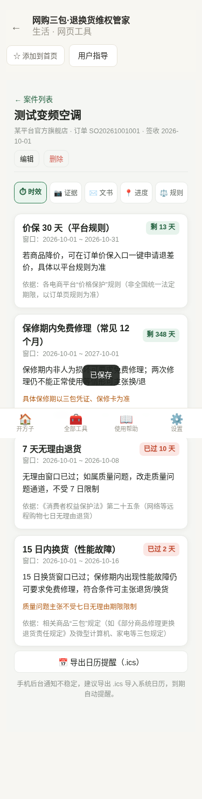
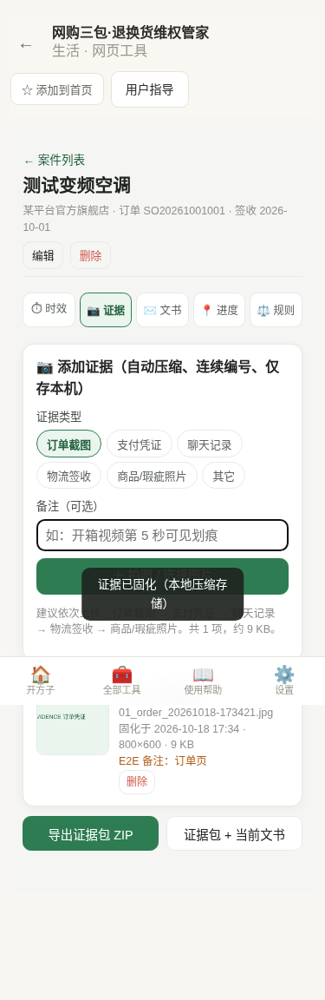
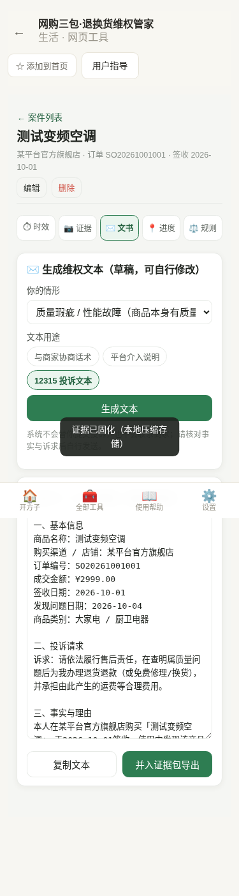
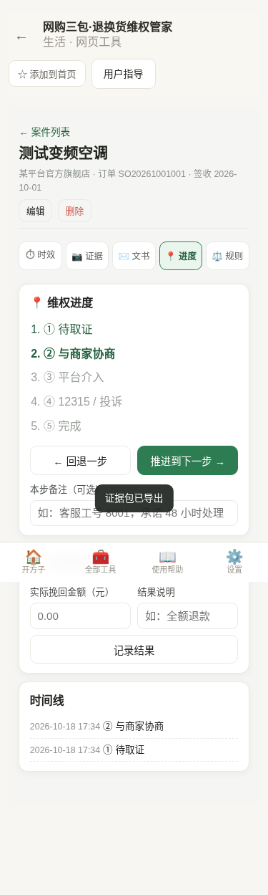
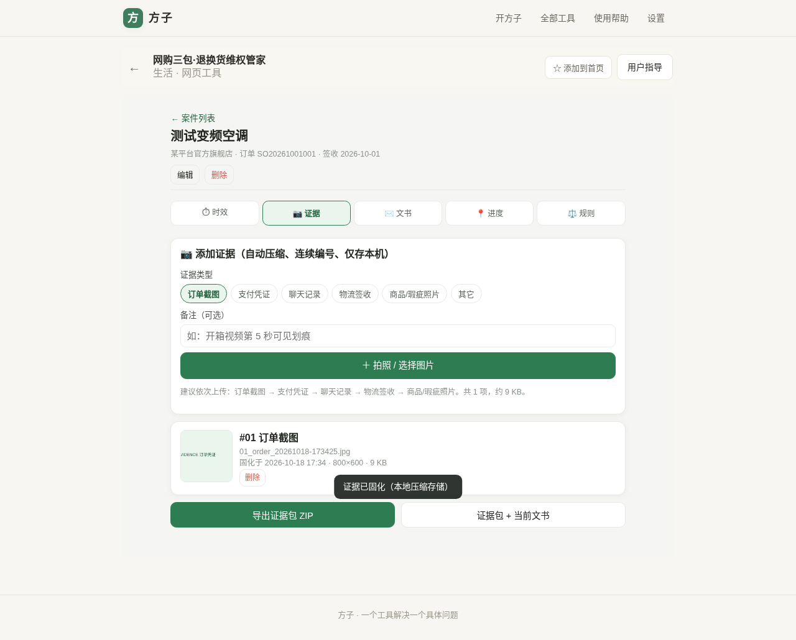
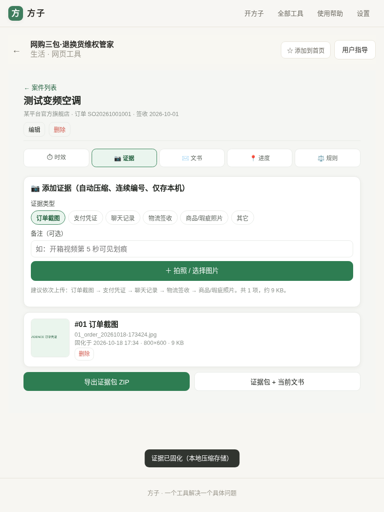

# 用户使用指导书：网购三包·退换货维权管家

- 对应 dev：dev_002_网购退换货维权管家.md
- 日期：2026-10-18
- 版本：v1.0.0

## 功能简介

把网购售后从「凭感觉、靠回忆」变成「有时效、有证据、有说法」。输入商品类别和签收日期，自动算出 **7 天无理由退货、15 日内换货（三包）、保修期内免费修理、价保** 的剩余天数与今天可做的动作；订单/支付/聊天/物流/商品瑕疵照片随拍随存、本地压缩并连续编号固化；一键生成协商话术、平台介入说明、12315 投诉文本草稿；并用五段式状态机跟踪进度、记录挽回金额。全程数据只存本机。

**边界**：只做时效参考、证据整理与文书草稿，**不代为投诉、不抓取平台数据、不联系商家**；规则为常见情形整理（版本 `cn-2026-10-18`），**以最新法律法规、平台规则及三包凭证/保修卡为准，不替代律师意见或 12315、市场监管部门认定**。

## 运行环境要求

- 现代浏览器（Chrome / Edge / Safari / Firefox 近年版本），支持 IndexedDB、Canvas、File API。
- 作为方子 PWA 网页工具运行，可安装到手机桌面；无需后端、无需联网即可查规则与查看已存案件。
- 拍照取证建议在手机端使用；证据整理与导出在 PC 端体验更佳。

## 安装与启动

在方子「全部工具 / 生活」中打开「网购三包·退换货维权管家」（路由 `#/t/shopping-claim`），无需安装额外依赖。手机端可用浏览器「添加到主屏幕」当原生 App 使用。

## 使用说明

### 1. 新建案件

在首页点「＋ 新建维权案件」，填写商品名称、渠道、订单号、金额、**商品类别**、**签收日期**（发现问题日期可后补），设置价保天数与是否定作商品，保存。

### 2. 时效看板（手机端）

进入案件默认在「时效」页，每个窗口显示状态徽标（剩 N 天 / 今天到期 / 已过 N 天 / 不适用）、起止日期、今天可做动作与法规依据。本例签收 2026-10-01、查看日 2026-10-18：无理由与 15 日换货窗口已过并提示改走质量/保修通道，保修剩 348 天、价保剩 13 天。

> 关键认知：**质量问题不受 7 天无理由期限限制**；**「拆封」不等于「不完好」**。手机后台通知不可靠，可点「导出日历提醒（.ics）」导入系统日历。

### 3. 证据柜

切到「证据」页，选择证据类型、写备注，点「＋ 拍照 / 选择图片」可多选上传。图片在本地压缩（长边 1600、JPEG q0.72、去元数据），案件内连续编号，文件名形如 `01_order_20261018-173421.jpg`，并记录固化时间、尺寸、大小。

建议顺序：订单截图 → 支付凭证 → 聊天记录 → 物流签收 → 商品/瑕疵照片。点「导出证据包 ZIP / 证据包 + 当前文书」得到图片与 `证据清单.txt`（含商品信息、时效窗口、每项证据类型/固化时间/原文件名/备注）。

### 4. 维权文书

在「文书」页选择情形（质量瑕疵 / 发错货 / 仅不想要 / 过了 7 日在三包期 / 价保）与用途（协商 / 平台介入 / 12315），点「生成文本」，自动填入商品、渠道、订单、金额、日期与诉求，可在文本框直接修改后复制或并入证据包。12315 文本含事实、诉求、证据清单与「自述草稿、不构成法律意见」提示，姓名/电话/日期需自行补全。

### 5. 进度与结果

在「进度」页推进或回退五段状态（待取证 → 协商 → 平台介入 → 12315 → 完成），可写每步备注；在「处理结果」记录实际挽回金额，时间线自动留痕。

### 6. 规则速查

「规则」页列出本商品适用规则、常见例外（定作/鲜活易腐、拆封≠不完好）与法规来源（消法第 24/25 条、三包规定、保修承诺、平台价保），并标注规则版本与免责声明。

### 7. 平板 / PC 自适应

页面在平板与 PC 上自动居中加宽，证据与表单双列布局，无横向溢出，适合集中整理证据包与文书。

## 常见问题（FAQ）

- **拆封了还能退吗？** 拆封≠不完好，商家不能仅以已拆封拒绝无理由退货；商品应保持完好、配件齐全，定作/鲜活易腐等法定例外除外。
- **过了 7 天商家不理？** 质量问题的修换退不受七日无理由期限限制，可继续主张三包/保修并保留证据。
- **数据会上传吗？** 不会，全部存本机 IndexedDB；清理浏览器数据会删除，请先用证据包 ZIP 备份。
- **免费版与专业版区别？** 免费版可跟踪 2 个商品并使用时效/规则；专业版（一次买断 ¥9.90，也可月/年订阅）支持不限案件、全套文书、证据包与 .ics 导出。

## 注意事项

- 规则版本 `cn-2026-10-18`，法规更新后以官方最新口径为准。
- 金额较大或争议复杂时建议咨询律师或拨打 12315。
- 证据图片本地压缩会去除 EXIF，可追溯性依靠连续编号、原文件名与固化时刻。
