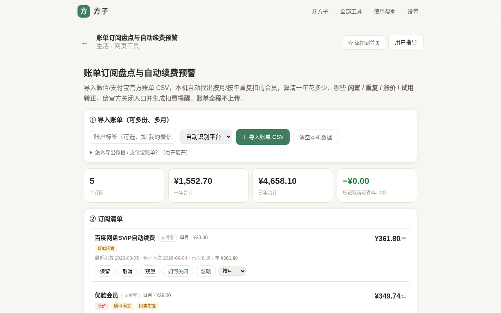
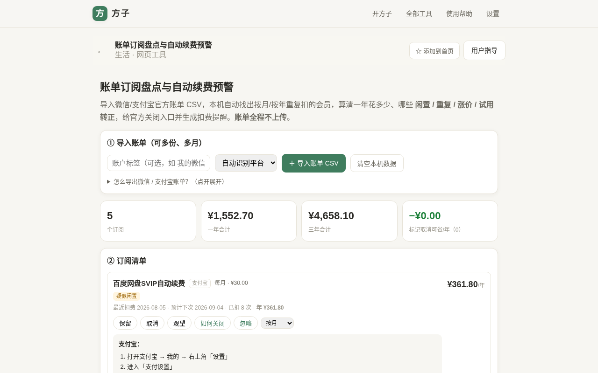
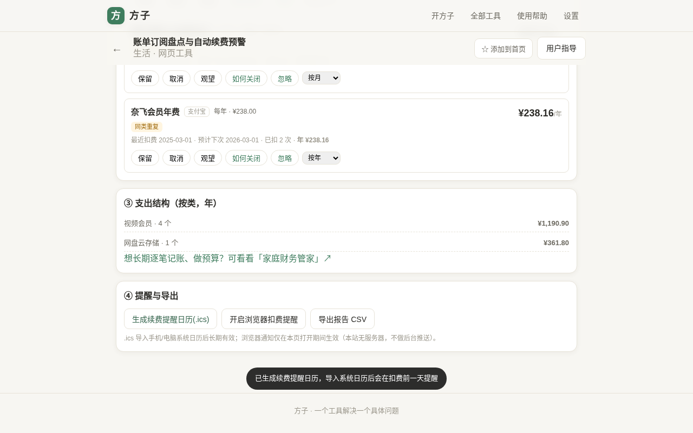
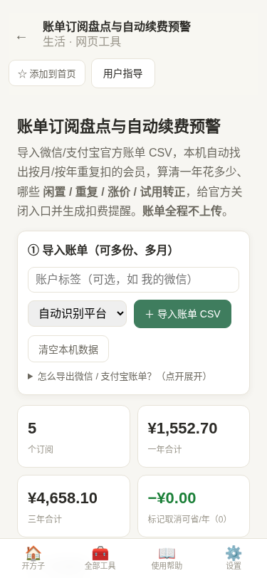

# 用户使用指导书：账单订阅盘点与自动续费预警

- 对应 dev：`dev_009_账单订阅盘点自动续费预警.md`
- 日期：2026-10-17
- 版本：v1.0.0

## 功能简介

导入从**微信 / 支付宝官方导出的账单明细 CSV**，在浏览器本机自动找出按月 / 按季 / 按半年 / 按年**周期性自动续费的会员订阅**，算清一年、三年在订阅上花多少钱，自动标注**疑似闲置 / 同类重复 / 涨价 / 试用转正**，支持人工标注「保留 / 取消 / 观望」、手动改周期与忽略，给微信 / 支付宝**官方解约入口**，并能生成扣费前提醒的**系统日历（.ics）**、导出盘点报告 CSV。账单全程在本机解析、**不上传、不长期保存逐条明细**。

## 运行环境要求

- 现代浏览器：Chrome / Edge / Firefox / Safari 较新版本均可，建议 Chrome / Edge。
- 需支持 IndexedDB（保存你的人工标注）、File 读取、`TextDecoder`（用于支付宝 GBK 编码账单，浏览器原生支持）。
- 完全离线可用（PWA 安装后断网也能跑）；无后端、无需登录、无需付费即可使用核心识别。

## 安装与启动

- 在线使用：打开方子 → 全部工具 → 生活类 →「账单订阅盘点与自动续费预警」，路由 `/#/t/subscription-audit`。
- PWA：在浏览器菜单选择「安装应用 / 添加到主屏幕」，之后可像原生 App 一样从桌面启动，支持离线。
- 无需任何配置、无需填写 API Key 或云存储地址。

## 使用说明

### 第一步：从微信 / 支付宝导出账单 CSV

- **微信**：我 → 服务 → 钱包 → 账单 → 右上角「…」/ 常见问题 → 申请交易账单 / 交易明细 → 选择时间段 → 邮箱接收，下载其中的**交易明细 CSV**。
- **支付宝**：我的 → 账单 → 右上角「…」→ 开具交易流水证明 / 交易明细 → 选择时间段 → 邮箱接收，下载明细 CSV（GBK 编码也能自动识别）。
- 建议导出**最近 6–12 个月**：时间太短识别不出年付订阅。工具会自动跳过导出文件里的说明行、表头前文字和尾部合计行。

### 第二步：导入并查看盘点结果

- 可填「账户标签」（如“我的微信”），平台默认「自动识别」，也可手动指定微信 / 支付宝。
- 点「＋ 导入账单 CSV」，可一次选择**多份、多月、多账户**文件（多份合并去重为专业版能力）。
- 解析在本机进行，顶部出现订阅数、**一年合计 / 三年合计 / 标记取消可省**概览卡片；下方「② 订阅清单」逐条列出订阅、周期、单次金额、最近 / 预计下次扣费时间、已扣次数与年化金额。

### 第三步：看智能标注，决定保留 / 取消 / 观望

- 专业版会给订阅打标：**涨价**（同周期最高较最低涨 ≥10%）、**同类重复**（如多个同类视频会员）、**疑似闲置**（距上次扣费较久仍在续费）、**试用留意转正**（命中试用 / 首月优惠）。
- 每条可点「保留 / 取消 / 观望」，标记为「取消」后顶部「标记取消可省/年」会实时累加。
- 点「如何关闭」展开微信 / 支付宝**官方解约步骤与帮助链接**；解约必须你本人在官方 App 内操作，本工具只提供入口，**不会触碰支付账户、也不会自动解约**。
- 专业版还可「忽略」某条、用下拉手动修正周期（按月/季/半年/年），标注结果自动保存在本机。

### 第四步：按类别查看、生成提醒、导出报告

- 「③ 支出结构」按类别汇总年度订阅支出；底部提供到「家庭财务管家」的入口（两者数据互不干扰，本工具不改写其账本）。
- 「④ 提醒与导出」：
  - **生成续费提醒日历(.ics)**：为每个订阅生成「下次扣费前一天 09:00」的日历事件（含每年/每月重复规则 RRULE 与提前 1 天弹窗 VALARM），导入手机 / 电脑系统日历后长期有效。
  - **开启浏览器扣费提醒**：在当前页面打开期间补充一次最近扣费的浏览器通知（本站无服务器，**不做后台 Web Push**，长期提醒请用 .ics）。
  - **导出报告 CSV**：带 UTF-8 BOM，Excel 打开中文不乱码，含订阅、周期、金额、标注等列。

### 手机端

移动端为边到边布局、统计卡两列排列、底部为方子原生 Tab 栏，导入、标注、导出操作与 PC 端一致。

## 免费版与专业版

- **免费**：单份账单解析、基础订阅识别与年度总览（够大多数人先看清订阅）。
- **专业版（买断 ¥9.90）**：多份 / 多月 / 多账户合并去重、闲置 / 重复 / 涨价 / 试用智能判定与手动纠错、.ics 日历提醒与报告 CSV 导出。
- 也支持订阅（¥4/月、¥30/年）；当前为本地演示计费，权益记录保存在本浏览器。

## 常见问题（FAQ）

- **支持哪些文件？** 微信、支付宝官方导出的交易明细 CSV（UTF-8 或 GBK 均可）；会自动忽略说明行 / 合计行，跨文件按订单号去重。PDF / 银行 App 流水暂不支持。
- **账单安全吗？** 全部在本机解析，不上传任何服务器；逐条账单明细不长期保存，IndexedDB 里只存导入批次元信息与你的人工标注。点「清空本机数据」可彻底删除。
- **年付会员为什么没识别？** 需要账单覆盖到足够的扣费记录（年付至少要跨年看到多次扣费）。请导出更长时间段后重新导入。
- **偶尔的普通消费会不会被当成订阅？** 周期聚类要求同名商户 + 金额相近 + 间隔规律（变异系数受限），单次的餐饮、购物不会被误判；识别结果也可手动忽略或改周期。
- **.ics 导入后没提醒？** 请确认导入时勾选了对应日历，并允许该日历发送通知；事件默认在扣费前一天 09:00 提醒。

## 注意事项

- 金额识别与分类为本地启发式规则，结果供自查参考，**不构成财务或法律建议**；实际扣费与解约以微信 / 支付宝官方为准。
- 工具不接触支付密码、不登录、不自动解约、不做代扣操作，规避金融合规风险。
- 清除浏览器站点数据或更换浏览器 / 设备，人工标注不会自动同步（本产品无后端）。
