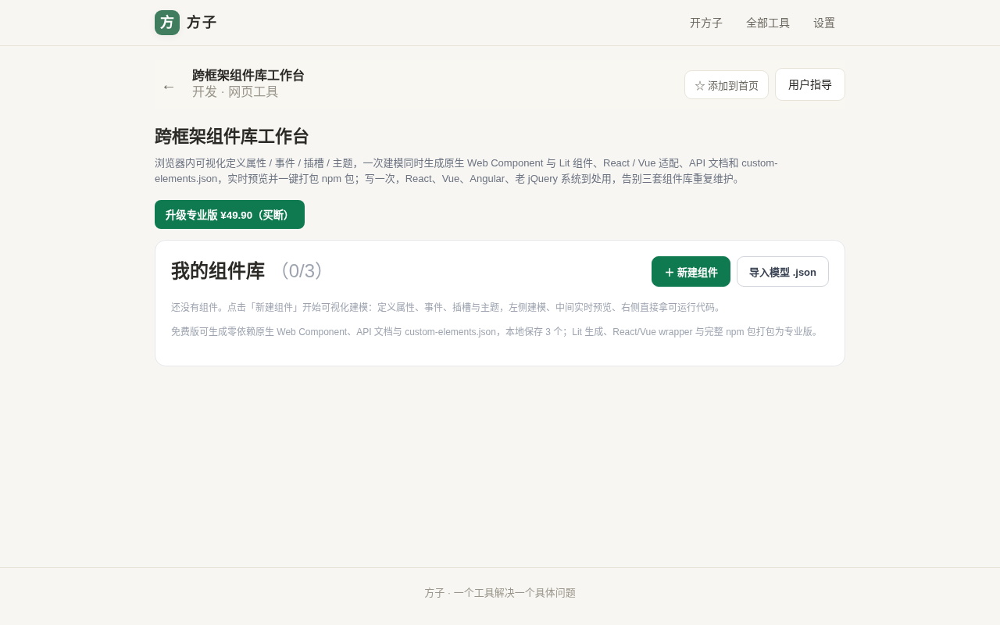
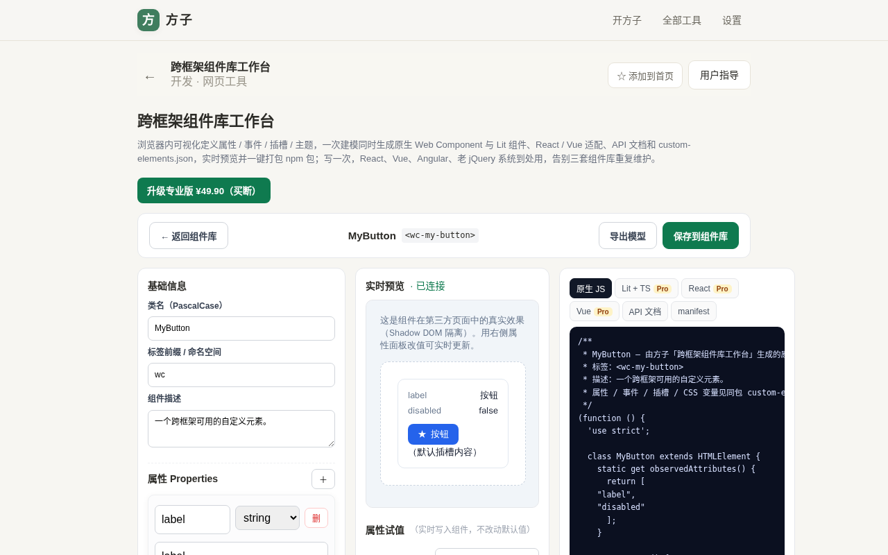
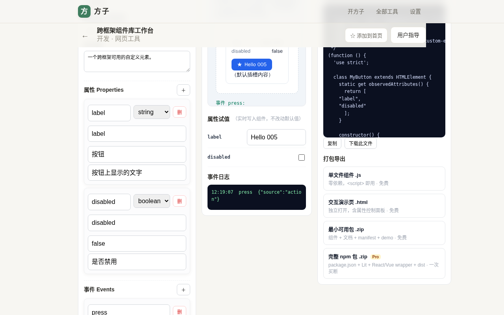
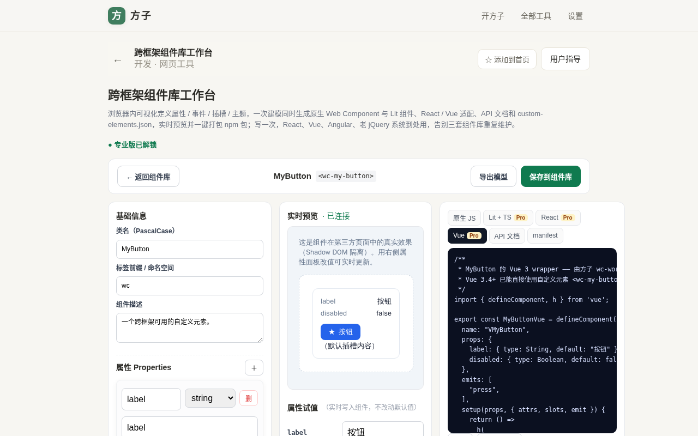
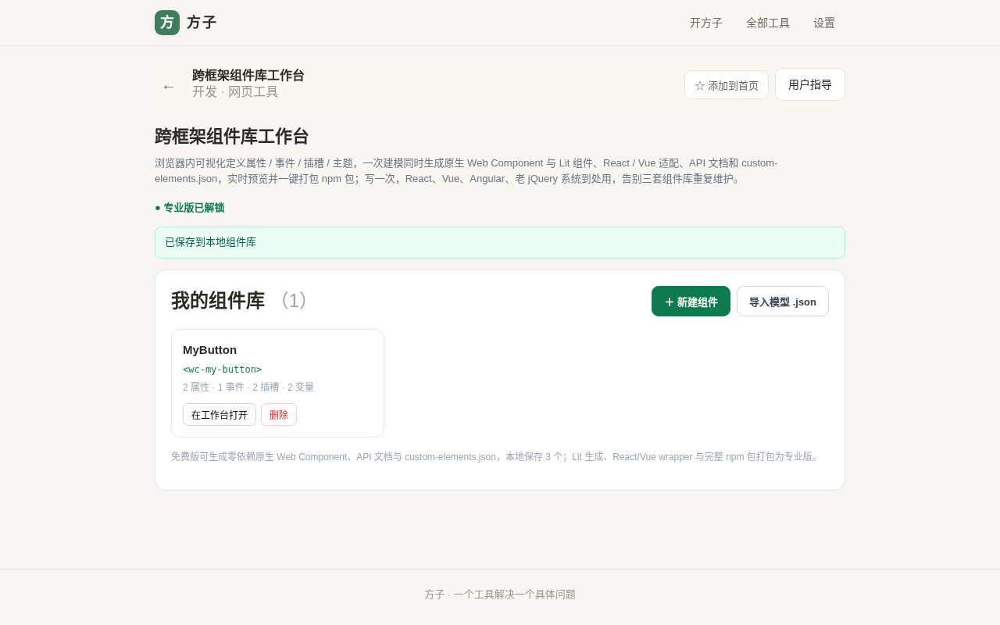
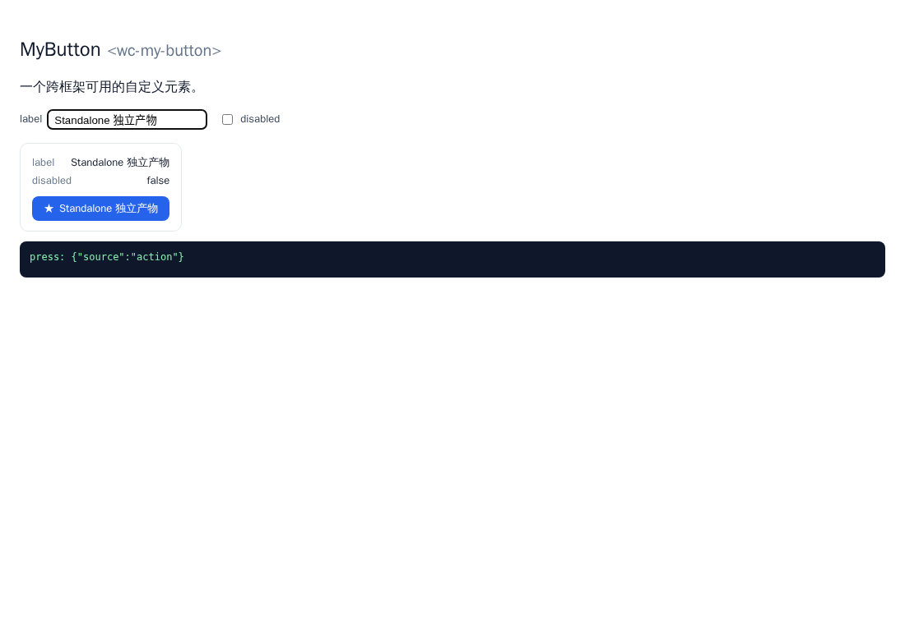
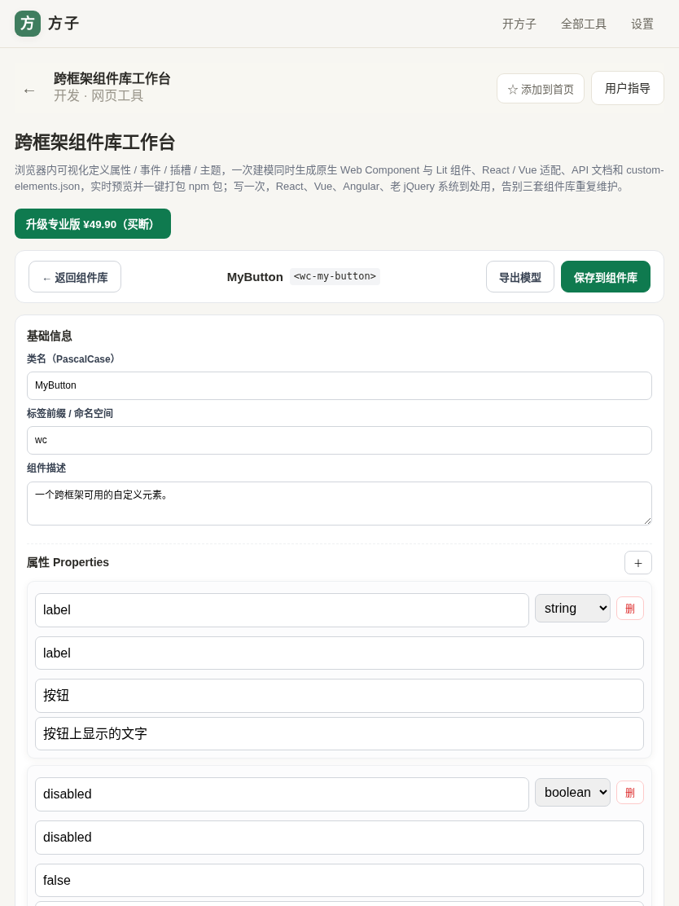
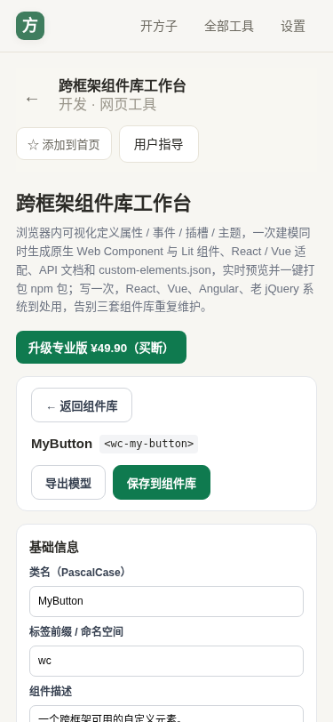

# 用户使用指导书：跨框架组件库工作台（wc-workbench）

- 对应 dev：`dev_005_跨框架组件库工作台.md`
- 日期：2026-10-15
- 版本：v1.0.0
- 入口：方子 PWA → 开发 →「跨框架组件库工作台」，路由 `/#/t/wc-workbench`

## 功能简介

在浏览器里**可视化定义一个 Web Component**：填属性（property / attribute）、事件（CustomEvent）、插槽（slot）、CSS 变量主题，工作台一次建模，同时产出**零依赖原生 Web Component、Lit 3 + TS 组件、React/Vue 适配 wrapper、API 文档（Markdown）与 custom-elements.json**，并在中间栏用 Shadow DOM 沙箱实时预览、右侧直接拿可运行代码和可下载的 npm 包。解决「同一个组件要在 React / Vue / 老 jQuery 系统里各写一遍」的重复维护问题，全部本地完成、无需注册、无后端。

## 运行环境要求

- 任意现代浏览器：Chrome / Edge 90+、Firefox 90+、Safari 15+（依赖 Custom Elements v1、Shadow DOM v1、CustomEvent）。
- 作为方子 PWA 内网页工具运行，支持安装到桌面 / 主屏后离线使用（Service Worker 缓存）。
- 打包下载为纯前端 fflate（MIT）在本地生成 zip，不上传任何代码或模型。

## 安装与启动

无需安装。打开方子后从「全部工具 → 开发」进入，或直接访问 `/#/t/wc-workbench`。首次进入是「我的组件库」视图；组件模型保存在浏览器 localStorage（免费版最多 3 个，专业版不限）。

## 使用说明

### 1. 新建组件

在组件库页点「＋ 新建组件」，进入三栏工作台。默认已带一个示例 `MyButton`（标签 `wc-my-button`，含 label / disabled 属性、press 事件、默认 + icon 插槽、primary-color / radius 两个 CSS 变量），可直接体验。

### 2. 左侧建模

- **基础信息**：填 PascalCase 类名与标签前缀（命名空间）。标签自动派生为 `前缀-类名kebab`，如 `MyButton` + `wc` → `wc-my-button`；标签必须全小写且含连字符，非法时顶部会标红提示。
- **属性 Properties**：填 camelCase 属性名，attribute 自动按 kebab 派生（可改）；类型可选 string / number / boolean，并填默认值与说明。
- **事件 Events**：声明自定义事件名（kebab），生成的组件在交互时 `dispatchEvent(new CustomEvent(name, {bubbles:true, composed:true}))`，可跨越 Shadow DOM 被父页面监听。
- **插槽 Slots**：留空表示默认插槽，命名插槽（如 `icon`）生成 `<slot name="icon">`。
- **CSS 变量主题**：声明 `--变量名` 与默认色值，组件 `:host` 上挂载，外部可覆盖做主题化。

### 3. 中间实时预览与试值

- 组件源码被内联进一个 sandboxed iframe（`allow-scripts`，srcdoc，零网络）真实注册并渲染，状态栏显示「· 已连接」。
- 在「属性试值」里改 label、勾选 disabled，改动**实时写入组件 JS 属性并反射到 attribute**，不影响默认值。
- 点击预览中的组件按钮，自定义事件会冒泡回工作台，显示在「事件日志」里（时间、事件名、detail）。

### 4. 右侧取代码

用顶部标签页切换产物：**原生 JS**（免费）、**Lit + TS / React / Vue**（专业版）、**API 文档**（免费）、**manifest / custom-elements.json**（免费）。可「复制」或「下载此文件」。专业版标签在未解锁时代码区显示门控遮罩。

### 5. 打包导出（四种）

- **单文件组件 .js**（免费）：零依赖 IIFE，`<script src="wc-my-button.js">` 后即可 `<wc-my-button></wc-my-button>`，含重复 `define` 保护。
- **交互演示页 .html**（免费）：独立双击打开，自带属性控制面板，改值、看事件。
- **最小可用包 .zip**（免费）：组件 + 演示页 + custom-elements.json + README。
- **完整 npm 包 .zip**（专业版）：额外含 `package.json`、Lit 源、React/Vue wrapper、dist，目录可直接 `npm publish`。

### 6. 免费版与专业版

- 免费：原生生成、实时预览、API 文档、custom-elements.json、单文件与最小包、本地保存 3 个组件、模型导入导出。
- 专业版（freemium 一次买断 **¥49.90**）：Lit 生成、React/Vue wrapper、完整 npm 包、本地组件不限数量。
- 在右上角「升级专业版」按钮完成买断；未解锁时点击 Pro 产物会提示升级。下方截图为已解锁后 Lit 代码可见状态。

### 7. 保存与再次编辑

点「保存到组件库」后回到组件库，可看到组件卡片（类名、标签、属性/事件/插槽/变量数量），随时「在工作台打开」继续改，或删除（仅删本地记录，不影响已导出文件）。

### 8. 独立演示页

下载的 `.demo.html` 可完全脱离方子、用 `file://` 直接打开：勾选/输入控件即改组件属性，点击按钮在页面下方日志看到自定义事件。

### 9. 平板与手机

工作台在 ≤1080px 自动切为单列，平板、手机上可正常建模、预览与取代码，无横向溢出。

## 常见问题（FAQ）

- **标签报红「需为全小写且含连字符」？** 自定义元素规范强制要求标签至少含一个 `-` 且不能有大写。改前缀或类名即可（类名内部仍用 PascalCase，只有标签被 kebab 化）。
- **导入别人给的模型 .json 安全吗？** 安全。导入时所有类名 / 属性名 / 事件名 / 插槽名 / CSS 变量名都会被归一化为合法标识符，描述文本会去除注释闭合符与尖括号，无法借生成的源码注入脚本；字段类型非法会回退为 string。
- **生成的组件在我的框架里还要再改吗？** 原生文件零依赖可直接用；React/Vue 项目建议用专业版 wrapper（类型化 props 与事件）。React 19 已原生支持自定义元素，也可直接渲染标签。
- **数据会上传吗？** 不会。建模、预览、打包全部在浏览器本地完成。

## 注意事项

- V1 的 wrapper 覆盖 **React 与 Vue**；Angular wrapper 在规划的 V2（Angular 可直接消费原生自定义元素）。
- 本地组件库存于 localStorage，清除浏览器站点数据会删除未导出的模型，请及时用「导出模型 .json」或打包备份。
- 实时预览是 sandboxed iframe，组件中无法访问外网与父页 DOM，这是有意的隔离设计。
- 免费版组件数量上限为 3；超出请升级专业版或先导出 / 删除旧组件。
